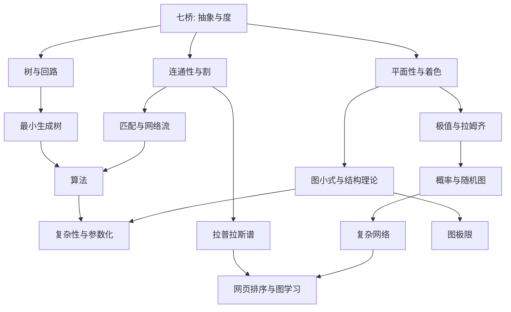

# 图论概念依赖与问题路线
图中箭头表示适合读者学习的**概念关联**，并不声称历史人物之间存在直接传授。

## 常见概念混淆
- 欧拉道路走过每条边；哈密顿圈访问每个顶点。
- 最小生成树要把所有顶点最便宜地连接；最短路找起终点之间最小代价；最大流处理容量约束下的流量。
- 平面性判据、地图着色上界、色多项式是不同问题。
- 有效算法与存在性定理不等价；NP完全不等于已知无法存在多项式算法。
