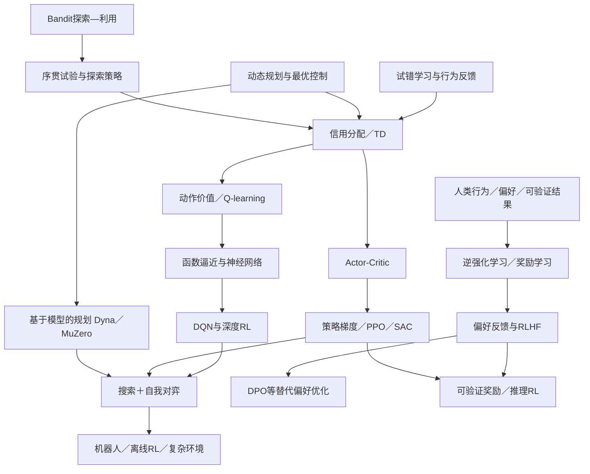

# 概念依赖图｜六条可交叉的研究路线

## 贯穿全书的七对辨析

1. **reward vs value**：即时反馈不是对未来回报的预测。
2. **prediction vs control**：会评估并不必然知道怎么行动。
3. **model-free vs model-based**：是否显式学习／使用环境动态模型。
4. **on-policy vs off-policy**：更新针对的数据采样策略与目标策略是否相同。
5. **探索 vs 利用**：多臂老虎机与完整 MDP 的反馈结构并不相同。
6. **RLHF vs DPO**：有共同偏好优化动机，不代表训练算法相同。
7. **reward learning vs reward specification**：学到可优化的代理目标不等于人类价值问题得到解决。

## 插页建议

- [ ] 1997：多巴胺信号与 TD 预测误差的可比性，参考 R10；避免“生物大脑真的执行 Q-learning”的过度推断。
- [ ] 1990—2020：探索、样本效率与计算量三种代价并列。
- [ ] 2016—2018：AlphaGo、AlphaGo Zero、AlphaZero 三系统训练来源的横向比较。
- [ ] 2022—2025：奖励模型／偏好优化／可验证结果／推理模型的机制差别。
