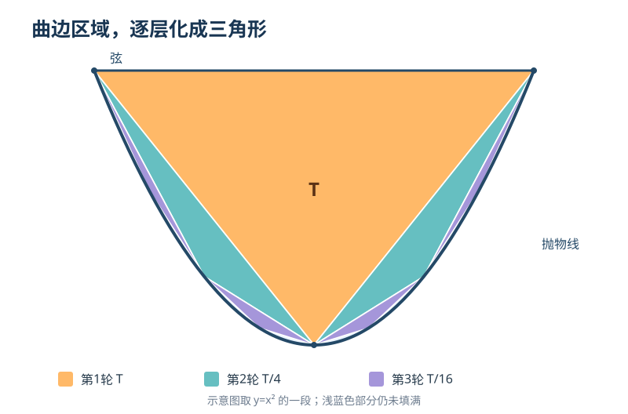

# 第五章｜阿基米德：在无穷的边缘计算面积

*第二部：无穷小的审判*

有一块平面图形，上面是一条笔直的线段，下面是一道弯曲的边。

它看上去像一张被绷直的弓。

你可以用尺子量出那条直线的长度，也可以在图形里面画出一个三角形。可是，如果有人要求你算出这块弧边区域的**精确面积**，问题立刻变得棘手。

直线围成的三角形容易算。曲线呢？

你可以在里面画更多三角形。画一个、两个、四个、八个……每画一次，空着的地方都会更少。

但空白始终没有完全消失。

如果永远还剩下一点，你凭什么宣称，自己已经得到整块图形的准确面积？

这不是一道现代积分作业。

两千多年前，叙拉古的阿基米德（Archimedes）已经为一类这样的曲边图形给出了精确答案。

这个答案非常奇特：

**它的面积，恰好等于其中某个特别选择的三角形面积的三分之四。**

不是约等于。

是严格相等。

阿基米德的难题，便是这一章的起点：**没有积分符号，甚至没有现代极限语言，怎样证明一条曲线下面的面积精确到一个分数？**

## 一｜上一章刚解决比例，这一章又把曲线摆在面前

第一部《数字的裂缝》里，我们遇到两道看似无解的障碍。

正方形的对角线无法用整数比精确表示。

一米长的道路又可以分出无穷多个部分。

欧多克索斯式比例理论给出了一条重要出路：不必先把每一段长度写成一个整数比，也可以用倍数之间的大于、等于、小于，严格说明几何量的比例关系。

与此相关的穷竭式论证，还教会了古希腊数学家另一件事：如果每一步都能有效缩小剩余部分，那么我们可以让它小于事先给定的任何一个正差额。

这已经很了不起。

但要从这里走到计算曲线面积，中间还有一段距离。

知道一块区域可以被越来越精细地逼近，不代表你知道它究竟有多大。

比如，一个圆里面可以画正方形、正八边形、正十六边形；这些多边形的面积逐渐增加。但仅凭这种构造，你仍须进一步证明那个增长过程指向什么精确结果。

对于曲线围出的形状，难题尤其明显。

三角形的面积有熟悉的公式：

$$
T=\frac12\times\text{底}\times\text{高}。
$$

多边形可以拆成三角形。

可曲边图形不肯在某个固定的边数上停止。

古希腊数学于是面对一个更有野心的问题：

**能不能把一个曲边图形，严格地证明为与某个直边图形面积相等？**

这就是当时所谓“求积”的一种核心含义。它不只是拿近似公式算出几位小数，而是建立一个**精确的几何等面积关系**。

阿基米德的《抛物线求积》正是这样的作品。

不过，这个人在给出答案时，还留下了一个远比“天才灵光一闪”更值得讲述的线索。

## 二｜一封写给多西修斯的数学通信

阿基米德来自西西里岛的叙拉古，生活在公元前三世纪，生卒年通常约记为公元前287年至前212年。

关于他的工程器械、浮力研究和叙拉古往事，后世流传了许多故事；其中有些有古代文献支持，有些被不断改写成易于传播的轶事。

但这一章不需要让他跳进浴缸，也不需要虚构他某天突然发现答案时的喊声。

我们有一份更有力量的材料。

在传世《抛物线求积》的开篇，阿基米德写信给一位名叫多西修斯（Dositheus）的数学研究者。

他在前言中提及已经去世的科农（Conon），说明原本考虑将有关几何研究寄给科农，如今改向多西修斯传达。

接着，他做了一项令人难忘的说明：

这条几何结论，是他**先借助力学方式加以研究，再通过几何方式加以论证**的。

这段意思来自公开的古典文本，不是我们替阿基米德编写的私人独白。

它也提醒我们，一项数学发现可能经历两个不同阶段。

第一阶段，你找到一条让自己有理由相信结论成立的道路。

第二阶段，你要拿出足够严密的论证，使别人也能够检验它。

两者有联系，却不应轻易混成同一件事。

更微妙的是：阿基米德在这部著作中确实展示了**两条方法不同的论证路线**。前一部分引入力学式的平衡思路，后一部分则采用欧几里得几何体系熟悉的构造、比例和反证。

至于力学方法在当时究竟获得多高的证明地位，现代科学史研究还有细致讨论；不能仅凭一句“先猜想，后证明”，就断定其所有力学论证都是不严格的随意猜测。

但文本所呈现的真实戏剧性已经足够鲜明：

**同一个面积结论，他竟然愿意用两套截然不同的工具再走一遍。**

为什么？

因为这不是一道只要答案正确便可以收工的问题。

数学还必须回答：答案**凭什么**正确？

## 三｜一条抛物线，先放进去一个三角形

首先需要弄清楚，阿基米德究竟在计算什么。

我们今天所说的抛物线，可以画成一条熟悉的 U 形曲线。

在曲线上任取两点，再用直线把它们连接起来。这样，直线弦和它们之间的一段抛物线弧，便围出一块区域。

这块区域叫作**抛物线弓形**，或抛物线段。

本章讨论的并不是“任何曲线下方的面积”，更不是无限延伸的整条抛物线包围了某个有限图形。

而是：**一条抛物线的弧，与连接弧端点的直线弦之间，那块有限的面积。**

为了把问题变得看得见，我们采用一个现代坐标例子：

$$
y=x^2。
$$

再用直线：

$$
y=1
$$

把抛物线的中间一段截下来。

两条线相交于：

$$
(-1,1),\qquad(1,1)。
$$

被围出的区域上面是一条水平线，下面是一段向下凹陷的 U 形抛物线。

现在，把抛物线最低的点 $(0,0)$ 和弦的两个端点连起来。

一个三角形出现了。

它的底边长为 $2$，高为 $1$。

所以它的面积：

$$
T=\frac12\times2\times1=1。
$$

请记住这个 $T$。

它是整个故事最重要的参照物。

我们的目标不是证明弓形面积等于1。那显然不对：三角形两旁还留着两块弧边区域。

我们要证明：

$$
\boxed{\text{抛物线弓形面积}=\frac43T}。
$$

如果选择刚才这幅图，因为 $T=1$，答案就是 $4/3$。

下一个问题更加具体：

**那个多出来的 $1/3$，究竟藏在哪里？**

## 四｜第二轮，只要两块小三角形

看看大三角形左右两侧的空白。

左边的空白，也由一条短直线弦和一段抛物线弧围成。

右边同样如此。

于是，我们可以在这两块空白里，再各画一个内接三角形。

这样一来，原先只画了一个三角形；第二轮过后，图中总共有三个三角形。

它们仍然不能完全铺满整个弓形。

但变化已经发生。

第一次，我们得到了一个面积为 $T$ 的大三角形。

第二次，我们在两侧添上了两个小三角形。

那么，这两个小三角形合起来，占最初三角形面积的多少？

你可能会猜是八分之一、十分之一，或者某个难以写出的无理比。

答案竟然非常整齐：

**恰好是四分之一。**

也就是说：

$$
T_{\text{第二轮合计}}=\frac14T。
$$

<small>图中橙色为初始三角形，蓝绿色为第二轮两个三角形，紫色为第三轮四个三角形。剩余的浅蓝色区域仍属于抛物线弓形；图示采用现代坐标模型，并非古代手稿原图。</small>

先不要着急跳到下一项。

整个证明里最关键的一步，是解释：**为什么恰好是四分之一？**

如果这个比例只是凭图形“看起来差不多”猜出来的，那么后面再漂亮的无穷级数也失去了基础。

我们必须真正证明它。

## 五｜把“四分之一”算出来

仍然使用刚才的抛物线：

$$
y=x^2。
$$

原来最大三角形的三个顶点是：

$$
A=(-1,1),\quad B=(1,1),\quad P=(0,0)。
$$

它的面积已经算出，是 $1$。

现在只看左侧。

左边剩余的那块抛物线弓形，其两端位于 $A=(-1,1)$ 和 $P=(0,0)$。

这两个端点连成的线段，斜率是 $-1$，所以直线方程为：

$$
y=-x。
$$

我们要在曲线上找一个适合构造小三角形的点。

沿用抛物线弓形的几何性质，应该取弦中点对应横坐标的位置：

$$
x=-\frac12。
$$

曲线上的点便是：

$$
M=\left(-\frac12,\frac14\right)。
$$

而在相同的横坐标处，直线弦 $y=-x$ 的高度为：

$$
y=\frac12。
$$

两者相差：

$$
\frac12-\frac14=\frac14。
$$

左侧小三角形的三个顶点分别是 $A,P,M$。

利用三角形的面积公式，或者把这个斜三角形沿竖直方向剪切到便于计算的位置，都可以算得：

$$
T_{\text{左}}=\frac12\times1\times\frac14=\frac18。
$$

这里的 $1$ 是两个端点横坐标相隔的距离，$\frac14$ 是曲线上顶点相对于这条斜弦的**竖直差值**；它们的组合确实给出三角形面积，但不是把竖直差值误称为对斜底边的垂直高。

如果想直接用坐标验算，也可以写：

$$
T_{\text{左}}
=\frac12\left|
\begin{vmatrix}
1&-1\\[2pt]
\frac12&-\frac34
\end{vmatrix}
\right|
=\frac18。
$$

右侧完全对称，另一个小三角形的面积也是 $1/8$。

因此：

$$
T_{\text{左}}+T_{\text{右}}
=\frac18+\frac18
=\frac14T。
$$

**四分之一，不是画图得来的猜想，而是抛物线与内接三角形之间的严格几何关系。**

还有一个问题。

这次我们选的抛物线是 $y=x^2$，截线又恰好是 $y=1$。如果弦是倾斜的，关系还成立吗？

成立。

用今天的坐标记号，可以把任意两个弦端点写作：

$$
(u,u^2),\qquad(v,v^2),\qquad u<v。
$$

两点之间的水平跨度记为 $h=v-u$。

这条弦与抛物线之间，最大内接三角形的第三个顶点在横坐标中点：

$$
x=\frac{u+v}{2}。
$$

弦和曲线在这里的竖直差值恰好是：

$$
\frac{h^2}{4}。
$$

三角形面积于是为：

$$
T(h)=\frac12h\cdot\frac{h^2}{4}
=\frac{h^3}{8}。
$$

如果把弦对应的横向区间一分为二，新的两个子区间各有跨度 $h/2$。

每个子三角形面积就是：

$$
T\left(\frac h2\right)
=\frac{(h/2)^3}{8}
=\frac18T(h)。
$$

两个合起来：

$$
2\times\frac18T(h)=\frac14T(h)。
$$

这段推导采用了**现代坐标几何**，并不声称阿基米德曾写下 $y=x^2$ 或行列式。

古代《抛物线求积》中，对应的是抛物线的几何性质、比例关系和内接三角形构造。

但两条道路抵达的关键事实一致：

**对每一个仍然剩下的抛物线小弓形，都可以用同样的方法画出新的三角形；下一轮新增三角形的总面积，是上一轮的四分之一。**

现在，真正惊人的计算才刚刚开始。

## 六｜那个多出来的三分之一，原来由无穷多层组成

把最初的大三角形面积记作 $T$。

第一轮：一个大三角形，面积为：

$$
T。
$$

第二轮：在两侧添上两个三角形，总面积为：

$$
\frac T4。
$$

第三轮：剩下四块弓形，每块再添一个三角形。四个新三角形的总面积是：

$$
\frac{T}{16}。
$$

第四轮新增的面积为：

$$
\frac{T}{64}。
$$

于是我们得到一张不断细化的面积清单。

| 轮次 | 这一轮新增的三角形数 | 本轮新增面积 |
|---|---:|---:|
| 第1轮 | 1 | $T$ |
| 第2轮 | 2 | $T/4$ |
| 第3轮 | 4 | $T/16$ |
| 第4轮 | 8 | $T/64$ |
| 第5轮 | 16 | $T/256$ |

请注意最反直觉的地方。

每一轮，**新增的三角形数量都在翻倍**。

但这一轮新增的**面积总和**，却只剩上一轮的四分之一。

数量变多了，贡献反而急剧缩小。

如果你继续把小三角形填进去，得到的总面积应当沿着下面这串数增长：

$$
T+\frac T4+\frac{T}{16}+\frac{T}{64}+\cdots
$$

把 $T$ 提出来：

$$
T\left(1+\frac14+\frac1{16}+\frac1{64}+\cdots\right)。
$$

这是一条公比为 $1/4$ 的等比级数。

用今天的求和语言：

$$
1+\frac14+\frac1{16}+\cdots
=\frac1{1-\frac14}
=\frac43。
$$

因此，层层内接三角形的面积加起来，指向：

$$
\boxed{\frac43T}。
$$

这就解释了那个额外的三分之一从哪里来。

它不是某一块神秘的、固定形状的“最后一块”。

而是两侧、再两侧、再往两侧……无数层越来越小的三角形，合起来的精确贡献。

可是，在这个最令人满意的地方，我们也最容易犯一个逻辑错误。

**我们算出了三角形面积级数的极限，不等于已经证明原来的曲边区域恰好等于这个极限。**

如果还有一块虽然无法画出来、却始终具有正面积的剩余区域呢？

如果我们只是在给一个真实面积做越来越好的下界，却永远没有证明这个下界就是它本身呢？

阿基米德的严格性，恰恰体现在他没有停在“看上去应该等于 $4T/3$”这里。

## 七｜无限接近，为什么仍然不够

回到第三章的芝诺悖论。

我们已经知道：

$$
\frac12+\frac14+\frac18+\cdots=1。
$$

但当时最需要小心的一点是：任何有限项的和都没有直接等于1。要获得精确结论，必须说清楚无穷过程在什么意义下具有确定的结果。

抛物线求积也一样。

我们可以非常准确地计算**前有限轮**添进了多少面积。

设只进行前 $n$ 轮，所有已画出的三角形总面积为 $S_n$。

那么：

$$
S_n=T\left(1+\frac14+\cdots+\frac1{4^{n-1}}\right)。
$$

把括号里的式子记为 $G_n$，乘以 $1/4$：

$$
\frac14G_n
=\frac14+\frac1{16}+\cdots+\frac1{4^n}。
$$

用 $G_n$ 减去 $\frac14G_n$，中间项全部抵消：

$$
\frac34G_n=1-\frac1{4^n}。
$$

因此：

$$
\boxed{S_n=\frac{4T}{3}\left(1-\frac1{4^n}\right)}。
$$

这不是无穷式子，只是一个关于**有限正整数 $n$** 的恒等式。

由它立刻得到：

$$
\frac{4T}{3}-S_n=\frac{4T}{3\cdot4^n}。
$$

这告诉我们，已经画进去的三角形面积，与候选答案 $4T/3$ 的差距，可以任意小。

但最初的问题仍未解决。

**候选答案和三角形面积很接近，不等于候选答案和整块曲边区域严格相等。**

我们还差另一种控制：没有被三角形覆盖的**真正剩余面积**，到底有多大？

这一步，是整个证明最容易在通俗讲述中被省略的部分。

也恰好是最值得讲清楚的部分。

## 八｜穷竭：不把剩余量算光，而是让它无处可躲

现在我们要换一件事来证明。

假设整块抛物线弓形的真实面积为 $A$。

前 $n$ 轮三角形的总面积是 $S_n$。

它们都在弓形内部，所以：

$$
S_n<A。
$$

没有填到的剩余面积记为：

$$
R_n=A-S_n。
$$

怎样证明这个 $R_n$ 可以小到任何程度？

答案来自图形的特殊结构。

对于抛物线弓形里的任何一块小弓形，都可以画出一个包围它的**平行四边形**：两条边分别沿着那条弦，以及与它平行、经过弧上适当点的切线。

这块平行四边形的面积，恰好是相应最大内接三角形面积的**两倍**。

而弯曲区域严格位于其中。

所以，每一块剩余小弓形的面积，都**小于**对应那个包围它的平行四边形面积，也就是小于其内接三角形面积的两倍。

这件事可以用前面的 $y=x^2$ 坐标模型验证：长度跨度为 $h$ 的弦与平行切线，在相同横坐标处相隔 $h^2/4$；夹在它们之间的平行四边形面积为

$$
h\times\frac{h^2}{4}
=\frac{h^3}{4}
=2T(h)。
$$

因此，完成前 $n$ 轮三角形之后，所有剩余弓形的面积加起来，必定小于下一轮将要画进去的那些三角形总面积的两倍。

而我们已经知道，下一轮三角形的总面积是：

$$
\frac{T}{4^n}。
$$

于是：

$$
\boxed{0<R_n<\frac{2T}{4^n}}。
$$

这是整章数学推理里最重要的不等式之一。

它不只是说“剩余面积看起来越来越少”。

它给出了一条可以检查、可以用于反证的严格上界。

如果你要求剩余面积小于 $T/100$，我们可以继续增加构造轮数。

如果你要求小于 $T/1000000$，也可以。

只要要求的差额是一个**确定的正数**，总能选到某个有限轮数，让

$$
\frac{2T}{4^n}
$$

比它更小。

阿基米德没有现代的极限符号，也不需要宣称自己真的操作了无穷多次。

借助这种**任意正差额都能被有限步骤压过去**的性质，严格证明已经准备就绪。

## 九｜最精彩的一步：证明它既不能多，也不能少

把目标面积记为：

$$
B=\frac43T。
$$

我们要证明：

$$
A=B。
$$

先假设，真实面积**比它大**。

也就是说：

$$
A>B。
$$

那么，多出来的差额：

$$
\delta=A-B
$$

就是一个确定的正数。

因为前 $n$ 轮已画进的面积 $S_n$ 一直小于 $B$，所以真正剩余的面积：

$$
R_n=A-S_n
=(A-B)+(B-S_n)
>\delta。
$$

换句话说，如果整块面积真的比 $B$ 大，那么无论画多少轮三角形，剩余区域都至少藏着那块固定的差额 $\delta$。

然而，我们刚刚证明：

$$
R_n<\frac{2T}{4^n}。
$$

只要选足够大的有限 $n$，就能使：

$$
\frac{2T}{4^n}<\delta。
$$

于是会同时得到：

$$
R_n>\delta
\qquad\text{和}\qquad
R_n<\delta。
$$

矛盾。

所以：

**真实面积不可能大于 $B$。**

接下来，再假设它**比 $B$ 小**：

$$
A<B。
$$

这次令：

$$
\delta=B-A>0。
$$

有限部分和公式告诉我们：

$$
B-S_n=\frac{4T}{3\cdot4^n}。
$$

选择足够大的有限 $n$，让：

$$
\frac{4T}{3\cdot4^n}<\delta。
$$

那么：

$$
S_n>B-\delta=A。
$$

这相当于说，我们放进弓形里面的三角形，总面积竟然**比弓形本身还大**。

当然不可能。

因此：

**真实面积也不可能小于 $B$。**

既不能大，也不能小。

唯一剩下的可能就是：

$$
\boxed{A=\frac43T}。
$$

证明完成。

如果只记一个结论，它很短：

**抛物线弓形面积等于那个同底、同高内接三角形面积的三分之四。**

但如果记住它为什么能够被证明，就会看到一种更深的逻辑。

我们没有“算完”无穷多项。

我们只需说明：任何声称答案有固定正偏差的假设，都将在某个有限步骤里遇到矛盾。

这便是穷竭式严密论证的魅力。

它不是用一个漫长到永远结束不了的过程冒充完成。

它是把“无论你提出多小的正差额，我都有办法在有限步骤内击败它”变成了证明的力量。

## 十｜两条路线：为什么阿基米德还要谈杠杆

读到这里，你可能已经觉得这是一套足够漂亮的几何证明。

但请别忘记第二节那个来自阿基米德本人前言的细节。

他还使用了一条**力学路线**。

如果我们只说“阿基米德用穷竭法计算出了面积”，就会丢掉这部作品一种非常特别的思想张力。

阿基米德研究过杠杆、平衡与形心。

在《抛物线求积》的力学部分，他借用了这样的观念：如果不同图形可以通过抽象的平衡关系加以比较，那么面积之间，也许能够像力臂与重量那样建立联系。

这里谈到的不是让他真的在叙拉古工作台上，将抛物线弓形切成无穷细的物质薄片逐个挂到秤上。

在传世文本里，杠杆首先是一种**数学化的思想装置**。

研究者假定某些图形、线段或区域可以被置入平衡关系，用已知的几何与力学性质推导未知面积。

它很大胆：把一个原本属于静力学的语言，带入了几何面积问题。

它也很容易引发一个方法论问题。

如果某个几何结果是通过设想悬挂和杠杆平衡得到的，那么，这究竟算不算以数学当时认可的标准完成了证明？

历史上对这条界限有不同解释。

希思等早期研究者尤其强调：阿基米德先借力学找到结论，然后以纯几何方法给出所要求的严密论证。

2025年发表在《精密科学史档案》的尼古拉斯·温特斯研究，则进一步分析了《抛物线求积》两部分不同的数学语言与写作风格，指出力学部分具有自身的论证性和表达策略，不能仅仅被缩减为“猜想阶段的废纸”。

我们不需要替所有研究者判定最终答案。

文本里已经有一个足够可靠的事实：

**阿基米德把同一个结果分别放进力学和几何的框架里处理。**

这种做法使数学史上的发现过程不再只剩下一种单调的路线——

先有公理，接着推演，然后出现答案。

有时，研究从直观、机械模型或陌生的类比开始。

但一个结果要进入可公开检验的知识体系，还必须说明：哪些推理步骤真正承担了证明责任？

在这里，阿基米德把“怎样找到一个定理”和“怎样为一个定理提供足够理由”之间的距离，显露得格外清楚。

## 十一｜如果你用今天的积分检查，会发现什么

现在做一件只有后世读者才方便做的事。

前面我们选择的区域，由

$$
y=1
$$

和

$$
y=x^2
$$

在 $-1\le x\le1$ 之间围成。

用现代定积分，直接可以写出：

$$
A=\int_{-1}^{1}(1-x^2)\,dx。
$$

计算：

$$
A=\left[x-\frac{x^3}{3}\right]_{-1}^{1}。
$$

所以：

$$
A=\left(1-\frac13\right)
-\left(-1+\frac13\right)
=\frac43。
$$

而我们最开始的内接三角形面积正好是 $T=1$。

因此：

$$
A=\frac43T。
$$

结果完全一致。

这种跨时代核对非常有用。

它帮助我们确认：两种语言都在描述同一个正确的数学关系。

但还需要划出一道明确界限。

**这不是阿基米德本人使用的计算方式。**

他没有写出我们今天的 $\int$ 符号，没有用牛顿—莱布尼茨公式求原函数，更没有直接援引后来经过数百年发展才逐渐严格化的分析体系。

他处理的是古希腊数学中的几何量、比例关系和反证论证。

而我们今天能用十几行积分算完的题目，在那个语境下需要一整套细密构造。

这并不说明古代人不够聪明。

恰恰相反：**今天的简便，正建立在许多代人对概念和工具不断重构的基础上。**

一次现代计算能复核结果，不等于能取代我们理解原来那份证明为何成立。

## 十二｜一部著作，为什么值得研究两千年

阿基米德留下的数学著作涉及球与圆柱、螺线、浮体、平面平衡和许多其他问题。

《抛物线求积》的特别之处，是它让我们在一部文本中同时看见**发现线索、跨学科方法和精确证明**。

还有一段与此相关、但容易被讲混的手稿史。

1906年，丹麦学者海贝格研究一部被后来宗教文字覆盖的羊皮纸重写本，辨识出其中保存的阿基米德文本。这部后来广为人知的《阿基米德重写本》，其中包括一部单独的作品《方法》（*The Method*），使现代研究者对阿基米德利用力学思想探索数学的做法获得了更多材料。

但是：

**《方法》与《抛物线求积》是两部不同的著作。**

不能说《抛物线求积》的 $4/3$ 面积结论直到1906年才第一次被发现；这项结论和相关证明，在现代重写本研究之前就已由传世文献为人所知。

真正令人惊讶的是：即使我们早已知道他的某些答案，后来重新辨识的材料，依然可能改变我们对他**怎样思考**的理解。

科学史在这里再次展示了自己的复杂性。

一个定理是否正确，是数学问题。

它最初如何被发现，使用过哪些不同方法，后人为什么偏爱某种叙述方式，则是历史问题。

如果把二者混为一谈，我们会同时损失两种理解。

## 十三｜阿基米德没有发明积分，但他改变了问题的高度

现在重新看开篇的弯曲图形。

你最初只有一条曲线、一条直线，以及一块难以度量的区域。

第一个三角形放进去，面积仍然没填满。

再放两个，仍然有空白。

再放四个、八个、十六个……

从任何一个有限轮次看，图形总有未被覆盖的部分。

如果只依赖视觉，这个过程没有明显的终点。

但阿基米德所展示的论证，让问题从另一个方向获得结论。

他没有找到一块“最后出现的三角形”，替整个无限过程画上句号。

他证明了：**任何试图否认正确答案的固定差额，都会在有限次逼近之后变得站不住脚。**

于是，曲线围成的面积，第一次在我们的叙述里拥有了一种特别的身份。

它不只是可以测量。

也不只是能够近似。

它能在一套清楚的几何规则之下，被**精确证明**。

这项能力很接近后世微积分所追求的东西：面对连续变化与曲线形状，怎样从许多局部关系推导出整体结果。

但“很接近”不等于“已经发明”。

从阿基米德到牛顿、莱布尼茨，中间隔着众多数学家的探索，以及关于运动、切线、面积、无穷小和极限的多条研究路线。微积分并不是由一位古人的单个定理自然生长出来的必然终点。

甚至在十七世纪，人们已经掌握了强大得多的运算技术，却仍然会因为“无穷小到底是什么”而产生尖锐争论。

这正是本书第二部《无穷小的审判》要继续追究的事情。

第一部，我们看到数学因不可公度而不得不重新说明**什么能够被比较**。

第二部的第一站，阿基米德让我们看到：数学又必须重新说明**什么能够被精确求出，以及这样的精确性凭什么成立**。

但在下一章，问题将从静止的面积转向运动的世界。

如果一条曲线描述的是一个不断改变位置的物体，那么，在某个没有持续时间的瞬间，它到底有多快？

阿基米德的求积方法给了我们一种处理整体面积的典范。

可一个不断变化的量，其**瞬间变化率**又该如何定义？

当运动逼着数学给出答案时，一套更大胆、也更容易引发争议的新方法即将登场。

下一章：《牛顿的流数：运动逼出了新数学》。

---

## 史料与推导边界

1. **阿基米德，《抛物线求积》（*Quadrature of the Parabola*），致多西修斯前言、命题18—24。** 阿基米德在前言提及科农与机械、几何两种研究路线；命题24证明任意由抛物线弧和弦围出的弓形，其面积是同底同高内接三角形的 $4/3$。依据 T. L. Heath 编译的 *The Works of Archimedes*（初版1897，Cambridge University Press再版）。[Cambridge版本与前言摘录](https://www.cambridge.org/core/books/abs/works-of-archimedes/quadrature-of-the-parabola/5A7B236D7719D853D995A55931E1A1BC)。
2. **Thomas L. Heath, *Archimedes*（1912），第四章关于《抛物线求积》的介绍。** 区分力学及几何两段证明，描述递次内接三角形、新一轮面积为前轮四分之一，以及最后的穷竭反证。[Project Gutenberg在线全文](https://www.gutenberg.org/cache/epub/35550/pg35550-images.html)。
3. **Nicholas L. Winters, “Method and Style in Archimedes’ Quadrature of the Parabola,” *Archive for History of Exact Sciences*, 79 (2025), article 15。** 重新审视该作机械论证与几何论证在方法、写作风格和证明地位上的关系；对于“力学只是随便猜，几何才是真数学”的简单二分保持谨慎。[期刊论文](https://doi.org/10.1007/s00407-025-00352-w)。
4. **Andrew Leahy, “Archimedes’ Quadrature of the Parabola,” *MAA Convergence*。** 以现代教学语言介绍命题24的几何性质及面积证明结构。[数学协会科普与史料综述](https://old.maa.org/press/periodicals/convergence/a-translation-of-evangelista-torricellis-quadratura-parabolae-archimedes-quadrature-of-the-parabola)。
5. **MacTutor, “Archimedes of Syracuse”** 及 **Archimedes Palimpsest Project, “The History of the Archimedes Manuscript”**。人物年代、传世著作与1906年重写本研究的资料入口；《方法》是一部与《抛物线求积》不同的著作。[MacTutor](https://mathshistory.st-andrews.ac.uk/Biographies/Archimedes/)；[重写本项目史](https://www.archimedespalimpsest.org/about/history/)。
6. **现代教学性重述。** $y=x^2$、$(u,u^2)$、坐标行列式、有限等比数列、剩余面积上界 $R_n<2T/4^n$、两种偏差的反证整理以及 $\int_{-1}^1(1-x^2)\,dx$，均为本章帮助今天读者核算的表达；它们不是阿基米德手稿中的现代记号或其当年的逐字证明。
7. **史学与作品边界。** 《抛物线求积》的原文本及其后世传递经过漫长整理；关于著作写作先后、机械方法在证明中的地位，应尊重现存文本和研究争论。正文不采信未经核实的私人对话、戏剧化“灵光一闪”，也不把古典穷竭论证直接等同于十九世纪形式化的极限理论。
