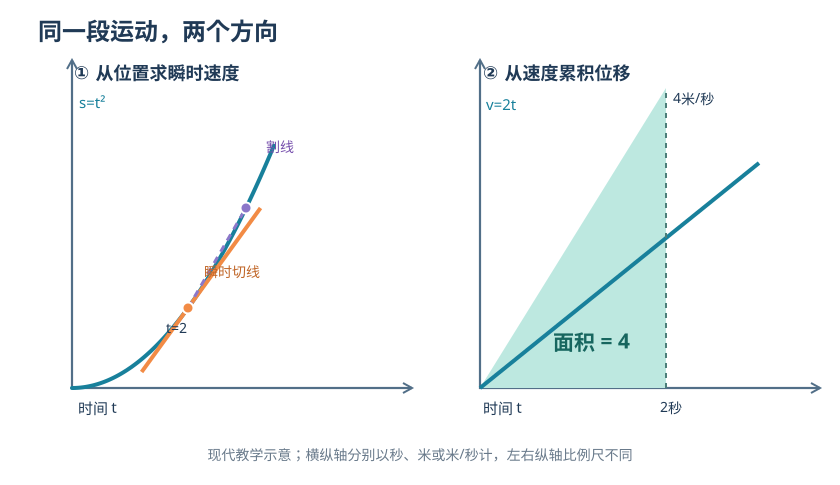

# 第六章｜牛顿的流数：运动逼出了新数学

*第二部：无穷小的审判*

假设一辆小车沿直线前进。

第一秒末，它距离起点一米。

第二秒末，四米。

第三秒末，九米。

只看这些数字，你很容易发现：它每秒走过的距离越来越长。

可是，现在请你回答一个更难的问题：

**恰好在第二秒的那个瞬间，它的速度是多少？**

别急着说“四米每秒”。

四米是它在第二秒末的位置，不是速度。

也别急着拿第三秒的九米减去第二秒的四米。

那算出的是第二秒到第三秒之间的**平均速度**。我们要问的，是那个没有时间长度的“第二秒瞬间”。

如果时间长度是零，位移变化也是零，难道要用零除以零？

如果瞬间根本没有持续时间，运动又凭什么在其中拥有速度？

第三章芝诺的飞矢，曾经把这个疑问推向哲学。

两千多年后，另一种更紧迫的要求出现了：人们不只想辩论运动如何可能，还想**计算正在变化的运动**。

十七世纪，牛顿（Isaac Newton）逐渐发展出一套方法。他不再只把长度、面积当作静止的结果，还把它们看成能够不断产生、不断变化的量。

这些量叫作**流量**。

它们变化的快慢，叫作**流数**。

问题是：一旦我们开始计算某个瞬间的变化率，那个“长度为零的时间间隔”，真的可以被数学驯服吗？

## 一｜会算走了多远，不等于会算此刻有多快

在古代，几何已经能够处理惊人复杂的图形。

上一章，我们看见阿基米德用严密的几何论证，证明抛物线弓形的面积等于对应内接三角形面积的三分之四。

它解决的是一个令人钦佩的难题：

**给定一块静止的曲边区域，怎样确定它的精确面积？**

但正在运动的世界，又会把研究者引向另一类问题。

物体在移动。

速度会增加，也会减小。

某个量可能在这个瞬间增长，在下一个瞬间停止，又在更晚的时候减少。

如果速度始终不变，那么计算非常简单：

$$
\text{速度}=\frac{\text{位移}}{\text{时间}}。
$$

比如十秒走了二十米，匀速运动时速度就是每秒两米。

可是，一旦速度不断变化，我们拿一整段时间里的位移除以时间，得到的只是平均值。

平均值当然有用。

但它不能直接告诉我们：**某一个指定时刻，物体到底有多快。**

这不是“尺子够不够精密”的问题。

无论测量仪器多先进，数学仍需要一个概念：什么叫作**瞬时速度**？

如果我们不知道它的定义，就算仪器显示出一个数字，也没有解释这个数字究竟代表什么。

正是在这里，数学从计算已有的长度，走向研究**量如何生成**。

但这条道路也不是牛顿突然从空白中开辟出来的。

## 二｜在牛顿之前，已经有人逼近这道门

把微积分写成“牛顿看见一个苹果，然后发明了一整门数学”，传播起来很容易。

但它把真正的历史发展削得太薄了。

十七世纪以前，阿基米德等古代数学家已经积累了曲线求积与几何逼近的工具。

进入近代以后，许多人继续推进这项事业。

费马研究过极大值、极小值与曲线的切线。他的方法虽然不使用现代导数术语，却已经触碰了“某个位置附近的量怎样变化”这一难点。

卡瓦列里通过不可分量的方法研究面积和体积，把如何从许多部分理解整体推向新的方向。

沃利斯在无穷级数与求积问题上进行了系统研究。

巴罗讨论切线与求积之间的关系，对后来数学发展尤其重要。

这些人的方法不完全相同，有的偏向几何，有的偏向代数，有的更敢使用无穷过程。

也不能把他们的成果直接合并成一套已经完成的现代微积分。

但有一点可以确定：

**牛顿进入的不是一片没有前人的荒地，而是一组正在迅速汇合的数学问题。**

面积、切线、最大最小值、运动速度，看起来属于不同的题目。

越来越多的研究者却发现，它们仿佛在反复要求一种相似的本领：

从一个量附近的极小变化，判断它在那个位置的性质。

需要的，不只是一种专门解决某条曲线的技巧。

而是一套能够跨越许多问题反复使用的运算规则。

## 三｜1665年，不是一则苹果故事

牛顿关于流数的早期研究，可以在十七世纪六十年代的手稿中找到证据。

他在1664年前后已经开始深入学习数学。1665年，剑桥受到疫病影响，他返回林肯郡的伍尔斯索普；此后因疫病情况而中断正常大学生活，在家乡停留了相当长的一段时间。

那段经历后来经常被压缩成一个传奇：

大学关闭，一位年轻人回到乡下，于是几乎在无人帮助的情况下，同时发明微积分、发现光的秘密并提出万有引力。

我们必须把传奇和能核查的进展分开。

牛顿的数学训练已经开始于返乡之前。他研究的内容也深受先前出版和流传的数学工作影响。

同时，史料确实显示，他在1665—1666年前后取得了非常重要的进展。

牛顿研究计划（The Newton Project）所整理的材料表明：在1666年10月的一份数学论文中，他已经系统讨论通过**运动**解决数学问题的方法，其中包括求曲线切线，以及与曲线围成面积有关的计算。

这比“某一天突然灵机一动”更值得注意。

因为它展示了一个研究方向正在形成：

**不再把曲线仅仅当作纸上静止的形状，而是把它想象成某个点或某种量连续变化留下的结果。**

但是，这份1666年的工作没有立即成为所有欧洲数学家都能读到的印刷著作。

接下来还会发生一段重要的历史延迟。

牛顿的方法发展得相当早，其公开传播却比形成的时间复杂得多。

我们先不急着追问发表的先后。

先弄清楚他究竟换了一种什么眼光。

## 四｜一条线不是画出来的，而是“流出来的”

想象有一个点从左往右移动。

它走过的距离，在不断增长。

如果把这个增长的长度记作 $x$，牛顿会把它理解为一种**流动的量**，即 fluent。

中文常译为“流量”，但这里的“流量”不是水管每秒通过多少升水的那个日常用法。

它首先意味着：**一个处在连续生成或变化中的数学量。**

对于这个流量，我们可以继续追问：

它增长得有多快？

这种增长的速率，就是 fluxion，中文常译为**流数**。

在牛顿后来使用的一种常见符号里，如果流量写作 $x$，其流数就可以记作：

$$
\dot{x}。
$$

字母上方的点，不是装饰。

它提醒我们，这个量正在发生变化；而我们想知道的是它变化的速率。

用今天的术语，如果 $x$ 是随时间 $t$ 变化的可微函数，那么可以写：

$$
\dot{x}=\frac{dx}{dt}。
$$

这条等式是**用现代记号解释牛顿的概念**。右边的 $dx/dt$ 属于更常见的莱布尼茨式表达，不能把两套符号不加区分地说成牛顿最初写下的同一句原文。

牛顿的思想还有一层重要的灵活性。

他可以把某个均匀变化的量当作衡量其他变化的参照，近似扮演时间的角色。

因此，并非每一道流数计算都必须对应一辆真正正在行驶的车。

线段的长度可以“流动”。

图形的面积可以“流动”。

一条曲线上的两个坐标，也可以随着构造它们的运动同时变化。

把静止的对象想成连续生成的结果，数学就多了一种语言：

**不是只问“它是多少”，而是问“它怎样变成这样”。**

## 五｜终于计算第二秒的速度

回到开篇的小车。

为了让问题具有明确答案，我们必须补充一项假设：不仅知道第一、二、三秒的位置，还知道在所讨论的时间段内，位置随时间遵循同一个规则。

设：

$$
s(t)=t^2。
$$

其中 $t$ 的数值以秒计，$s(t)$ 的数值以米计。这里省略了使单位一致的常数系数，仅为了让演算容易跟上。

这样，第一秒末它位于一米处，第二秒末位于四米处，第三秒末位于九米处。

现在固定第二秒这个时刻：

$$
t=2。
$$

你如果考察第二秒到第三秒：

$$
\frac{s(3)-s(2)}{3-2}
=\frac{9-4}{1}
=5\text{米/秒}。
$$

但这仍然是一整秒的平均速度。

我们尝试把时间缩短。

从 $t=2$ 秒起，向后取一个长度为 $h$ 秒的时间段，其中 $h>0$：

$$
\frac{s(2+h)-s(2)}{h}。
$$

代入 $s(t)=t^2$：

$$
\frac{(2+h)^2-2^2}{h}
=\frac{4+4h+h^2-4}{h}。
$$

整理：

$$
=\frac{4h+h^2}{h}
=4+h。
$$

这里必须先记住一个条件：

$$
h\ne0。
$$

我们能够约去分母中的 $h$，是因为此时它还不是零。

现在看不同时间长度得到的结果：

| 时间增量 $h$（秒） | 从第二秒出发的平均速度（米/秒） |
|---:|---:|
| $1$ | $5$ |
| $0.1$ | $4.1$ |
| $0.01$ | $4.01$ |
| $0.001$ | $4.001$ |

时间段越短，平均速度越逼近每秒四米。

如果从第二秒之前取时间段，也会得到类似结果。

例如 $h=-0.01$，把从第1.99秒到第2秒的平均速度按同一差商计算：

$$
4-0.01=3.99\text{米/秒}。
$$

一边越来越接近 $4$，另一边也越来越接近 $4$。

于是，用现代数学语言，我们把第二秒的瞬时速度定义为：

$$
v(2)=\lim_{h\to0}\frac{s(2+h)-s(2)}{h}
=4\text{米/秒}。
$$

**这才是问题真正的答案。**

第二秒那一瞬间，它位于四米处。

在我们的运动模型里，它同时具有每秒四米的瞬时速度。

“位置是四米”与“速度是四米每秒”，碰巧有相同的数字，但它们是不同的物理量，单位也不同。

现在最重要的问题来了：

我们是不是先把 $h$ 当作非零，最后又偷偷把它设成了零？

不是。

因为最终进行的操作并不是在 $h=0$ 处计算原来的商。

而是在 $h$ **接近**零的时候，考察这个商趋向哪一个确定的值。

这个区别，会成为后世微积分争论的关键。

## 六｜流数究竟是一种怎样的计算

上一节是我们今天熟悉的极限写法。

但牛顿究竟怎样思考变化的量？

在他的流数方法中，除了 fluents 和 fluxions，还有一个十分重要、又很容易被误解的词：

**moments**。

这里可译作“矩”或“瞬时增量”。

它不是一个独立的“瞬时速度”。

它指的是一个流动的量，在极短的时间变化中产生的那一点增量。

想象某个量 $x$ 正在增加，它的变化速率是 $\dot{x}$。

在一种教学性的近似重述中，如果我们用 $o$ 表示极短的时间增量，就可以把流量的首阶增量写成：

$$
\dot{x}\,o。
$$

这里的 $o$，在牛顿的历史记号体系中，是用于相关微小时间量的符号之一。

但不能把它直接译成现代意义上已经严格定义的 $dt$，也不能把它一开始就理解为**恰好等于零**的时间长度。

这套思路为什么有用？

因为它能够把“一个正在变化的量”与“它改变的速度”联结起来。

设有两个相互联系的流量：

$$
y=x^2。
$$

如果 $x$ 稍微增加一点，$y$ 会增加多少？

把 $x$ 的一个非零增量记作 $\Delta x$：

$$
\Delta y=(x+\Delta x)^2-x^2。
$$

展开：

$$
\Delta y=2x\Delta x+(\Delta x)^2。
$$

这时候，最吸引注意的是两类项。

第一类，是与 $\Delta x$ 成正比的：

$$
2x\Delta x。
$$

第二类，是增量的平方：

$$
(\Delta x)^2。
$$

如果增量很小，那么平方项通常比第一阶项更快地缩小。

这便启发了一种办法：**考察增量趋于消失时，哪些比例关系能够稳定保留下来。**

但在真正严格推理时，我们不能仅仅说“平方项太小，所以可以随便删掉”，然后结束讨论。

必须解释，为什么删掉它不会改变要找的变化率。

用现代语言，这个理由十分清楚。

在 $\Delta x\ne0$ 时：

$$
\frac{\Delta y}{\Delta x}
=2x+\Delta x。
$$

让 $\Delta x$ 趋近于零：

$$
\lim_{\Delta x\to0}
\frac{\Delta y}{\Delta x}
=2x。
$$

因此，对这条曲线，$y$ 相对于 $x$ 的瞬时变化率是：

$$
\frac{dy}{dx}=2x。
$$

如果 $x$ 自身又随着时间变化，那么在可微且相关条件成立的模型里：

$$
\boxed{\dot{y}=2x\dot{x}}。
$$

这个等式特别漂亮。

它不要求 $x$ 一定以每秒一单位的速度增加。

如果某个时刻 $x=2$，而 $\dot{x}=3$ 个长度单位每秒，那么此刻：

$$
\dot{y}=2\times2\times3=12
$$

个对应的平方长度单位每秒。

也就是说，**$y$ 改变得多快，取决于 $x$ 此时有多大，也取决于 $x$ 此时变化得多快。**

流数法所追求的，正是能够反复处理这种关系的规则。

## 七｜一条曲线的切线，竟然也是两个流数的比例

刚才我们讨论的是物体的位置和速度。

现在把问题换成一条画在纸上的曲线。

例如：

$$
y=x^2。
$$

如果你想在曲线上某一点画出切线，应该怎样确定它的方向？

以前的几何方法，往往需要为不同曲线分别寻找合适的构造。

而运动的想法可以给出另一种理解。

想象有一个点在这条曲线上连续移动。

它的横坐标 $x$ 不断变化。

它的纵坐标 $y$ 也跟着变化。

于是，横坐标有自己的流数 $\dot{x}$，纵坐标也有自己的流数 $\dot{y}$。

这个点在某一瞬间沿哪个方向运动，取决于它在横向和纵向分别变化得多快。

如果此刻 $\dot{x}\ne0$，那么切线斜率可以用两者的比来表达：

$$
\frac{\dot{y}}{\dot{x}}。
$$

我们刚刚推导出：

$$
\dot{y}=2x\dot{x}。
$$

所以：

$$
\frac{\dot{y}}{\dot{x}}=2x。
$$

于是，在 $x=2$ 的位置，曲线切线的斜率是：

$$
2\times2=4。
$$

请注意：在这里，**变化率又不再表现为一辆车的速度**。

它表现为一条曲线在某一点的方向。

运动提供了思考的框架，但数学方法已经超出日常运动问题。

这恰好说明牛顿式观念的野心在哪里。

速度、切线、增长率，原来不一定是互不相干的难题。

它们都能在某种意义上被理解为：**一个量相对于另一个量的局部变化关系**。

这不是说物理速度与几何斜率完全没有区别。

物理速度带着时间与长度的单位；平面曲线切线斜率通常描述两个坐标变化之间的比。

只是它们背后开始出现同一种可迁移的运算结构。

## 八｜速度还能继续变化：第二个点究竟意味着什么

事情可以再推进一步。

最初，我们问位置怎样变化。

得到速度。

接着，我们还可以问：**速度本身怎样变化？**

如果速度也在变化，那么它就可以被当作新的流量。

这个新流量，也有自己的变化速率。

用牛顿体系后来常见的点记号表达：

$$
\dot{s}
$$

表示位移的第一阶流数，也就是速度。

而：

$$
\ddot{s}
$$

表示速度变化的速率，即第二阶流数。

在今天的力学中，对直线运动，这就是加速度。

还用我们的模型：

$$
s(t)=t^2。
$$

刚才已经求出：

$$
\dot{s}(t)=2t。
$$

再对时间求一次变化率：

$$
\ddot{s}(t)=2。
$$

意思是：**这个模型的速度每秒增加两米每秒，即加速度为每秒每秒两米。**

从位置，到速度，再到加速度，形成一个层次清晰的系列。

但历史上也不该把不同阶段的点记号使用情况说得过于整齐。牛顿在不同手稿和著作中使用过多种表示方式；单点、双点乃至更高阶点记号的出现和公开传播有自己的时间线。

我们今天习惯写：

$$
s,\quad\dot{s},\quad\ddot{s}
$$

看起来只是一行简单符号。

可这行符号背后，是一种新的思想习惯：

**一个变化率，本身还可以继续成为被研究的变化量。**

数学于是拥有了追踪不断变化的世界的语言。

## 九｜反过来：已知速度，能否找回走过的路

还记得上一章的阿基米德吗？

他面对一块曲边区域，努力找到它的精确面积。

而牛顿的研究把另一个方向也带进了同一套问题之中。

我们刚才做的事情是：

已知位置函数，找速度。

现在把问题倒过来：

**已知每个时刻的速度，能不能重新找回位置？**

假设有一个物体，从起点开始运动，速度随时间的规律是：

$$
v(t)=2t。
$$

第一秒末，速度为每秒两米。

第二秒末，速度为每秒四米。

第三秒末，速度为每秒六米。

如果你要算前两秒它到底走了多远，不能直接把第二秒的速度乘以两秒。

因为速度一直在增长。

我们需要把整段时间里的变化累积起来。

有一个简单而直观的办法。

在一张图上，横轴表示时间 $t$，纵轴表示速度 $v$。

因为 $v(t)=2t$，速度曲线是一条从原点向上倾斜的直线。

从零到两秒，这条直线与时间轴之间的区域，是一个三角形。

它的底是两秒，高是每秒四米。

三角形的面积：

$$
\frac12\times2\times4=4。
$$

在这张**速度—时间图**中，面积的单位是：

$$
\text{秒}\times\frac{\text{米}}{\text{秒}}=\text{米}。
$$

所以图形面积表示的，就是这段时间里的位移。

结果：四米。

这与我们的原始位置函数 $s(t)=t^2$ 完全相符。

如果考虑任意时间 $t\ge0$：

$$
\text{底}=t,\qquad\text{高}=2t。
$$

面积就是：

$$
A(t)=\frac12t(2t)=t^2。
$$

于是：

$$
s(t)=t^2。
$$

**已知速度，累积回位移；已知位移，计算出速度。**

两种计算，仿佛朝着相反方向走在同一条路上。

*现代示意图：左侧以位置—时间曲线展示瞬时速度，右侧以速度—时间曲线下方的三角形展示累积位移。图形不是牛顿原稿中的插图。*

从今天的数学语言看，后一种运算常写为：

$$
s(t)-s(0)=\int_0^t v(u)\,du。
$$

在这个例子里：

$$
s(t)=\int_0^t2u\,du=t^2。
$$

这当然是**现代积分记号**，不是牛顿在十七世纪六十年代的手稿里使用的符号。

但我们已经看到微积分一项核心联系：

**求瞬时变化率，与求变化率的累计量，在适当条件下是相互关联的逆向问题。**

牛顿对这种关系的研究，是微积分发展史的重要环节。

同时，费马、巴罗、格雷戈里及其他数学家的前期工作也不可抹掉。

这里不是一位天才孤独地发明一切的地方。

它是几条长期分离的道路，终于能够用更统一的语言互相照亮的地方。

## 十｜一项早已成形的方法，为什么没有立刻出现在书店里

牛顿的数学成果形成与传播之间，存在一个很容易被通俗故事忽略的时间差。

按照现存手稿与数学史研究，可以大致排出这样一条线：

| 时间 | 发生的事情 | 必须分清的性质 |
|---|---|---|
| 1665—1666年前后 | 牛顿逐渐形成流数、级数等思想，在1666年论文中发展通过运动解决问题的方法 | 研究形成；不是正式印行 |
| 1669年 | 关于无穷级数等内容的《分析》手稿在有限数学圈内流传 | 手稿传播；不是面向公众的正式出版 |
| 1671年 | 写成一部较完整的《级数与流数的方法》 | 写成著作；没有立即印行 |
| 1676年 | 牛顿通过通信向欧洲数学家传达部分方法与研究范围 | 学术交流；不能等同公开交出全部算法 |
| 1684年 | 莱布尼茨发表微分方法论文 | 另一位学者的正式发表 |
| 1687年 | 牛顿出版《自然哲学的数学原理》 | 重要物理数学著作，但不是完整流数算法教材 |
| 1704年 | 牛顿的《曲线求积》随《光学》公开发表 | 流数与求积相关方法进一步见诸印刷 |
| 1736年 | 约1671年撰写的《级数与流数的方法》以约翰·科尔森英译本出版 | 该手稿的迟到出版；不代表此前完全无人知晓流数法 |

在这里，需要特别避免两种相反的误写。

第一种，是说“牛顿在1665年公开发表微积分”。

没有这回事。

第二种，是说“牛顿的微积分到1736年才第一次让任何人知道”。

也不对。

部分思想早已在信件、手稿以及其他数学与物理著作中出现。1687年的《原理》和1704年的《曲线求积》，更不能被抹去。

真正准确的说法是：

**研究形成、手稿流通、在不同著作中公开、较完整专著正式印行，是四种不同的历史事件。**

而这种差异，后来也成为牛顿与莱布尼茨优先权争论中需要认真辨别的问题。

这里还有一个史料陷阱。

我们能读到牛顿后来为自己的研究先后所写的长篇说明。他提到早年工作，也谈到与莱布尼茨的通信。

这些材料非常宝贵，因为它们出自事件当事人，包含他如何理解自己成果的细节。

但当事人的自述尤其是在优先权争论中的自述，**不是一份无需交叉核实的中立裁决**。

写数学史必须把“牛顿说自己何时发现了某方法”与“现存手稿和独立研究能证明什么”放在各自的位置。

## 十一｜1687年的牛顿，已经意识到零与极限的危险

回到一个尚未彻底解决的疑问。

第五节里，我们计算：

$$
\frac{(2+h)^2-4}{h}=4+h。
$$

随后让 $h$ 趋近零，得到瞬时速度4。

数学步骤没有问题。

可在十七世纪，新的无穷小运算为什么能够被信任，还需要说明。

牛顿并不是完全没有意识到这个问题。

在1687年出版的《自然哲学的数学原理》第一卷第一节，他以“**初始与最终比**”为主题建立了一组引理。

这些引理关心的正是：

当两个量不断减小、甚至趋于消失时，我们还能怎样严格讨论它们的比？

《原理》第一卷的相关文字，明确区别了一般的有限数量比，以及量在趋于消失时逼近的最终比。

它还借助运动速度作类比，以说明这种最终比并不是在量已经成为零之后再去取一个普通分数。

这与我们刚才的数学演示，存在明确的思想联系。

不过，不能因此断言牛顿已经拥有十九世纪数学分析中的完整 $\varepsilon$—$\delta$ 定义。

他的原始论证与后来形式化的极限理论，有不同的语言、背景与数学公理基础。

也不能反过来把他描写成只会耍“先不让它为零，算完又让它为零”的小把戏的人。

真正困难的问题，比这种漫画式批评深得多。

**一种正在产生巨大计算成果的方法，究竟应当怎样说明它操作的那些不断缩小的量？**

牛顿尝试过不止一种回答。

流数、矩、运动中的连续变化，以及初始与最终比，都属于这项长期探索的不同侧面。

但这些尝试并没有让之后关于无穷小与数学严格性的讨论自动结束。

我们还将看到，十八世纪的批评者会用尖锐的语言再次逼问这套方法的基础。

在此之前，另一位同样重要的人物，已经走出了不同的道路。

## 十二｜另一个人，用了另一种符号

牛顿的名字往往会与微积分紧紧连在一起。

这当然有充分理由。

他的流数思想对连续运动、曲线切线以及由变化率恢复量的研究，都作出了深远贡献。

但如果我们把所有发现都放进牛顿一人的笔记本，历史便会立刻失真。

与此同时，莱布尼茨（Gottfried Wilhelm Leibniz）也在独立发展一种研究变化的数学方法。

他的工作更突出地使用了不同的微小变化记号，以及一套便于表达运算规则的符号。

1684年10月，莱布尼茨在《学术纪事》（*Acta Eruditorum*）发表了一篇介绍微分计算的重要论文。

那时候，牛顿约1671年完成的流数长篇手稿，还没有作为完整著作公开出版。

后来，两人及其支持者围绕发现与发表的先后，展开了长期争论。

这项争论有它具体的通信、论文与时代背景，不能用“谁偷了谁的发明”一句话盖棺定论。

现代数学史的常见判断是：**牛顿与莱布尼茨分别发展了微积分的核心方法**；二者有不同思路、不同记号，也有复杂的信息交流与发表先后。

我们下一章会专门讲莱布尼茨。

但在这里，先留下一个问题。

为什么同样是研究变化，有人更倾向把数学量想象成正在**流动**的对象，有人却愿意把它们之间的**微小差异**直接写进符号？

这种看上去只是书写习惯的差别，为什么会影响后世数学家如何学习、传播和使用微积分？

答案涉及的不只是优先权。

还涉及一个极其现实的数学问题：

**一种运算方法，能否被越来越多的人掌握、复用和改进？**

## 十三｜这一章真正留下的，不是一个点号

最后，重新回答开篇问题。

恰好在第二秒，物体的速度是多少？

如果它遵循我们给出的模型：

$$
s(t)=t^2，
$$

那么：

$$
\boxed{v(2)=4\text{米/秒}}。
$$

但这章的意义，当然不只是算出数字4。

我们从时间段中的平均速度出发。

把时间段缩短。

发现越来越短的差商可以趋向一个确定的值。

于是，某一瞬间的速度终于拥有了可以复核的数学定义。

接着，流数法又让我们看到：

对于关联的流量 $y=x^2$，它们的变化率满足：

$$
\dot{y}=2x\dot{x}。
$$

对于随时间改变的位置，速度还可以再次变化，形成加速度。

反过来，如果我们掌握了速度如何变化，也能够通过累积恢复走过的路。

到这里，原本散落在物理、几何与面积计算中的几个问题，开始显示出共同的结构。

这是一种强大的数学统一。

但它不是毫无代价的。

我们越是能够快速计算，就越需要追问：被我们除掉的那个微小量究竟是什么？两个都在趋零的量，为什么可以留下一个确定的比？

牛顿有自己的回答与尝试。莱布尼茨又提出另一套令人惊讶的语言。

后来的数学家还必须继续澄清这些语言背后的逻辑。

从阿基米德到牛顿，数学获得了更强大的计算变化的工具。

可工具越强大，关于它**为何可靠**的追问也越无法回避。

下一章：《莱布尼茨的符号：把无限小写进纸面》。

在那里，我们要讨论的，不只是如何计算。

而是：**为什么几个微小的符号，竟然能改变一整门学科发展的方向？**

---

## 史料、时序与数学解释说明

1. **牛顿研究计划（The Newton Project），《Introduction to the Texts》与生平时间线。** 1664年前后的数学训练、1665—1667年大学因疫病中断、1666年通过运动处理切线与面积问题的手稿发展。[手稿导论](https://www.newtonproject.ox.ac.uk/texts/introduction)；[年代记录](https://dev-newtonproject.history.ox.ac.uk/his-life-and-work-at-a-glance)。本章没有复原牛顿返乡时的私下对话、具体发现时刻或内心感受。
2. **牛顿，《流数法历史》（*The History of the Method of Fluxions*），剑桥大学图书馆 MS Add.3968；牛顿研究计划外交式转写。** 包括流量、流数、矩、点记号及使用均匀流动量的说明，也包含优先权争论中的自述，因此对于先后归属必须与独立研究交叉核对。[手稿转写](https://newtonproject.ox.ac.uk/view/texts/diplomatic/NATP00356)。
3. **MacTutor，《A history of the calculus》。** 梳理阿基米德至费马、卡瓦列里、沃利斯、巴罗、牛顿和莱布尼茨的多线发展，确认牛顿1669年《分析》手稿流传、1671年《级数与流数的方法》写作、1704年《曲线求积》出版与1736年英译印行的区别。[数学史综述](https://mathshistory.st-andrews.ac.uk/HistTopics/The_rise_of_calculus/)。
4. **Niccolò Guicciardini, *The Development of Newtonian Calculus in Britain, 1700–1800*（Cambridge UP, 1989）。** 关于1687年《原理》与1704年《曲线求积》的公开内容和1736年流数长篇手稿英译，提供独立学术研究。[出版社页面](https://www.cambridge.org/core/books/development-of-newtonian-calculus-in-britain-17001800/3F5BFC9F14EE42649CF64AC036308B31/listing?pageNum=2)。
5. **牛顿，《自然哲学的数学原理》第一卷第一节，“初始与最终比”的引理及说明。** 1687年拉丁文原著；本章参考后世1846年英译的传世文本，论述其“量趋于消失时的比”与现代极限的关系，不把它直接说成十九世纪完整的极限公理化。[第一节引理](https://en.wikisource.org/wiki/Page:Newton%27s_Principia_(1846).djvu/101)；[相关说明](https://en.wikisource.org/wiki/Page:Newton%27s_Principia_(1846).djvu/108)。
6. **D. T. Whiteside 编，《The Mathematical Papers of Isaac Newton》，卷III（1670—1673），剑桥大学出版社。** 手稿写作、原计划出版、后续英译与拉丁文出版的详细编年参考。[出版社卷册说明](https://assets.cambridge.org/97805210/45810/frontmatter/9780521045810_frontmatter.pdf)。
7. **Frank J. Swetz, MAA《Mathematical Treasure: Leibniz’s Papers on Calculus》；*Landmark Writings in Western Mathematics*（2005）。** 1684年10月莱布尼茨在《学术纪事》发表微分方法的事实；关于两位学者的独立发展及发表先后，应与牛顿本人带有优先权立场的追述区分。[MAA页面](https://old.maa.org/press/periodicals/convergence/mathematical-treasure-leibnizs-papers-on-calculus-differential-calculus)；[数学史研究](https://www.sciencedirect.com/science/chapter/edited-volume/pii/B9780444508713500851)。
8. **本章现代教学模型的界限。** $s(t)=t^2$，差商 $2t+h$，$y=x^2$ 的流数关系 $\dot y=2x\dot x$，速度图形中的面积 $A(t)=t^2$，以及 $\int_0^t2u\,du$，均为读者理解概念的现代数学演示，不等于牛顿曾在1666年逐字书写这些公式，也不意味着他的论证完全采用十九世纪极限语言。插图为原创的现代坐标示意。
9. **本书叙事边界。** “运动逼出新数学”是解释性章节题目，并不意味着运动是微积分出现的唯一原因，也不意味着牛顿单独发明全部切线、求积和微分规则。本书仍处于初稿阶段，未经独立双重审稿或终稿封版。
