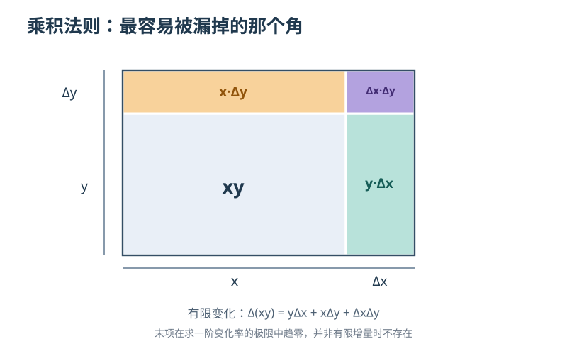

# 第七章｜莱布尼茨的符号：把无限小写进纸面

*第二部：无穷小的审判*

请看两种写法。

第一种：

$$
\dot y=2x\dot x。
$$

第二种：

$$
\frac{dy}{dx}=2x。
$$

它们可以描述同一件事：当 $y=x^2$，而 $x$ 不断变化时，$y$ 相对于 $x$ 的瞬时变化率是 $2x$。

但如果把两行公式放在一个刚开始学习微积分的人面前，第二行会暗示一种非常强烈的想法。

**$y$ 的变化，正在与 $x$ 的变化相比较。**

分子写变化的对象，分母写作为参照的对象。

你甚至可以顺着这个结构去猜：如果想把变化一段段加起来，又该怎样写？

答案是另一个我们今天几乎习以为常的符号：

$$
\int。
$$

一个拉长的字母。

几个比普通变量还不起眼的笔画。

可正是这些符号，让微积分不仅是一位数学家手里的技巧，更逐步变成能够写在纸上、传给别人、继续扩展的一套运算语言。

1684年10月，一篇署名缩写为 G. G. L. 的论文出现在莱比锡的《学术纪事》（*Acta Eruditorum*）上。它从第467页开始，到第473页结束。

只有七页。

没有宣布自己即将创造未来所有的数学课程。

却写出了后来一代又一代学生会不断使用的微分规则。

这篇论文的作者，是戈特弗里德·威廉·莱布尼茨（Gottfried Wilhelm Leibniz）。

问题在于：**一种记号，凭什么改变一门学科？**

要回答这个问题，我们得先看见：在这七页纸之前，数学家们究竟缺少什么。

## 一｜有了正确的答案，为什么还需要另一种写法

上一章，牛顿把不断生成的量称作“流量”，把量变化的速率称作“流数”。

他常用点记号表达变化率：

$$
\dot x,\qquad \dot y。
$$

如果某个量是位置，位置的流数就可以解释为速度。

如果速度本身也变化，就可以讨论第二阶流数——加速度。

这一套语言对运动特别自然。

但连续变化并不只发生在时间中。

例如，给你一条曲线：

$$
y=x^2。
$$

你想求它在横坐标 $x$ 处的切线斜率。

这里的关键，并不是必须让一个点“每秒”走多少米。

而是要比较：**横坐标略微变化时，纵坐标随之变化多少。**

换一个问题：

假设一个长方形的长和宽都在改变。它的面积会怎样变化？

再换一个：

如果我们已知一条曲线各处的变化率，能不能反过来求出它所累积的面积或总量？

这些问题也许可以分别解决。

但如果每碰到一个新图形，就要重新设计一次特殊的几何构造，方法便很难普遍传播。

真正重要的，不只是能不能算出一道题。

而是能不能给出一套**可以重复调用的规则**。

这时，符号的设计不再是书写上的小事。

一个符号如果能够告诉你“现在要执行哪类运算”，它就不只是答案的缩写。

它开始承担方法本身的一部分。

不过，莱布尼茨也不是从某个绝对空白的时代走来。

## 二｜巴黎的研究者，不是一位突然出现的救世主

莱布尼茨生于1646年，卒于1716年。

他的兴趣远远超出数学，还包括哲学、逻辑、法律与其他学术领域。

十七世纪七十年代，他在巴黎生活、研究，并与当时的重要科学家和数学家交流。尤其与惠更斯（Christiaan Huygens）的往来，构成了他深入学习数学的重要背景。

他接触的数学世界，也已经有了费马、卡瓦列里、帕斯卡、沃利斯、巴罗等人的成果。

切线、曲线面积、数列求和与变化关系，早已是许多人反复探索的问题。

莱布尼茨的道路，并不是抛弃这些前人，然后从零创造出一个完整体系。

他试图在不同问题之间找出可以迁移的运算结构。

这一点在历史上尤其值得强调。

因为当我们今天使用

$$
\frac{dy}{dx}
$$

时，很容易觉得它天生就应该这样写。

但对于十七世纪的数学研究者来说，问题还远远没有被安排得这么整齐。

“变化的一点点”要怎样表示？

“把许多部分相加”又该怎样表示？

一个符号应当只表示某一幅几何图中的特定线段，还是能在完全不同的计算中重复使用？

莱布尼茨在十七世纪七十年代花了相当多的精力探索这些问题。

而这段探索，留下了一个比任何传奇都更具体的历史日期。

## 三｜1675年：那个被拉长的 S

1675年秋天，莱布尼茨在一系列尚未正式出版的数学手稿中尝试新的记号。

数学符号史研究把一个重要节点定位在**1675年10月29日**。

在那份手稿中，他用一个拉长的字母 S，来代替先前用于表示“全部相加”的简写。

为什么是 S？

因为它来自拉丁文 **summa**，意思就是“和”。

今天我们把这个符号写作：

$$
\int
$$

你可以把它理解为一份极简的运算指令：

**把这些微小的贡献累加起来。**

这个符号的出现，并不意味着莱布尼茨在那一天已经写出了现代积分教材里全部的记号。

手稿告诉我们的是一段渐进形成的过程。

同年11月的其他手稿中，他又进一步尝试把积分记号和 $dx$ 结合起来。有关手稿具体日期以及哪一种完整写法第一次出现，不同数学史资料对**符号的不同演进阶段**有更细致的划分。

这才是应当保存的史实重点：

**1675年是未刊手稿中逐步形成新记号的时期，不是积分符号已经面向欧洲公开发表的年份。**

直到1686年，印刷的学术期刊上才出现了这套积分记号的重要公开表达。

请暂时记住这十余年的差距。

因为数学里的“发明”，从来不等于某个想法第一次出现在手稿里的瞬间。

它还要走过表达、公开、理解、检验以及别人真正开始使用的漫长道路。

## 四｜1684年，七页纸上的微分法

1684年10月，《学术纪事》刊出莱布尼茨的一篇论文。

它的拉丁文标题以 *Nova methodus pro maximis et minimis* 开头，主要讨论求极大值、极小值、切线的方法，以及一种适用于相关问题的新计算方式。

在传世印本上，文章位于第467—473页，并附有几何图版。

今天，史料研究还发现这篇早期论文的印刷存在不同印次、排版差异。因此，我们不应该把所有馆藏印本都想象成同一批、同一张纸上毫无差别的复本。

但它所呈现的核心数学方向是清楚的。

**将变化关系写成可以运算的“微分”。**

莱布尼茨在论文中使用 $dx,dy$ 等记号，给出求常数倍、和、差、积、商以及幂等表达式微分的方法。

其中一条规则，直到今天仍然是微积分课程的基础：

$$
\boxed{d(xy)=x\,dy+y\,dx}。
$$

如果你还不知道它为什么成立，不必着急。

我们很快就会把它从一张长方形的图里推出来。

在此之前，先看这个记号的力量究竟在哪里。

原本的任务可能是一条特定曲线的切线构造。

如今，一条规则却告诉你：

**只要两个变量相乘，求它们的变化时，就可以按照同一种结构处理。**

这就把一道道具体问题，抽象成了一种可复制的运算。

但是——只有写法，没有证明，也不足以让一门数学稳固下来。

让我们亲自检验这些符号所表达的关系。

## 五｜两个小字母，究竟在比较什么

设一条曲线由下面的公式给出：

$$
y=x^2。
$$

横坐标由 $x$ 变为 $x+h$。

纵坐标相应由 $x^2$ 变为 $(x+h)^2$。

于是，横坐标的有限增量是：

$$
\Delta x=h。
$$

纵坐标的有限增量为：

$$
\Delta y=(x+h)^2-x^2=2xh+h^2。
$$

如果 $h$ 不是零，二者的比就是：

$$
\frac{\Delta y}{\Delta x}
=\frac{2xh+h^2}{h}
=2x+h。
$$

对于一段明确非零的横向变化，这个比描述的是割线的斜率。

但我们想求的不是两点之间的割线。

而是某一点的**切线**。

为此，用现代极限理论让 $h$ 从正、负两侧趋近于零，得到：

$$
\lim_{h\to0}\frac{\Delta y}{\Delta x}=2x。
$$

于是：

$$
\boxed{\frac{dy}{dx}=2x}。
$$

在我们今天的可微函数理论里，这就是 $y=x^2$ 的导数。

你可以把 $\frac{dy}{dx}$ 读作“$y$ 对 $x$ 的变化率”。

如果 $x=3$，导数是 $6$。

如果 $x=5$，导数是 $10$。

不必再针对每一个点，从头设计一套特殊的切线证明。

同一个规则可以反复使用。

这便是新语言的第一层优势：把不同点、不同曲线的局部变化问题，放进统一的操作方式。

但还要立刻补上一句——也是接下来几章无法回避的逻辑边界：

**$dy$ 和 $dx$ 不能在任何情境下都当成两个普通有限数，随手做除法。**

在刚才的现代推导中，我们真正使用的是非零的有限增量 $\Delta x$，计算完差商，再考察极限。

而莱布尼茨时代对“微分”与“无限小”本身的解释，属于另一套有自己历史争论的概念。

不能把我们这里的极限定义，倒填成1684年论文已经完成的严格基础。

不过，符号诱发的下一条规则，会让它的计算能力变得更加明显。

## 六｜乘积法则：一块长方形为什么会多出一个角

想象一块长方形。

它的长是 $x$，宽是 $y$。

所以面积是：

$$
A=xy。
$$

现在，长和宽都发生一点变化。

长增加 $\Delta x$。

宽增加 $\Delta y$。

新长方形的面积变为：

$$
A+\Delta A=(x+\Delta x)(y+\Delta y)。
$$

把括号展开：

$$
A+\Delta A
=xy+y\Delta x+x\Delta y+\Delta x\Delta y。
$$

减去原来的面积 $xy$，就得到：

$$
\boxed{\Delta A
=y\Delta x+x\Delta y+\Delta x\Delta y}。
$$

这是一条**精确等式**。

没有删掉任何东西。

你可以把新增面积想成三部分：

原长方形右边加了一条窄条，面积 $y\Delta x$。

原长方形上边加了一条窄条，面积 $x\Delta y$。

而最右上角，两个方向同时增加，因此又多出一小块，面积为 $\Delta x\Delta y$。

*原创现代几何示意。底色是原面积 $xy$；右侧、上侧和角落分别对应 $y\Delta x$、$x\Delta y$、$\Delta x\Delta y$。*

所以，我们不能说：

“因为最后那个小角落太小，所以它从一开始就根本不存在。”

**只要两个有限增量都不为零，那个角落就有真实的有限面积。**

那么，为什么微分的乘积法则里却只剩两项？

$$
d(xy)=y\,dx+x\,dy。
$$

事情的关键在于，我们现在问的不是**任意有限变化的准确增量**，而是该变化的**一阶变化规律**。

在今天的严格语言里，假设 $x=x(t)$、$y=y(t)$ 都是可微函数。

在时刻 $t$ 附近取一段非零的时间变化 $h$，相应的有限变化量为 $\Delta x,\Delta y$。

把刚才的精确式除以 $h$：

$$
\frac{\Delta(xy)}h
=y\frac{\Delta x}h+x\frac{\Delta y}h
+\frac{\Delta x\Delta y}h。
$$

当 $h$ 趋于零时，前两项分别趋向 $y\dot x$ 和 $x\dot y$。

最后一项可以写成：

$$
\left(\frac{\Delta x}h\right)\Delta y。
$$

因为 $x(t)$ 可微，$\Delta x/h$ 趋向一个有限的变化率。

因为 $y(t)$ 可微，$\Delta y$ 趋于零。

所以它们的乘积趋于零。

注意，结论是**这一项在求变化率的极限时贡献为零**，而不是它在任何有限步骤中都严格等于零。

于是得到：

$$
\frac{d(xy)}{dt}=y\frac{dx}{dt}+x\frac{dy}{dt}。
$$

换回微分语言：

$$
\boxed{d(xy)=x\,dy+y\,dx}。
$$

莱布尼茨1684年的规则之所以强大，正是因为它把这类变化关系凝结成一条可以直接运算的式子。

而我们刚刚给出的论证，是用**现代可微函数和极限概念**对它进行的证明，并非声称莱布尼茨原文逐行采用这一套极限论证。

## 七｜从一道题，扩展到一整套算法

再来试一下新符号的复用能力。

我们已经知道：

$$
d(x^2)=2x\,dx。
$$

现在要求：

$$
d(x^3)。
$$

当然可以把 $x^3$ 拆成差商，重新展开计算。

但如果把它写成：

$$
x^3=x\cdot x^2，
$$

就能直接调用乘积法则：

$$
d(x^3)=d(x\cdot x^2)。
$$

按照规则：

$$
=x\,d(x^2)+x^2\,dx。
$$

再代入已经掌握的结果：

$$
=x(2x\,dx)+x^2\,dx。
$$

合并：

$$
\boxed{d(x^3)=3x^2\,dx}。
$$

你会发现这里出现了一个很特殊的变化。

我们不是对每一道新题重新发明证明。

而是在**已知规则之间进行组合**。

就像学习乘法之后，不需要把每一次三位数乘法都重新解释成数百次加法；你已经拥有一套通用运算。

当然，数学公式的合法性并不像某种计算器按钮那样可以完全不经证明。

规则本身必须有适用条件。

但只要条件已经被核对，符号就能让我们把注意力从重复推演，转向更复杂的结构。

这是一项极其重要的知识生产能力。

因为当一种方法只有原作者能够熟练使用时，它的作用很难无限扩展。

当它能被写成规范、运算步骤和教学内容时，更多人便可以在其上继续工作。

然而，莱布尼茨的数学计划还不止于“怎样求变化率”。

同样的符号思想，正朝着反方向延伸。

## 八｜另一半：把无数个微小贡献加起来

回到那个来自1675年手稿的拉长 S。

它并不是某种装饰性的新字母。

它表达的是“求和”。

先想象一个简单的数学问题：

有一条直线：

$$
y=x。
$$

我们想求从 $x=0$ 到 $x=1$ 之间，这条直线、横轴以及两侧竖线围出的面积。

按照初等几何，它就是一个底为1、高为1的直角三角形。

所以面积为：

$$
\frac12。
$$

没有任何困难。

但若换成一条弯曲的曲线，例如 $y=x^2$，或者其他更复杂的函数，普通三角形面积公式就不再直接可用。

怎样把这种求面积的问题变成可以重复处理的运算？

有一个自然的构想：

沿横轴把区域分成许多很窄的小条。

每条的宽度记为 $\Delta x$。

它上面的函数高度大约是 $f(x)$。

于是，这一小条的面积约为：

$$
f(x)\Delta x。
$$

把一条条面积相加，就能逐渐逼近整块区域。

在这里，积分记号的设计是极其贴切的：

$$
\int f(x)\,dx。
$$

它让人联想到：许多局部的贡献，最终构成一个整体。

但是也必须保留时代差异。

在十七世纪，莱布尼茨的积分思想有自己的几何和无穷小语境；我们今天展示的狭长矩形与现代黎曼和，只是帮助读者理解的**后世数学解释**。

尤其不能说，1675年的莱布尼茨已经把现代式的

$$
\int_a^b f(x)\,dx
$$

连同上限、下限的全部排版规则一次设计完成。

定积分上下限符号的成熟有更晚的历史。

至于积分记号在印刷文献中的重要首次出现，则发生在**1686年6月**。

那个月，莱布尼茨在《学术纪事》发表了另一篇几何与无穷分析相关论文，其中公开使用了积分符号，并讨论求积与变化率的关联。

现在，我们用一个可以彻底算清楚的例子，说明“把许多小部分相加”到底怎样产生**严格结果**。

## 九｜一条直线下面的面积，为什么能由无限多块小条得到

还是前面那块直角三角形：

$$
y=x,\qquad 0\leq x\leq1。
$$

我们知道真实面积是 $1/2$。

但暂时不用三角形公式，而是把横轴分成 $n$ 个相等的小区间。

每个小区间宽度为：

$$
\Delta x=\frac1n。
$$

在第 $i$ 个小区间，选择右端点作为矩形高度的参照。

该点的横坐标为：

$$
x_i=\frac in。
$$

因此，这个矩形的面积是：

$$
x_i\Delta x=\frac in\cdot\frac1n=\frac{i}{n^2}。
$$

把全部 $n$ 个矩形的面积加起来：

$$
R_n=\frac1{n^2}(1+2+\cdots+n)。
$$

利用小学就能掌握的求和公式：

$$
1+2+\cdots+n=\frac{n(n+1)}2，
$$

得到：

$$
R_n=\frac{n+1}{2n}
=\frac12+\frac1{2n}。
$$

这些矩形的面积稍微超过真正的三角形面积。

为什么？

因为 $y=x$ 从左向右不断上升，右端点高度在每一段里都是最高的。

如果改用每段**左端点**的高度做矩形，则会得到：

$$
L_n=\frac{n-1}{2n}
=\frac12-\frac1{2n}。
$$

它比三角形面积略小。

于是，真正的面积 $A$ 被两组数夹在中间：

$$
\frac12-\frac1{2n}
\leq A\leq
\frac12+\frac1{2n}。
$$

无论你给出怎样小的正差额，我们都可以取足够大的有限 $n$，让两边与 $1/2$ 的差距都比它小。

因此：

$$
\boxed{A=\frac12}。
$$

用现代定积分记号写：

$$
\boxed{\int_0^1x\,dx=\frac12}。
$$

这里的证明结构，与第四章、第五章里的穷竭思路，有明显的概念呼应。

不同之处是：现在我们用函数、数列与现代极限语言进行表达。

**积分不是一句“把无穷多块面积都真的画完了”的故事。**

它可以被定义为某些有限求和在细分时收敛到的确定结果。

也正因为如此，我们才必须区分符号设计的历史，与赋予符号现代严格意义的后续数学发展。

莱布尼茨留下的记号极其成功。

但这个记号今天如何被严格解释，包含了比他所处时代更漫长的历史。

## 十｜最令人意外的地方：求变化与求累积竟然可以互相返回

到现在，我们已经看到两种运算。

第一种，从一个函数出发，研究它在局部怎样改变。

$$
\frac{dy}{dx}。
$$

第二种，把许多局部贡献累积起来。

$$
\int f(x)\,dx。
$$

它们似乎在处理相反方向的事情。

但请考虑这个函数：

$$
F(x)=\frac{x^3}{3}。
$$

对它求导：

$$
F'(x)=x^2。
$$

也就是说，它的变化率是 $x^2$。

现在倒过来问：

**如果已知变化率是 $x^2$，我们能否找回一个产生这种变化率的函数？**

刚才的计算已经给出了答案：

$$
F(x)=\frac{x^3}{3}。
$$

但还没完。

因为：

$$
\frac{d}{dx}\left(\frac{x^3}{3}+7\right)=x^2
$$

也成立。

把7换成任何常数，导数都一样。

所以，我们今天写不定积分时，要加上一个任意常数：

$$
\boxed{\int x^2\,dx=\frac{x^3}{3}+C}。
$$

其中 $C$ 是常数。

如果还指定了一个起点，就可以得到确定的累计量。

例如：

$$
\int_0^2x^2\,dx
=\left[\frac{x^3}{3}\right]_0^2
=\frac83。
$$

这条现代公式所体现的关系非常重要：

**通过求导得到局部变化率；通过积分恢复累计变化。**

在适当的连续性、可微性等条件下，这种互逆联系成为微积分基本定理的核心。

莱布尼茨于1686年的论文也讨论了求积与切线问题之间的反向关系。数学史文献会把它与微积分基本定理联系起来，但不能因此断言他已经用现代分析学的全部假设和记号给出了我们今天教科书里的同一份证明。

真正有意义的历史变化是：

从前看似分开的**切线问题与面积问题**，开始拥有能够往返的共同运算语言。

这不仅改变了计算速度。

还改变了数学家寻找问题联系的方式。

## 十一｜牛顿的点和莱布尼茨的 d：并不是一场单纯的符号选美

现在把两位数学家的写法重新放在一起。

上一章，我们使用牛顿式记号：

$$
\dot y=2x\dot x。
$$

这一章，我们使用莱布尼茨式记号：

$$
dy=2x\,dx。
$$

在适当的数学情境下，它们可以描述同一变化关系。

但关注的表述角度有所不同。

牛顿的点号，特别适合将一个量相对于共同的流动参照（常常是时间）的变化率标示出来。

所以今天在力学中，我们仍然经常写：

$$
\dot x=\text{速度},\qquad
\ddot x=\text{加速度}。
$$

莱布尼茨的记号，则非常清楚地告诉我们：

**谁相对于谁在变化？**

$$
\frac{dy}{dx},\qquad
\frac{dz}{dy}。
$$

它对连续讨论两个量之间的关系、展开运算法则和组织更复杂的计算，显得格外方便。

有时，你还可以通过这种写法直接看出复合变化的结构。

例如，设 $y$ 依赖 $x$，而 $z$ 又依赖 $y$。

在函数可微且相关条件成立的情况下，今天的链式法则写成：

$$
\frac{dz}{dx}
=\frac{dz}{dy}\cdot\frac{dy}{dx}。
$$

这看起来像把中间的 $dy$ 约去了。

这种形式确实有很强的提示性。

但严格理由来自**复合函数的求导定理**，不是在所有情境下都把 $dy$ 当成任意非零普通数字就能随便消去。

把提示性写法误当成无条件的算术规则，会遮住数学真正需要的假设。

所以，我们不能简单宣布：

“莱布尼茨的符号在所有方面都比牛顿优越。”

牛顿记号在动力学中并没有消失。

而莱布尼茨的 $d$、$\int$ 也并非从一开始就在每个领域都能无条件使用。

**两套符号留下来的，不是历史上谁把谁彻底击败，而是不同运算结构各自获得了有效的表达方式。**

不过，真正让莱布尼茨记号在欧洲大陆广泛传播的，并不只有符号的美感。

还需要别人愿意去学、去教、去扩展。

## 十二｜一篇论文并不等于一门可以教授的课程

1684年的微分论文只有短短数页。

它确实包含了后来被广泛使用的数学规则。

但如果你以为欧洲数学家一拿到期刊，就立即人人读懂并开始熟练使用微积分，那就把传播历史想得太简单了。

短篇论文首先面向能够理解当时几何和代数传统的学者。

它并不是给初学者逐行解释所有概念的教材。

而且，早期稿件、印刷版本以及符号细节本身，也经历过修改和演变。

一门新数学如果只有少数研究者能够在论文里展示，距离形成可持续的教学传统，还差很远。

这里，雅各布·伯努利与约翰·伯努利兄弟等数学家进入了故事。

他们研习、应用并继续发展这套微分与积分方法，把它带入更多数学问题。

1696年，一本意义重大的法文著作出版了：

《无穷小分析》（*Analyse des infiniment petits*）。

作者是洛必达侯爵（Guillaume de l'Hôpital）。

它通常被视为**最早的微分计算教科书**。

这本书与约翰·伯努利的数学教学有密切关系。洛必达此前接受过他的指导；后来的史料比对也让我们看到，洛必达书中部分内容与伯努利讲义之间存在明确联系。

因此，不能把这套知识的教学成果简单全部归功于洛必达一人。

但也不能反过来否认：把方法组织成可供学习的书籍，本身是一项重要的传播与编写工作。

请注意这里的历史进展：

从1675年的未刊手稿，到1684年的微分论文，到1686年的积分论文，再到1696年的教材。

每一步都改变了方法能够被谁理解、被怎样讨论、被如何接力完善。

一个极有生命力的符号，如果永远只待在创作者自己的笔记本里，它不可能独自改变一门学科。

**让一种方法成为公共数学知识，需要的不只是发现，还有交流、印刷、教学和后继研究。**

## 十三｜那么，微积分究竟是谁发明的？

讲到这里，总有人会问：

**牛顿与莱布尼茨，到底谁先？**

这个问题不是不能回答。

但必须先说清楚，“先”究竟指什么。

如果问的是**早期独立研究**，牛顿在1660年代的流数工作有充分手稿根据，早于莱布尼茨的系统微分研究。

如果问的是**在印刷期刊上公开发表微分与积分方法**，莱布尼茨1684年、1686年的论文具有明确的发表先后优势。

如果问的是**符号体系、理论发展和后续传播**，两位学者与他们的先驱、合作者和后继者，发挥了不同作用。

这三种问题不能混成同一个名次。

1676年，牛顿和莱布尼茨通过学术通信渠道交换过数学成果的相关信息。

这些信件后来成为优先权争论里的重要材料。

但“曾经通信”本身不等于“证明一方抄袭了另一方完整的微积分方法”。

后来的争论逐渐尖锐，并牵涉英国与欧洲大陆的学术机构。

1713年前后，英国皇家学会有关争论的调查与出版，又把事情推向新的阶段。

不过，这份调查并非我们今天可以不经辨析就照搬的独立裁决。

牛顿当时身居学会领导位置，并深度参与了支持自己一方的相关文字工作。

现代研究通过比较各自独立的手稿与出版证据，通常承认两人都作出了重要的独立创造。

这并不意味着二人的方法、出版时间和交流过程完全相同。

也不意味着优先权争论在当时只是毫无实际后果的误会。

它说明的是：

**一个科学成果的历史归属，不能只靠争论当事人的控诉，也不能只看哪种记号最后被使用得最多。**

数学史的任务是把不同类型的证据放回恰当的位置。

至于本章真正要解释的变化，则发生在那些争论之外。

当越来越多数学家能够使用同一套微分和积分规则，数学研究的协作方式也在改变。

这才是符号的长期力量。

## 十四｜一个符号能帮助你计算，却不能替你解释它是什么

到现在，莱布尼茨的数学语言看上去几乎取得了完胜。

求变化率，可以写：

$$
\frac{dy}{dx}。
$$

求乘积的变化，可以写：

$$
d(xy)=x\,dy+y\,dx。
$$

求累积，可以写：

$$
\int f(x)\,dx。
$$

这套形式极其紧凑。

你无需每次都画出复杂的曲线几何构造。

只要符合条件，便可以调用一系列运算规则。

但另一道问题也因此越来越显眼：

**这些符号究竟代表什么？**

如果 $dx$ 不是零，它到底有多小？

如果 $dx$ 是零，那么写在分母里的 $dx$ 凭什么还可以参与运算？

在乘积法则的长方形里，右上角的 $\Delta x\Delta y$ 明明是有限增量时真实存在的面积。

为什么在微分法则中，我们却没有把那一角留在最终等式里？

刚才，我们用现代极限理论给出了合理的说明。

但这样的说明，不能被直接倒灌回1684年。

莱布尼茨的无穷小思想和微分规则，在他自己的理论背景下有不同的解释方式与论证实践；科学史与数学哲学仍对相关概念作细致研究。

后来，数学分析逐渐发展出更精确的极限语言；也有其他严格理论重新研究无穷小的可能性。

所以，不能简单断言“无穷小本身必然荒谬”。

可是，在十七、十八世纪，这些基础问题确实引发了激烈的批评。

新运算太成功了。

成功到它可以不断给出正确的切线、面积和变化率答案。

正因如此，数学家更需要追问：**答案经常正确，是否意味着每一步推理都已经获得足够清楚的正当性？**

这便是接下来一章要面对的质疑。

## 十五｜真正改变数学的，不只是那条长长的 S

现在回到开篇。

一个小小的 $d$。

一个拉长的 $\int$。

它们凭什么改变一门学科？

答案并不是“因为记号看起来漂亮”。

也不是“因为有了新字母，过去所有难题就自动解决”。

真正重要的是，这些符号把两种难以掌握的数学活动，组织成能够**相互配合、重复使用和公开交流**的运算。

一边是变化：

$$
d(x^2)=2x\,dx。
$$

另一边是累积：

$$
\int x^2\,dx=\frac{x^3}{3}+C。
$$

当它们被写成规则，数学家就可以在一项证明中调用另一项已经建立的结果。

当它们被印成论文，别人就可以检验、质疑与改进。

当它们被写成教材，新一代研究者便能在更高的起点上继续工作。

这套符号没有独自“发明”微积分。

但它确实帮助微积分成为一门能够传播的数学语言。

与此同时，一个尚未还清的逻辑问题也被保留在了纸面上：

**那些看似微不足道的增量，到底能不能既作为非零量参与计算，又在最后被无条件忽略？**

当时的数学家有自己的解释。

后世还会给出更严密的定义。

但一位十八世纪思想家即将把这道问题重新摆到他们面前。

1734年，一部名为《分析者》（*The Analyst*）的小册子公开发表。

它的作者叫乔治·伯克利。

下一章：《伯克利的质问：消失的量去哪儿了》。

在那里，微积分将第一次在本书的叙事中正面面对一项尖锐的要求：

**算对了，还不够。请解释你为什么有权这样算。**

---

## 史料、计算与争议说明

1. **莱布尼茨，*Nova methodus pro maximis et minimis …*，《学术纪事》1684年10月，第467—473页。** 本章关于 $dx,dy$ 与微分运算法则、切线和极值问题的论述，有原始刊本及馆藏证据支持。[史密森学会馆藏记录](https://www.si.edu/object/siris_sil_698366)；[美国数学协会原刊图像与说明](https://old.maa.org/node/641731)。印本排版差异见 Samuel V. Lemley, "Printing Leibniz's Calculus", *The Library* 22 (2021), [论文](https://doi.org/10.1093/library/22.2.177)。
2. **莱布尼茨，*De geometria recondita et analysi indivisibilium atque infinitorum*，《学术纪事》1686年6月，第292—300页。** 积分符号及相关求积思想在印刷品中的重要早期公开呈现。[美国数学协会原刊说明](https://old.maa.org/node/641732)。该文同现代微积分基本定理相关，不等同今日所有严格假设与证明排版。
3. **Jeff Miller 编《Earliest Uses of Symbols of Calculus》，MacTutor数学符号史档案。** 记载1675年10月29日未刊手稿首次写拉长S、11月11日手稿中的积分符号与 $dx$ 配合，并区分后来的印本和定积分上下限符号史。[符号史档案](https://mathshistory.st-andrews.ac.uk/Miller/mathsym/calculus/)。不同来源所称“第一次”可能指不同形式，不宜简化成某天已完成全部现代记号。
4. **John L. Bell, "Continuity and Infinitesimals", *Stanford Encyclopedia of Philosophy*（2022修订）。** 阐述莱布尼茨1684年微分计算的规则、无穷小的哲学背景，以及现代极限解释与十七世纪理论的不同。[条目](https://plato.stanford.edu/entries/continuity/)。
5. **MacTutor，《Gottfried Wilhelm Leibniz》；美国数学协会《Math Origins: The Language of Change》。** 巴黎时期研究与惠更斯背景、牛顿式点号和莱布尼茨式微分记号的历史对比。[人物传记](https://mathshistory.st-andrews.ac.uk/Biographies/Leibniz/)；[记号史](https://old.maa.org/press/periodicals/convergence/math-origins-the-language-of-change)。
6. **布朗大学图书馆数学史馆藏；美国数学协会与现代校注本。** 伯努利兄弟的传播贡献、洛必达1696年《无穷小分析》的出版及其与约翰·伯努利授课资料之间的关系。[布朗大学馆藏展](https://library.brown.edu/exhibits/archive/math/textfr.html)；[MAA教材介绍](https://old.maa.org/node/871243)；[Bradley、Petrilli、Sandifer 2015年校注译本](https://link.springer.com/book/10.1007/978-3-319-17115-9)。
7. **牛顿—莱布尼茨优先权争论。** 1676年通信、牛顿早期流数研究、莱布尼茨独立发展及1684/1686年先行发表，须依据现存手稿与独立研究区别判断；1713年前后调查不作为无争议中立仲裁。[AMS书评与研究梳理](https://doi.org/10.1090/noti2593)；[*Oxford Handbook of Leibniz*](https://academic.oup.com/edited-volume/34667/chapter/295383476)。
8. **现代教学性重述。** $y=x^2$ 的差商与导数、矩形有限变化的精确分拆、乘积法则的现代极限证明、$\int_0^1x\,dx=1/2$ 的黎曼和、不定积分中的 $+C$、带上下限的现代积分写法，以及原创长方形示意图，都是为帮助本章读者理解概念而设计的现代演示，并非莱布尼茨1684或1686年原文里的逐字算法。
9. **历史叙事边界。** “符号促成公共数学语言”是一种有证据约束的解释性写作框架，而不是宣称符号本身单独决定欧洲数学发展。本文不虚构两位数学家的面谈、私人心理、杂志读者即时反应，也不因当时无穷小理论存在争议而宣布所有早期计算无效。
