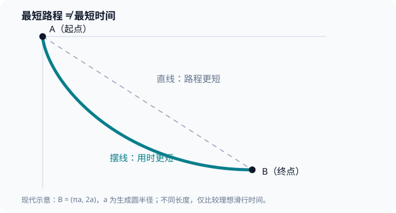

# 序章｜1696年的挑战书：最快的路，为什么不是最短的路？

1696年6月，一道题出现在德意志学术期刊《学术纪事》（Acta Eruditorum）上。

题目没有要求计算一条曲线的长度，也没有要求证明某个新定理。它只问了一件看似人人都懂的事：

在同一个竖直平面里，给定高处的 A 点和低处的 B 点。一个物体从 A 点静止出发，只在重力作用下沿着一条光滑轨道滑到 B 点。

**轨道应该是什么形状，才能让它最先抵达终点？**

按照日常经验，似乎没有什么悬念。两点之间，直线最短。

但出题人约翰·伯努利（Johann Bernoulli）知道，**距离最短，并不等于时间最短。**

他把这道题公开交给欧洲数学家，并给出应征期限。它很快牵动莱布尼茨、牛顿、雅各布·伯努利等人；1697年，相关解答陆续刊行。

问题的名称叫「最速降线」（brachistochrone）。

它真正考验的，是一门刚刚成形的新数学：微积分。

不过，在翻开这些人的解答之前，先别急着相信答案。我们不妨站在1696年的问题面前，自己做一次判断。

## 一、直线最短，为什么还可能输？

想象有两条轨道，起点、终点完全相同。

第一条是从 A 斜斜地直通 B 的直线。

第二条却很不规矩：刚离开 A 时，它几乎垂直向下，随后才逐渐弯向终点。

单论长度，第一条赢得毫无争议。任何绕行都比直线长。

但题目要比较的不是长度，而是**经过这段轨道需要多少秒**。

这两件事只有在一个前提下才等价：物体沿所有轨道都以同样的速度运动。

偏偏在重力作用下，这个前提不成立。

沿着倾斜程度较缓的直线，物体开始加速，却不能一下子获得很大的速度。沿着起初更陡的曲线，它虽然走了额外的路，却可以在最初一段迅速下落，提前获得速度优势。

接下来的路程，它便有可能以更高的速度通过。

这是一笔交易：

**多走一些路，换来更早获得的速度。**

然而，这笔交易并非永远划算。曲线如果绕得太远，增加的路程就会吞掉速度带来的好处。想赢，关键不是「尽量往下冲」，而是恰好找到最合适的弯曲方式。

问题由此变了性质。它不是从几条已经画好的轨道里挑出最快的一条，而是要在**所有允许的轨道形状之间**寻找最优者。

这比比较两个数困难得多。

因为候选答案不是一串数字，甚至不是一组直线。候选答案是无穷多条曲线。

## 二、一瞬间的速度，决定整段路的时间

这里先建立一个必要的物理模型。

我们把滑动物体理想化成没有大小的质点；轨道完全光滑，没有摩擦；空气阻力可以忽略；重力加速度 $g$ 保持不变；物体从静止开始，轨道在同一个竖直平面中。

这些条件不是现实世界的完整描述，而是为了使数学问题清楚、可解。它们也提醒我们：最速降线不是「所有真实滑梯都必须做成这个形状」的工程结论。

设物体从起点向下落了高度 $y$。根据现代能量关系，它失去的重力势能转成动能：

$$
mgy=\frac12 mv^2.
$$

于是有

$$
v=\sqrt{2gy}.
$$

请注意这个式子的意思。

物体在某处有多快，取决于它已经下降了多高，而不直接取决于它沿途到底走了多长的路。

**下降得越深，速度越大。**

这条关系与伽利略时代的落体运动研究有历史联系，但上面使用的是现代能量语言和现代记号，不能冒充1696年的原始证明。

接下来还有第二件事：路程。

假设轨道上的一小段长度是 $ds$，物体通过它的瞬时速度是 $v$，那么这一小段所花的时间，可以用现代微积分写成

$$
dt=\frac{ds}{v}.
$$

把沿途所有微小时间累积起来，便有

$$
T=\int_{\text{轨道}}\frac{ds}{\sqrt{2gy}}.
$$

这才是整道题的锋利之处。

曲线一改变，沿途的每一个微小长度 $ds$ 都可能改变；与此同时，各点的下降高度 $y$ 也会改变，所以速度分布也在改变。

我们要做的，不是把一个固定公式里的 $x$ 换成另一个数。

我们要改变**整个函数的形状**，让一个由无数微小部分组成的总时间达到最小。

在现代数学里，这类问题后来成为变分法的重要主题。

但是，如果你真的站在17世纪的数学世界，眼前还有更加根本的难题：

什么叫「无穷小的一段路」？怎样把它们相加？又凭什么认定某条曲线比所有别的曲线都快？

这些问题并不能靠画一张漂亮的图解决。

## 三、伯努利竟然去研究光线

约翰·伯努利的解答中，有一条尤其出人意料的思路。

他没有只盯着滑动的物体，而是把目光转向了**光**。

想象一束光从空气射入水中。

你熟悉的现象是，光线会在交界处改变方向，也就是折射。

如果把光在不同介质里的速度看作不同，那么它选择的传播路径便可以用「所需时间」来讨论。费马此前提出的最短时间原理，正为这种问题提供了思想工具。

为什么一条光线宁肯拐弯，也不笔直向前？

因为不同地方的传播速度不同。走得最短，未必走得最快。

这听起来是不是和我们的滑动物体几乎一样？

区别只在于，光穿过的介质具有不同传播速度；滑动物体则因为不断下降，在同一轨道上获得不同的运动速度。

伯努利把滑落过程想象成穿过许多水平薄层。先近似认为，每一层里的速度相对固定，路径是一小段直线；穿过层与层的边界时，这段直线可以发生转向。

一层、两层、十层、一百层……

层数越来越多，每层越来越薄，折线便趋向一条连续曲线。

这种方法把难以直接处理的滑落轨道，转成了一个与光线折射相似的问题。

伯努利并不是简单地把「光的定律」生搬硬套在力学上。他看见的是两种现象背后共通的数学目标：**在各个位置速度不同的条件下，使总旅行时间最小。**

这一思路最终导向了一条已经为17世纪几何学家熟悉的曲线。

它的名字是：**摆线**。

## 四、答案居然是一个轮子画出来的

摆线的产生方式非常朴素。

让一个圆轮沿着平直的地面滚动，轮子边缘有一个固定的标记点。圆轮滚动时，这个点描出的轨迹，就是摆线。

将它翻转过来，就得到从高处先陡降、再渐渐平缓的形状。

图中只展示一个精心选定的例子：两条轨道从同一 A 点出发，抵达同一 B 点。直线确实更短，倒置摆线却能让理想质点更早到达。图为现代数学示意，而非1696年的原始插图。

也许你会怀疑，所谓「摆线更快」，只是看图得到的直觉。

那就让数字来作证。

设圆轮半径为 $a$。取摆线从尖点出发到最低点的一段，其终点在水平方向前进了 $\pi a$、向下下降了 $2a$。

今天我们可以用参数 $\theta$ 表示这一段：

$$
x=a(\theta-\sin\theta),\qquad
y=a(1-\cos\theta),\qquad 0\leq\theta\leq\pi.
$$

这两条式子分别告诉我们：圆轮滚动一定角度后，标记点向右走多远、向下落多深。

沿这段曲线，极小的弧长是

$$
ds=2a\sin\left(\frac{\theta}{2}\right)d\theta,
$$

而速度可以写成

$$
v=2\sqrt{ga}\sin\left(\frac{\theta}{2}\right).
$$

将两者相除，时间竟然简化为

$$
dt=\sqrt{\frac ag}\,d\theta.
$$

也就是说，摆线的总滑落时间是

$$
T_{\text{摆线}}=\pi\sqrt{\frac ag}.
$$

再看直线。

它从 $(0,0)$ 直达 $(\pi a,2a)$，长度虽然是两点间最短的

$$
L=a\sqrt{\pi^2+4},
$$

但沿着这条固定倾角的轨道，重力在运动方向上的加速度只有一个固定的分量。按匀加速运动计算，直线用时为

$$
T_{\text{直线}}=\sqrt{\pi^2+4}\sqrt{\frac ag}.
$$

两者比较：

$$
\frac{T_{\text{摆线}}}{T_{\text{直线}}}
=\frac{\pi}{\sqrt{\pi^2+4}}
\approx 0.844.
$$

在这个特定的端点安排下，摆线的到达时间约比直线少 **15.6%**。

如果取 $a=1$ 米、$g=9.81$ 米每二次方秒，那么理想计算给出：直线约 **1.19 秒**，摆线约 **1.00 秒**。

短了将近五分之一秒。

不要低估这个结果。我们并没有改变起点、终点、重力，也没有给物体增加初速度。唯一改变的，就是轨道本身。

但还必须指出：**上面的计算只证明这条摆线在指定端点下比直线快，并没有证明它比一切可能的曲线都快。**

后一件事才是真正艰难的部分。

要从「赢了直线」走到「战胜所有候选曲线」，需要更强的数学论证。我们会在第17章重返1696年的挑战，真正解释这场胜利为什么成立。

## 五、面对挑战的，不只是一位天才

回看历史，更有意思的不是谁第一个报出了「摆线」这个名字，而是为什么这么多人能够用不同思路走向相近的结论。

1696年6月，约翰·伯努利把问题公开发表；应征期限随后有所延长。1697年，围绕这一问题的解答和讨论见诸学术期刊。

莱布尼茨、牛顿、雅各布·伯努利、洛必达等人都参与了求解。不同史料统计参与者时，会因是否计入提交稿、公开发表稿、重印稿和后世整理稿而出现差异；因此，简单罗列一个「五人」或「六人」的名单，未必能准确交代当年的出版经过。

牛顿留下的解法曾匿名发表。后世常用一些非常传奇的细节讲述这一事件，但在这里，真正重要的是可以核验的东西：**问题的公开日期、解答的发表记录、不同研究者采用的方法。**

尤其不能漏掉雅各布·伯努利。

约翰利用光线折射的类比寻找轨道；雅各布的研究则更接近于直接比较一条曲线与附近其他曲线的变化。两条路线共同推动了一个更普遍的问题：

假如我们想优化的对象不是一段路程，而是**整条曲线**，究竟该怎样计算？

这也解释了为什么最速降线问题在变分法历史中具有特殊地位。

微积分已经让数学家学会计算变化率、累积面积；而最速降线迫使他们进一步追问：

一个由积分表达的总量，怎样随着函数本身的改变而变化？

这个问题日后会引向欧拉和拉格朗日。

所以，这场挑战既展示了微积分的威力，也暴露了它还需要继续成长。

## 六、在1696年之前，人类已经追问了两千年

讲到这里，我们似乎已经知道故事的答案：

曲线可以比直线更快；微积分能够把总时间写成数学表达式；最好的曲线有时会是摆线。

但本书真正想追问的，还不是这个。

回到一开始的那个积分：

$$
T=\int_{\text{轨道}}\frac{ds}{v}.
$$

它看上去不过是一个符号，却把几乎整部微积分史装在里面。

要理解它，首先要懂得「一瞬间」的速度是什么。

要计算它，又必须知道如何把一段连续路径分成越来越小的部分，再把这些部分重新累积成一个完整的量。

要证明计算可靠，还必须解释为什么无限分割不会让逻辑崩塌。

今天，我们习惯直接写下微分、积分和极限，仿佛这些概念一直在那里，等待数学家拿来使用。

但在1696年之前，它们经历了漫长而曲折的形成过程。古希腊的运动悖论、穷竭法、阿基米德的几何求积，中国的割圆术，印度的无穷级数研究，以及17世纪的代数与运动学，都在各自的历史背景下回应过这场知识难题的某个部分。

这些成果之间既存在传承，也存在独立探索。把它们看成一条必然汇入牛顿书桌的直线，同样是一种不可靠的历史想象。

真正的问题是：

**人类究竟从什么时候开始相信：把一件事无限地切分，最后还能得到一个确定、可靠的答案？**

要回答它，我们必须把时间拨回微积分出现之前两千多年。

那里有一个人提出了非常尖锐的质疑：

假如走完一段路之前，必须先走完它的一半；走完这一半之前，又必须先走完这一半的一半……

那么，一个人究竟怎么可能真正到达终点？

提出这一挑战的人，叫芝诺。

而这，才是微积分故事真正的第一章。

---

## 参考资料与史实说明

1. Philippe Henry 与 Gerhard Wanner，*Johann Bernoulli and the cycloid: A theorem for posterity*，《Elemente der Mathematik》72（2017），137–163，尤其第147页关于1696年问题原文、应征与1697年解答；DOI：[10.4171/EM/338](https://doi.org/10.4171/EM/338)。
2. MacTutor History of Mathematics，[*The brachistochrone problem*](https://mathshistory.st-andrews.ac.uk/HistTopics/Brachistochrone/)，关于挑战、光学类比、公开解答和后续变分法研究。
3. Eric W. Weisstein，[*Brachistochrone Problem*](https://mathworld.wolfram.com/BrachistochroneProblem.html)，Wolfram MathWorld，关于理想模型、摆线与数学历史。
4. Gilbert Strang，*Calculus*，第三版，第12章「Motion along a Curve」中摆线与最快下降时间的例题；[MIT OpenCourseWare 教材](https://ocw.mit.edu/courses/res-18-001-calculus-fall-2023/mitres_18_001_f17_full_book.pdf)，原书印刷页约527—529。本文示例计算采用现代推导，**不是**伯努利原稿的逐字转写。

**阅读边界**：本文出现的 $v=\sqrt{2gy}$、时间积分、摆线参数方程，以及具体的1.00秒与1.19秒，均属于现代数学与理想力学的解释。文中没有虚构历史人物的对话或私人心理，也没有把比较直线所得到的数值优势冒充对全部曲线的最优性证明。