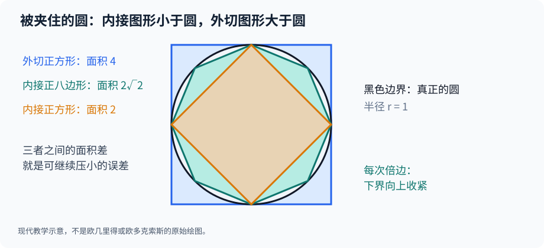

# 第一部·第二章｜欧多克索斯：不谈无穷小，怎样证明曲线面积？

有一件事，芝诺没有做错。

他让我们把一米长的路分成一半、再分一半、继续分一半，然后问：**无限次分割之后，到底还剩下什么？**

上一章，我们用现代极限回答了运动的困惑。但古希腊数学家遇到的另一个问题，可能更加棘手。

给你一个圆。

你知道怎样求一个正方形的面积，也会计算三角形的面积。可是，圆的边界偏偏不是直线。

于是你想到一个办法：在圆里面放入一个正方形。还嫌缺角太多？改成八边形、十六边形、三十二边形。

随着边数增加，多边形的边缘越来越贴近圆。

直到这里，一切都很自然。

可当有人问你「圆的面积**恰好**是多少」时，问题突然变了：

**你凭什么知道，继续增加边数，就一定能得到一个精确的结论？**

「很接近」是一种视觉印象。

「必然等于」则需要证明。

而这一跃，正是与欧多克索斯有关的古希腊数学传统留给后世的一份重要遗产。

## 一、最先被击败的，是「看上去差不多」

先从一个半径为1的圆开始。

在圆中画一个内接正方形。正方形的两条对角线都是圆的直径，长度为2；因此，它的面积是

$$
A_4=\frac{2\times 2}{2}=2.
$$

再画一个恰好包住整个圆的外切正方形。它的边长是2，面积为

$$
B_4=4.
$$

你于是获得一条完全确定的结论：

$$
2<S_{\text{圆}}<4.
$$

这里的 $S_{\text{圆}}$ 是圆的面积。这条不等式不需要知道圆周率的十位小数，它只依赖圆在两个正方形之间的位置。

可是，2到4之间实在差得太远。

我们继续：把正方形每一条边对应的圆弧一分为二，构造内接正八边形；同样可以构造外切正八边形。

内接多边形变大了，外切多边形变小了。

换言之，圆被夹在一个**不断上升的下界**和一个**不断下降的上界**之间。

*图示为现代绘制的数学模型，不是欧多克索斯的原作。外边形、圆周、内接多边形之间的区域，直观显示了误差所在的位置。*

这种方法强在哪里？

假设有两个人争论：甲认为圆的面积是3.12，乙认为是3.25。

他们都不能只凭肉眼裁决。

但如果你能构造出一对多边形，让圆的面积夹在3.13与3.15之间，那么就可以排除3.12和3.25。

这不是拿一张图说服对方。

而是用可以检查的几何关系，**排除不可能的答案**。

然而，问题还没解决。

哪怕你已经把上下界缩小到百万分之一，也只是足够精确的估计。

古希腊数学家想追求的，是不依赖某一次具体计算的证明：

**对于任意小的误差要求，我们总能经过有限步骤，把误差压到这个要求以下。**

## 二、欧多克索斯：我们知道他的成果，却几乎听不到他的原声

欧多克索斯（Eudoxus of Cnidus）通常被放在公元前四世纪的希腊数学史中。

传世史料将他与数学、天文学以及比例理论联系起来。后来的注释传统尤其把《几何原本》卷五的一般比例理论归功于他，而古希腊几何中称作「穷竭法」的论证体系，也通常与他的贡献相联系。[1][2]

但是，必须在故事开始前说一句扫兴的话：

**我们没有一份保存完好的欧多克索斯《穷竭法讲义》。**

今天熟悉的完整证明，主要来自比他稍晚的欧几里得《几何原本》，以及阿基米德等人的著作。

所以，当我们说「欧多克索斯解决了什么问题」时，应当理解为：根据古代归属和后世保留下来的数学文本，重建这项研究的历史地位。

不能凭空想象某一天，他走进一间教室，画下一个圆，向学生宣布「我找到了极限」。

那样的课堂未见可靠史料记载。

而且，当时的人也没有今天的「极限」这个完整概念。

这门数学的真正突破，不是给一个新符号取了名字，而是建立了**不依赖无理数必须写成分数的比例语言**。

## 三、一条对角线，击碎了旧式比例

先看一件比圆面积更早暴露的问题。

一个边长为1的正方形，其对角线长度是多少？

按勾股关系，它的长度满足

$$
d^2=1^2+1^2=2.
$$

在现代记号中，就是

$$
d=\sqrt2.
$$

可是，$\sqrt2$ 不能表示为两个整数的比值。

这意味着什么？

如果一种比例理论只允许「拿一段共同的小尺子，刚好量尽两个长度」，那么正方形边长和对角线就会对这套理论制造困难。

你当然可以比较两者大小。

但是怎样在不先假定它们能被同一个长度整除的情况下，定义「这两组长度拥有相同的比例」？

欧几里得《几何原本》卷五给出了一种格外强大的回答。它的第五个定义，以**所有整数倍的大小比较**为基础。[3]

这段古典定义可以用现代语言简要解释为：

假设要比较 $a:b$ 和 $c:d$，其中 $a,b$ 是同类量，$c,d$ 也是同类量。

我们不用把每个比例都化成分数，而是任意取正整数 $m,n$，检查

$$
ma\quad\text{与}\quad nb
$$

之间的大小关系。

如果对所有这样的整数 $m,n$，另一组

$$
mc\quad\text{与}\quad nd
$$

都呈现相同的大小关系——大于、等于、小于分别对应——那么就认为两个比例相等。

这听起来比小学里的「交叉相乘」麻烦得多。

可它非常重要，因为这套定义允许比较**不通约的几何量**。

你不需要找到一段能够同时整除正方形边和对角线的小尺子。

只要比较任意整数倍的大小关系，比例就能被严格处理。

不过，这也有一个时代边界：卷五定义是欧几里得书中的传世文本，将其归于欧多克索斯是有依据的史学判断，**不是我们手里握着欧多克索斯的亲笔原稿**。[1][2][3]

这一理论为下一步扫清了障碍。

因为想计算圆的面积，迟早需要比较两种不容易由有理数简单表达的几何大小。

## 四、把「无穷次」改写成「只要足够多次」

真正精彩的部分来了。

假设你手里有一块面积为 $R_0$ 的剩余区域。

第一次切去其中至少一半，剩余面积便不超过

$$
R_1\leq\frac{R_0}{2}.
$$

第二次继续从余量中切去至少一半：

$$
R_2\leq\frac{R_0}{4}.
$$

第 $n$ 次之后：

$$
R_n\leq\frac{R_0}{2^n}.
$$

这是一种现代记号的表达。古希腊原文没有写 $R_n$ 或 $2^{-n}$。

但所表达的几何性质，清楚保留在《几何原本》卷十命题1中：

从较大的量中反复移去多于其一半的部分，继续操作足够多次，最终剩余会小于**任意预先给定的较小正量**。这一定理也明确允许每次恰好取走一半的情况。[4]

注意，这里发生了一次关键转换。

芝诺困惑的是：如果总还能再分一半，为什么可以说已经到达？

而穷竭思路选择另一种问法：

**你想要的误差有多小？我不需要真的完成无限次操作，只需要证明能用有限次数满足它。**

比如，原来的误差不超过1平方米。

你要求误差小于百分之一平方米。

那么只要经过7次对半压缩，因为

$$
\frac1{2^7}=\frac1{128}<0.01,
$$

就足够了。

如果要求误差小于百万分之一平方米，那么20次就足够，因为

$$
\frac1{2^{20}}<10^{-6}.
$$

数字越严格，所需次数可能越多。

但对每一个预先给出的正误差，都存在**某一个有限次数**。

这是逻辑上的保证，而不是视觉上的许愿。

甚至更重要：如果我们要证明一个量恰好等于某个候选值，往往不需要知道它们相差多少。

只需假设它们不相等，然后把这段正差额当作需要压过的门槛。

## 五、圆的面积，可以通过「反证」被锁定

《几何原本》卷十二命题2，给出了一个非常漂亮的例子：

**两个圆的面积之比，等于它们直径平方之比。**[5]

请注意原定理的准确形式。

它谈的是**两个圆的面积关系**。

如果今天把它改写成 $S=\pi r^2$，这有助于理解，但那是使用现代圆周率符号的回译，不能说欧几里得原文已经写下我们的公式。

这项证明的逻辑大致如下。

设两个圆分别为圆甲和圆乙。

你希望证明：

$$
\frac{S_\text{甲}}{S_\text{乙}}
=\frac{d_\text{甲}^2}{d_\text{乙}^2}.
$$

先不直接证明它，而是假定有一个面积值 $S'$，按照直径平方的比例配出的「对应面积」，却比圆乙的实际面积小。

这就产生了一个正差额：

$$
\Delta=S_\text{乙}-S'>0.
$$

现在，在圆乙内画正方形，再不断将圆弧对半分，得到越来越精细的内接多边形。

利用几何关系，可以使圆乙与该多边形之间剩下的面积，小于事先给定的 $\Delta$。

于是，这个内接多边形的面积就会大于 $S'$。

但是，我们还可以在圆甲里构造一个与之相似的内接多边形。相似多边形的面积之比，已经能由直径平方之比控制。

将比例关系与「内接多边形的面积总小于所在圆的面积」放在一起，就会与最初对 $S'$ 的假设冲突。

另一种假设——配出的面积比圆乙真正面积更大——同样可以通过交换两圆的角色加以排除。

所以，候选比例没有空间向上或向下偏移，只能与两圆真实面积的比例一致。

这就是穷竭法最动人的地方：

**不需要真的画出一个具有无穷条边的多边形，却能够严格否定任何非零面积误差。**

当然，这里呈现的是定理的论证主线，而不是逐行转抄欧几里得的古典证明。完整证明还需要遵循古代比例理论和相似图形的相关命题。[5]

## 六、现代数学能把图像算得更清楚，但不是古人的原话

现在做一个帮助理解的小实验。

仍然取半径为1的圆。

在现代三角函数语言下，内接正 $n$ 边形的面积可以写成

$$
A_n=\frac n2\sin\left(\frac{2\pi}{n}\right).
$$

将每个内接三角形拆开，它的底角与圆心角之间的关系便能推导出这个式子。

对 $n=4$，有 $A_4=2$；对 $n=8$，有

$$
A_8=2\sqrt2\approx2.8284.
$$

对 $n=16$，近似得到

$$
A_{16}\approx3.0615.
$$

对 $n=32$，近似得到

$$
A_{32}\approx3.1214.
$$

圆的面积当然是我们今天熟悉的 $\pi\approx3.14159$。

从2到2.8284，再到3.0615、3.1214，内接多边形的面积一步步逼近它。

若同时做外切正多边形，还能给面积设置从上方逼近的边界。

但这张表只能用来**展示趋近**。

它无法单凭几行小数证明，当边数不断增加时一定会发生什么。

严格证明必须补上一条保证：误差可以小于任意事先指定的正面积。

古希腊方法的价值，正在于不是只留下数值表，而是在几何范围内研究这种保证。

我们应该把现代公式与古典证明分开理解：前者使读者看得见数值，后者告诉读者**为什么这个方向不是碰运气**。

## 七、这不是今天的极限，但它触碰了极限的逻辑核心

如果你学过一点微积分，可能会马上联想到：

$$
\lim_{n\to\infty}A_n=\pi.
$$

这样的表达非常方便。

但如果历史叙述写成「公元前四世纪，欧多克索斯发明了极限」，就会把两千多年后才逐渐系统化的概念硬塞进古人的嘴里。

古典穷竭法并不是完整的现代分析体系。

它没有用现代实数完备性去统一地证明各种数列必定收敛，没有普遍的积分算子，更没有一套适用于任意函数的导数法则。

它解决的是有明确几何结构的一类证明。

但它确实做到了一个极其难得的事情：

把「无限切分」的危险，转换为「有限步骤控制任意误差」的可靠推理。

前者让人恐惧：好像要走过无限多段，才能做成任何事。

后者则告诉你：每一次论证只需要面对一个明确的误差标准，然后用有限的几何构造赢得胜利。

这两种思维面对的是同一种无限，却得到了完全不同的结果。

**无限不必被当作一串永远做不完的任务；它也可以成为证明精确答案的工具。**

## 八、可是，知道方法不等于知道所有面积

到这里，我们已经有了方法：用简单图形逼近复杂图形，控制剩余，再通过反证证明答案唯一。

看上去，古希腊数学家似乎从此可以计算所有曲线围成的面积。

事情远没有那么简单。

圆有很强的对称性。你可以画出一组组相似的内接多边形，让每个角度的改变都有规律。

但如果图形不是圆呢？

如果你面对的是一条**抛物线**与一根直线弦围出的弯月形区域呢？

你可以在里面放一个三角形。

然后呢？

三角形外侧还留有两片区域。

再放两个更小的三角形，还有四片。

继续放，更多缺口还在。

这时，控制余量已经不仅是「继续切小」那么简单。

你还必须准确知道：

**新增加的那一批小三角形，和上一批到底有怎样的面积比例？**

如果不知道这一点，你仍然不能给出一个精确的总面积。

大约再过一个世纪，生活在叙拉古的阿基米德，会在一部专门的著作中，将这个问题推进到极具说服力的程度。

他给出的答案非常出人意料。

一块弯曲的抛物线区域，竟然恰好等于其中某个三角形面积的——

**三分之四。**

下一章，我们就去看这多出来的三分之一，究竟藏在什么地方。

---

## 参考资料与核证范围

1. [MacTutor｜Eudoxus of Cnidus](https://mathshistory.st-andrews.ac.uk/Biographies/Eudoxus/)；关于生平、比例理论与穷竭法的传统归属。
2. [Cambridge University Press｜Concepts in Greek Mathematics](https://www.cambridge.org/core/books/conceptualising-concepts-in-greek-philosophy/concepts-in-greek-mathematics/DC34401AA94103E01D51253EACB2C92D)；关于古代注释如何将《几何原本》卷五归于欧多克索斯。
3. 欧几里得《几何原本》卷五定义4—5，[Book V（Heath英译）](https://geometor.github.io/euclid/heath/V/index.html)。
4. 欧几里得《几何原本》卷十命题1，[X.1](https://www.euclids-elements.org/elements/books/bookX/propositions/propX1/)；关于去除至少一半后，余量小于任意预先给定的较小量。
5. 欧几里得《几何原本》卷十二命题2，[XII.2](https://www.euclids-elements.org/elements/books/bookXII/propositions/propXII2/)；关于圆面积之比与直径平方之比的几何反证。

**史实说明**：欧多克索斯的亲笔著作并未提供完整的现存穷竭法文本；本文叙事以古代归属、欧几里得传世证明和现代研究共同重建。公式 $A_n=\tfrac n2\sin(2\pi/n)$、无穷符号与误差字母均属现代数学回译，不是古希腊原文。