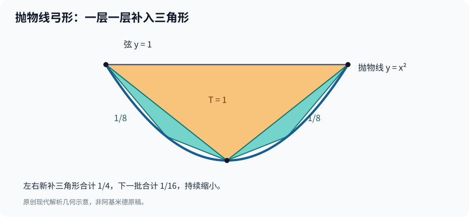

# 第一部·第三章｜阿基米德：无限个小三角形能给出精确答案？

你面前有一块奇怪的土地。

它的下边是一条笔直的线，上边却被一段抛物线围住。

如果边界全是直线，你会用三角形和长方形拼出面积。可是，抛物线偏偏弯着。

这块土地究竟有多大？

你可以拿一把足够细的尺子，画出一个近似图形，得出一个小数。

但在古代数学家眼中，那个小数不是最后的答案。

因为别人可以追问：

**你的图形边缘还有缝隙。那一丝没有覆盖的面积，凭什么可以不算？**

更棘手的是，越想把缝隙补齐，就需要越多的细碎图形。

一个三角形不够，补上两个；两个还不够，再补上四个。

数目越变越多。

芝诺当年让「无穷多个步骤」成了运动的难题。如今，阿基米德却要反过来做一件惊人的事：

**利用不断增加的三角形，把无穷的难题变成一个确定的面积。**

而这个面积，有一个出人意料的答案：

$$
S=\frac43\,T.
$$

这里的 $T$ 不是时间，而是某个恰好嵌入抛物线弓形的三角形面积。

**弯曲的区域，竟然只比那块直边三角形大三分之一。**

为什么？

## 一、阿基米德要解决的，不是圆

大约公元前三世纪，阿基米德生活和研究于西西里岛的叙拉古。他留下了多部关于几何、力学以及求积的著作。

其中一部叫《抛物线求积》（*Quadrature of the Parabola*）。

所谓「求积」，在古希腊几何的语境中，是要证明一块由曲线围成的区域，与某个直线图形具有确定的面积关系。

在该著作的前言中，阿基米德以书信形式向多西修斯（Dositheus）介绍这项结果。他提到已故的几何学家科农，并说自己**先借助力学发现**有关结论，后来又**以几何方法加以证明**。[1]

这段话的价值不在于描绘一个天才突然灵光一闪。

它让我们看见，古代数学研究里其实有两件不同的工作：

一件是找到答案可能是什么。

另一件是让答案经得起严格的证明。

力学直觉可以帮助发现关系，但在当时的几何证明标准下，它未必就能代替完整论证。

现代史学研究进一步比较了《抛物线求积》中不同部分的论证方式，指出书中力学性质的论证与几何性质的论证，甚至具有不同的表达风格。[2]

所以，不要把阿基米德的数学说成「在沙滩上随手画几个图，就得出了微积分」。

真正值得讲的，是他怎样一步一步把猜测变成必须成立的结论。

## 二、先把一块曲面，装进一个三角形

想象一条抛物线与一条直线相交于两个点。

两点之间的那段直线叫弦。弦与抛物线之间封住的区域，就是我们要研究的**抛物线弓形**。

在弧线上找到一个特殊点：该点的切线方向与弦平行。

把这个点与弦的两个端点连起来，会得到一个内接三角形。

这就是整个求积过程的起点。

*蓝色曲线、最初的三角形和左右两侧补入的小三角形构成现代示意。严谨的古典证明还需要抛物线的几何性质；图形本身并不是证明。*

这个三角形有多大？

我们暂时不需要知道它的具体数值，只把其面积称为 $T$。

现在观察：三角形之外，抛物线与两条斜边之间还有两个小小的弯曲区域。

很自然，我们可以在这两个区域里，再各放入一个三角形。

补完之后，仍有更小的弯曲区域。

继续补。

你会得到一棵越来越细密的「三角形树」。

但如果只有「可以一直补」这件事，阿基米德其实没有比芝诺更进一步。

要真正得到答案，必须发现那些新补进去的三角形遵循**什么精确比例**。

## 三、整场证明的机关：每一批都是上一批的四分之一

《抛物线求积》的关键几何结构是这样的。

从最初的弓形中取最大的内接三角形，面积为 $T$。

在它的两侧形成的两个子弓形中，各取一个符合相同构造条件的内接三角形。

这两个小三角形的面积加起来，恰好是原来三角形面积的四分之一：

$$
T_1=\frac{T}{4}.
$$

接着，在新出现的四个更小的子弓形中分别放入三角形。

这一批四个三角形的面积之和，又是上一批总面积的四分之一：

$$
T_2=\frac{T}{16}.
$$

再往后：

$$
T_3=\frac{T}{64}.
$$

更一般地说，第 $k$ 批新增三角形的面积总和是

$$
T_k=\frac{T}{4^k}.
$$

这里的 $k$ 从0开始，第一批 $T_0=T$。这些下标和分数式，是为了帮助现代读者而采用的代数记号，不是阿基米德原稿里的符号。

为什么「四分之一」特别关键？

因为如果每一批缩小得足够快，那么数量越来越多，面积总和却不一定越来越大到无法控制。

有必要强调一个常见误读：

**不是说每一个新增的小三角形都等于最初三角形的四分之一。**

而是说：**同一批新加入的所有三角形，面积加起来等于上一批总面积的四分之一。**

这项关系不是看图猜的。它依赖抛物线的几何性质以及两条切线、弦与中点之间的关系。现代读者可以在数学史研究中核查这一构造，《抛物线求积》最终的命题24也是基于这种递推与穷竭论证。[3]

一旦掌握了比例关系，下一步就变成了算术。

## 四、藏在弓形里的三分之一

先把所有已经画出的三角形面积加起来。

第一批是 $T$。

第二批是 $T/4$。

第三批是 $T/16$。

第四批是 $T/64$。

因此，如果一共取前 $n$ 批，得到的多边形面积就是

$$
S_n=T\left(1+\frac14+\frac1{16}+\cdots+\frac1{4^{n-1}}\right).
$$

这是一道现代中学数学的等比数列题。

把公比记作 $q=1/4$，有限和为

$$
S_n=T\frac{1-q^n}{1-q}
=\frac43T\left(1-\frac1{4^n}\right).
$$

这条式子已经告诉我们很多事。

第一批：

$$
S_1=T.
$$

第二批：

$$
S_2=T+\frac T4=\frac54T.
$$

第三批：

$$
S_3=\frac54T+\frac T{16}=\frac{21}{16}T.
$$

第四批：

$$
S_4=\frac{85}{64}T.
$$

看看它们与 $4T/3$ 的距离：

第一批还差 $T/3$。

第二批还差 $T/12$。

第三批还差 $T/48$。

每补一批，这个与候选答案的差额就缩小为原来的四分之一。

如果只求一个数学模型中的极限，可以写成

$$
\lim_{n\to\infty} S_n=\frac43T.
$$

这就是说：

$$
T+\frac T4+\frac T{16}+\cdots=\frac43T.
$$

于是那「多出来的三分之一」，并不是藏在某块神秘的最后一个小三角形里。

它分布在所有后续的三角形中：

$$
\frac T4+\frac T{16}+\frac T{64}+\cdots=\frac T3.
$$

**无穷多批三角形，构成的额外面积只有最初三角形的三分之一。**

这个结论，恰恰是对芝诺困惑的一次反向应用。

## 五、但请等等：这还不是完整证明

如果你以为只要写下

$$
T+\frac T4+\frac T{16}+\cdots=\frac43T
$$

就能宣布抛物线弓形的面积恰好为 $4T/3$，那么你犯了一个古代几何学家尤其警惕的错误。

**你只算出了所有已选三角形组成的无限级数，却还没有证明这些三角形真的穷尽了整个弓形。**

想象一下：即使你不停地向地上铺地砖，总面积的级数很容易计算，也不意味着地面的所有角落一定都被铺到了。

阿基米德需要补上两类事实。

第一，新增三角形始终落在弓形内部，各批之间不会重复覆盖面积；所以所有有限批次的面积之和都不超过真正弓形面积 $S$。

第二，剩余的弓形缺口可以被几何上可控的区域限制住。反复构造后，残余面积能够小于任意事先指定的正面积。

有了这条穷竭性质，才可以完成真正的反证。

假设弓形真实面积比 $4T/3$ 大，差额为某个正数 $\delta$。

由于内接多边形能够逼近真实弓形面积，我们可以选择足够多批次，使弓形外的剩余缺口小于 $\delta$。

那时内接三角形的总面积，就必须大于 $4T/3$。

可刚才的有限和明确告诉我们：

$$
S_n=\frac43T\left(1-\frac1{4^n}\right)<\frac43T.
$$

矛盾。

再假设弓形真实面积小于 $4T/3$。

那么，随着 $n$ 增大，有限和 $S_n$ 可以越来越接近 $4T/3$，最终必然超过这个假设的真实面积。

但是 $S_n$ 是弓形内部的多边形面积，不能超过弓形本身。

还是矛盾。

两个方向都被排除。

因此只剩下：

$$
\boxed{S=\frac43T}.
$$

这就是《抛物线求积》所呈现的几何证明精神：利用**有限构造**与**剩余量可以被任意压小**，使候选面积无法偏大、也无法偏小。[3]

它绝不是「先假设无穷多个三角形已经被全部画完，再直接读出结果」。

## 六、让现代公式做一次独立验算

为了看清楚面积之间的比例，我们选择一个具体的抛物线弓形。

取抛物线

$$
y=x^2
$$

以及水平直线

$$
y=1.
$$

这条直线与抛物线相交于 $(-1,1)$ 与 $(1,1)$。

两个交点之间的弦长为2。

抛物线最低点在 $(0,0)$，该点的切线水平，与上面的弦平行。

因此，最初的内接三角形底边长2，高为1，面积就是

$$
T=\frac12\times2\times1=1.
$$

依照阿基米德的结论，这个弓形的面积应该是

$$
S=\frac43.
$$

今天我们可以直接使用定积分进行核算：

$$
S=\int_{-1}^{1}(1-x^2)\,dx.
$$

计算得：

$$
S=\left[x-\frac{x^3}{3}\right]_{-1}^1
=\frac43.
$$

两个答案完全一致。

但请注意时代顺序。

上面的积分不是阿基米德的原始推导。它是微积分诞生两千年后，我们利用新语言对古典结论作出的验算。

如果把这个积分反过来当成阿基米德的工作步骤，会抹去他真正的困难：他当时不能调用一本已经写好的微积分教科书。

他必须在古典几何的规则内，找到一个既**可构造**又**可证明**的方法。

## 七、机械直觉与严格几何，为什么要走两遍？

阿基米德《抛物线求积》的前言值得再次回看。

他先说用力学方法发现结果，再说以几何方式展示证明。[1]

这不是两套互相敌对的方法。

更准确地讲，它们承担不同任务。

力学中的平衡、杠杆等关系，可以给出一条令人惊讶的发现路线：让复杂形状与已经理解的几何大小建立关系。

可是，如果你想宣称一块曲面与一个三角形严格成比例，就必须能够在公认的几何原则下排除反例。

有时候，数学家会先看见方向，再艰难地建立桥梁。

阿基米德在这里体现了这种区别。

更重要的是，他并非凭空创造所有证明资源。

前一章讲到的比例理论、用多边形逼近曲线、通过反证控制正差额，都已经是古希腊数学传统的重要组成部分。

阿基米德把这些资源用在了一个更难的对象上。

我们因此可以说，他使穷竭思想在一项具体求积问题中达到了令人惊讶的精度。

却不能说，他在公元前三世纪就已经建立了求导积分互逆、完整函数概念、现代实数体系的微积分。

**思想上的先声，不等于技术上的完全等同。**

## 八、阿基米德不只是给了一个答案，还留下了一个问题

现在，我们知道了怎样计算一块抛物线弓形的精确面积。

但为什么下一章不继续讲更多希腊数学家，而要把镜头转向中国？

因为当我们从后世回看数学史时，很容易产生一种错觉：

好像所有足够成熟的求积思想都必须沿着一条单线传承，最后汇聚到牛顿和莱布尼茨。

事实不是这样。

古代中国数学也长期面对土地测量、圆的面积、体积等实际问题。

它既有自身的计算传统，也发展出利用图形分割、转换和不断逼近来解释面积的方法。

我们当然可以比较不同文明的数学思想。

但**相似**不自动意味着某项成果已经**直接传播**给另一个文明。

真正值得研究的是：当数学家面对共同的几何障碍时，不同的符号、工具与证明风格，能够走出怎样不同的道路？

中国古代数学中有一位研究者，曾对一个看似习以为常的比例提出质疑。

古人说：圆周长是直径的三倍。

可是，如果真是这样，为什么把一个六边形画进圆里，它的周长恰好已经是直径的三倍？

那圆周本身，岂不是还要更长一点？

这位数学家，叫**刘徽**。

他要做的，不只是把圆周率的小数多算几位。

而是追问：

**当一条直边不断被割成更多的边，圆和多边形之间的差额，究竟如何消失？**

---

## 参考资料与史实说明

1. 阿基米德《抛物线求积》致多西修斯序言；T. L. Heath 编译，[*The Works of Archimedes: Quadrature of the Parabola*](https://www.cambridge.org/core/books/abs/works-of-archimedes/quadrature-of-the-parabola/5A7B236D7719D853D995A55931E1A1BC)，原编译1897年，后重印。
2. Nicholas L. Winters，[*Method and Style in Archimedes' Quadrature of the Parabola*](https://link.springer.com/article/10.1007/s00407-025-00352-w)，*Archive for History of Exact Sciences* 79（2025）。
3. Andrew Leahy，[*Archimedes' Quadrature of the Parabola*](https://old.maa.org/press/periodicals/convergence/a-translation-of-evangelista-torricellis-quadratura-parabolae-archimedes-quadrature-of-the-parabola)，MAA Convergence；包含对命题24及三角形求积的现代介绍。

**数学核证范围**：本章选择 $y=x^2$ 和 $y=1$ 的模型，以现代级数与定积分验证弓形面积为 $4/3$。这不是希腊原文公式的直接复写。古典证明使用几何性质、穷竭法与反证，不可缩减为「无限多项一相加就等于曲面」。