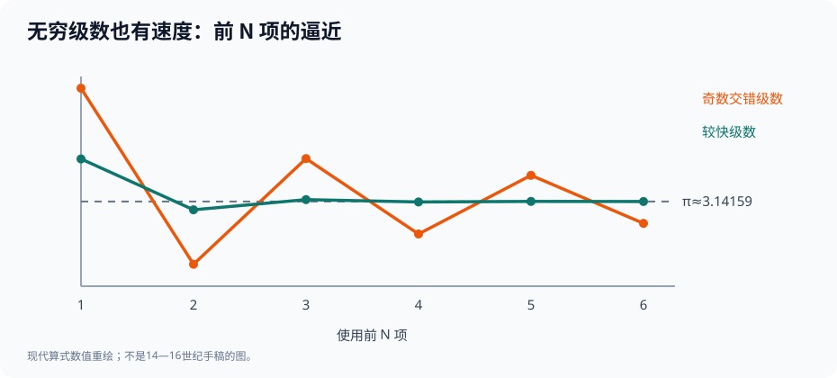

# 第一部·第五章｜马达瓦与喀拉拉：当无穷不再只是一个难题

一个圆，可以被切成六边形、十二边形、二十四边形。

再切下去，边数越来越多，刘徽告诉我们：只要控制好缺口，圆的面积与周长就能被算得越来越准。

但也有代价。

每增加一轮边数，计算都会变得更复杂。你需要求新的弦长、开方、计算面积，再判断数字是否足够精确。

如果目标不是三位小数，而是十位呢？

更进一步，假设要计算的不是圆，而是天体运行时不断改变的角度，以及与角度有关的正弦值。

难道每次都要重新画上一大堆图？

我们现在所熟悉的一个答案是：**把复杂函数改写成一串可以逐项计算的数。**

例如：

$$
\frac{\pi}{4}=1-\frac13+\frac15-\frac17+\frac19-\cdots
$$

这条无穷级数看起来十分奇怪。右边完全没有圆，只有奇数分母与交替出现的加减号。

可它的总和，却恰好与圆周率相关。

更有历史意味的是，这类结果并非只有17世纪欧洲数学家才曾研究。

**约14—16世纪，在印度西南部的喀拉拉地区，一条数学与天文学传统已经发展出了关于圆周率、正弦、余弦与反正切的无穷级数方法。**

故事的中心人物，叫马达瓦。

不过，要讲清他究竟做了什么，我们得先解决一个比公式还难的问题：

**当一位数学家的关键原作已经失传，我们凭什么把某个结果归于他？**

## 一、为什么这里的数学问题从天文学开始？

喀拉拉地区的数学家不仅研究数字与图形，也长期从事天文历算。

在天文学中，知道圆周率当然有用，但这并不是全部。

你还需要把天体位置表示为角度，计算与角度有关的弧、弦及三角量，再用这些量校正模型与观测之间的差异。

这样的工作不允许你每次都只回答「大概差不多」。

少量误差经过长期积累，可能变成明显的方位偏差。于是，一个反复出现的需求摆在研究者面前：

**怎样把同一个计算过程变得既有规律，又能不断提高精度？**

从这个角度来看，喀拉拉的级数研究并不是凭空冒出来的一场抽象竞赛。

它植根于印度数学和天文学的本土传统，有自己的文本、计算术语、教学传承和问题需求。[1][2]

马达瓦（Mādhava of Saṅgamagrāma）大约生活在1340—1420年前后，不同研究使用的终年略有差异。后世研究把他视为喀拉拉学派的重要开端。

可他的生平不是一部情节完备的传记。

我们并不知道他第一次发现这些级数时具体身在何处、对谁说了什么，更没有可信依据去写一场「午夜灵感」的戏剧。

真正能让我们靠近这段历史的，是**比他更晚的数学文本**。

## 二、马达瓦的公式，为什么常常出现在别人的书里？

这也是本章首先必须说明的史实边界。

研究者发现：马达瓦流传下来的部分天文著作仍可辨认，但包含这些著名数学级数的原始手稿，并没有完整保存至今。

许多成果是由后来的学者——包括尼拉坎塔（Nīlakaṇṭha）、杰什塔德瓦（Jyeṣṭhadeva）和商羯罗·瓦里亚尔（Śaṅkara Vāriyar）等人的著作——明确追溯到马达瓦的。[1][2]

特别值得注意的是，杰什塔德瓦于16世纪用马拉雅拉姆语写成的《Yuktibhāṣā》，不仅传递公式，还给出了详细的论证思路。

「后世记录」不等于「虚构归属」。

但它要求我们分清三个层次：

一项数学结果在后来的可靠著作中被归于马达瓦。

后来作者给出了结果的证明或解释。

我们是否知道马达瓦本人使用的恰好就是这一份证明？

前两者有传世文本和专业研究可以支持；第三者未必。

因此，本章采用一个严格的表述：

**马达瓦被可靠的喀拉拉后世传统归功于这些级数成果；保存至今的详细推导，不应一律视为他亲自写下的原文。**

这个区别，正如上一章不能把祖冲之失传的计算手稿改造成一份已经发现的完整日志。

历史不是靠补齐空白来变得精彩的。

有时候，真正有价值的正是空白与传承之间的关系。

## 三、一串奇数，怎样与圆发生关系？

现在，让我们亲手算一算那个最奇怪的公式。

先取：

$$
S_1=1.
$$

第二步：

$$
S_2=1-\frac13=\frac23.
$$

第三步：

$$
S_3=1-\frac13+\frac15=\frac{13}{15}.
$$

第四步再减去七分之一。

假如把每个部分和乘以4，它们就变成了圆周率的近似值。

例如，只取第一项得到4；取前两项得到约2.6667；取前三项得到约3.4667。

这些数围绕真正的 $\pi$ 上下摆动。

取更多项，摆动的幅度会逐渐减小。

*图中的两条曲线分别表示只计算前若干项时的现代数值结果；真实的圆周率为水平参考线。它不是历史手稿图像。*

这是一个**交错级数**：正项、负项轮流加入，每项的绝对值不断减小，并趋近于零。

在现代分析学里，我们可以写成：

$$
\frac{\pi}{4}=\sum_{k=0}^{\infty}\frac{(-1)^k}{2k+1}.
$$

这里的求和符号 $\sum$、极限、整数指标 $k$ 都是现代数学记号，**并不是马达瓦当年的书写形式**。

在2022年的专业数学史论文中，研究者展示了商羯罗·瓦里亚尔保存、归于马达瓦的梵文规则，并将其转写成上述交错级数。[1，§3.4]

这个出处很重要。

我们不是看见一个熟悉的公式，便随意把马达瓦的名字贴上去。

而是根据**传世文本的归属记录**，再用现代数学检验其含义。

## 四、一个新矛盾：公式是对的，却慢得惊人

刚才那条级数当然漂亮。

但它有个严重缺点：**收敛太慢**。

为说明这一点，先在现代数学中做一次误差估计。

假设我们只取前 $N$ 项：

$$
S_N=\sum_{k=0}^{N-1}\frac{(-1)^k}{2k+1}.
$$

对于这类绝对值逐渐减小的交错级数，截断后的误差不超过第一个尚未使用的项：

$$
\left|\frac{\pi}{4}-S_N\right|\leq\frac{1}{2N+1}.
$$

所以，乘以4以后，圆周率近似值的误差满足：

$$
|\pi-4S_N|\leq\frac{4}{2N+1}.
$$

如果你只计算10项，误差上界仍有约0.1905。

计算100项，误差上界也还有约0.0199。

这只是上界，不是每一次计算的实际误差；但它已经说明：想从这条公式里轻松得到许多位正确小数，并不现实。

于是，问题从「无限相加能否得到精确结果」变成了另一个更实用的问题：

**我们能不能提前估计没算完的尾巴有多大？**

这才是喀拉拉学派在计算策略上的重要转折之一。

### 末项修正：不用真的算完，就先修正未算的部分

假设你知道一个交错级数的前若干项。

剩下的无穷多项并没有凭空消失。

它们仍然对应一个尚未计算的尾和。

如果直接截断，会留下误差。

而如果你能对尾和作出可靠估计，把一个合适的修正量加到部分和上，就可能比单纯多算几十项更有效。

喀拉拉传统把这种与截断尾部相关的修正方法称为 **antya-saṃskāra**，通常译作「末项修正」。

研究显示，后世文本保存了多种逐步改进的修正表达式。[1，§3.5]

需要格外小心的是：

我们在上面给出的 $1/(2N+1)$ 是现代交错级数的**误差上界**，它并不等于马达瓦历史文本中那些具体的修正项。

混淆两者，就会让读者误以为现代教科书的简单定理已经足以复原古人的全部计算方法。

但两者确实在思路上相通：

**不光计算已经加上的项，还主动研究没有加上的部分。**

这种从结果转向误差的意识，使无穷级数成为真正可用的计算工具，而不只是一个华丽的恒等式。

## 五、换一条级数，计算竟然可以快许多

还有一种办法：不只修正尾巴，干脆换一种展开方式。

现代反正切函数满足，在 $|x|\leq 1$ 的适当收敛条件下：

$$
\arctan x=x-\frac{x^3}{3}+\frac{x^5}{5}-\frac{x^7}{7}+\cdots.
$$

这里的 $\arctan x$ 表示正切值为 $x$ 的角度，角度使用弧度。

取 $x=1$，便回到前面的 $\pi/4$ 级数。

但取

$$
x=\frac1{\sqrt3},
$$

由于 $\arctan(1/\sqrt3)=\pi/6$，我们可以得到：

$$
\pi=2\sqrt3\left(1-\frac1{3\cdot3}+\frac1{5\cdot3^2}-\frac1{7\cdot3^3}+\cdots\right).
$$

仔细看分母。

除了奇数 $1,3,5,7,\ldots$，这里还多了不断增长的 $3^k$。

这意味着后续项缩小得更快。

例如，取括号中前四项，得到：

$$
2\sqrt3\left(1-\frac19+\frac1{45}-\frac1{189}\right).
$$

它已经接近3.14，而前一条奇数交错级数用四项时仍在明显摆动。

这项比较的意义，不是要争论谁的公式更漂亮，而是提醒我们：

**无穷级数的价值，不仅取决于它能不能收敛，还取决于它收敛得多快。**

这里使用的反正切符号、弧度与代数式是现代回译。喀拉拉文本本身使用不同的三角量、半径与弧的语言；专业史学著作支持有关三角级数的归属，但不能据此说马达瓦写过这行完全一样的符号。[1][2]

## 六、正弦和余弦，为什么也会变成多项式？

圆周率只是这条路线的一部分。

当需要计算天体位置与角度时，正弦、余弦更是日常工具。

今天，我们可以写：

$$
\sin x=x-\frac{x^3}{3!}+\frac{x^5}{5!}-\frac{x^7}{7!}+\cdots,
$$

以及

$$
\cos x=1-\frac{x^2}{2!}+\frac{x^4}{4!}-\frac{x^6}{6!}+\cdots.
$$

这里的 $3!$ 表示 $3\times2\times1$，其他阶乘依此类推。

这些是现代记号下的幂级数。

它们的重要性在于：原本需要画圆、量角、查表的问题，转化为加法、乘法、除法的系统计算。

比如对很小的弧度角 $x$，可以用

$$
\sin x\approx x-\frac{x^3}{6}
$$

得到不错的近似。

如果需要更高精度，再加上后面的 $x^5/120$ 项。

不过，适用范围和误差必须说明。

这并不是说「只要一个角度很小，忽略任何后项永远不会出错」。

对于每个具体精度要求，我们仍要检查截断余项是否足够小。

喀拉拉著作中关于正弦、余弦的级数，正是后世研究确认其重要性的依据。剑桥大学出版社的数学史著作，特别强调这些公式通过后来学者的文献被归于马达瓦，并说明古人实际使用的量与我们今天的标准三角函数有所不同。[2]

从几何图形到可反复计算的代数项，这种转换极为深刻。

它意味着：一个连续变化的函数，竟然可以由无限多个简单项表示。

但仍有下一道难题没有解开。

**究竟在什么条件下，我们可以任意加减、逐项求和，甚至对无穷级数进行进一步运算？**

这一问题，会在后来欧洲微积分的成功与危机中再次出现。

## 七、喀拉拉的成果，为什么不能简单叫作「牛顿之前的牛顿」？

只要比较年代，就很容易写出一句足以吸引眼球的话：

「印度人早在牛顿之前几百年，就已经发明了微积分。」

这句话看似在纠正忽视，实际上可能又制造了新的历史误解。

原因有两个。

首先，**微积分不是一个只有开关状态的发明**。

如果把微积分理解为无穷级数、局部变化、曲线求积等核心方法的集合，喀拉拉学派显然取得了极有分量的成果。

但如果指的是17世纪后来系统形成的微分与积分符号体系、普遍计算法则及其互逆关系，那么不能只靠拥有几类级数，就宣布两套体系完全一样。

其次，**相似的数学成果不自动证明跨地区的传授关系**。

截至现有专业研究所能支持的范围，没有可靠证据表明马达瓦的这些级数通过一条可核实的路径直接传给了牛顿或莱布尼茨。[2]

这并不降低喀拉拉学派的地位。

恰恰相反：承认其独立的数学传统、天文需求、教学文献与论证方式，远比把它写成某位欧洲数学家「提前诞生」更尊重真实历史。

在这里，我们得到两个同时成立的判断：

**喀拉拉传统的重要级数研究真实而值得重视。**

**它与17世纪欧洲微积分之间的技术、方法和传播关系，必须具体比较，不能靠口号替代史料。**

## 八、从圆的数值，到运动的速度

我们已经看到人类处理无穷问题的多种道路。

芝诺让连续运动变成哲学难题。

欧多克索斯相关的几何传统学会了控制剩余。

阿基米德从不断补入的三角形中证明面积。

刘徽反复加倍多边形的边数。

喀拉拉数学家更进一步，把某些圆和三角函数问题化成可逐项计算、可以修正尾部误差的无穷级数。

但是，微积分历史还有另一条核心主线尚未真正展开。

**不是一块图形究竟有多少面积，而是一个运动的物体，在这一瞬间究竟有多快。**

平均速度似乎很容易算：

路程除以时间。

可如果速度一直在改变呢？

如果一颗球刚刚松开时几乎静止，随后越滚越快，那么第一秒与第二秒的速度显然不同。

你该怎样描述它在**一个没有长度的瞬间**的速度？

这一问，曾经以芝诺飞矢悖论的形式出现。

到了17世纪，它将变成可以设计实验、列出数值、并以数学规律检验的问题。

在意大利，伽利略将成为这条故事线的重要人物。

下一章，我们把注意力从无穷级数移向一条斜坡，去看一颗不断加速的小球怎样迫使数学重新定义「速度」。

---

## 参考资料与史料边界

1. K. Ramasubramanian，[《The history and historiography of the discovery of calculus in India》](https://ems.press/content/book-chapter-files/33358)，*Proceedings of ICM 2022*, vol.7, pp.5784–5812，尤见§3.4（马达瓦圆周率级数）和§3.5（末项修正）。
2. Ranjan Roy，[《Series and Products in the Development of Mathematics》，第1卷第1章试读](https://assets.cambridge.org/97811087/09453/excerpt/9781108709453_excerpt.pdf)，Cambridge University Press，第1—4页，涉及级数归属、现存文本与可能的传播联系。
3. MacTutor，[《Jyesthadeva》](https://mathshistory.st-andrews.ac.uk/Biographies/Jyesthadeva/)，关于《Yuktibhāṣā》对喀拉拉级数成果及推导的保存。

**边界说明**：本文所有 $\sum$、$\arctan$、$\pi$ 的现代式和交错余项定理是为帮助理解而进行的现代回译；马达瓦的相关数学原始著作并未完整存世，后人证明不能不加区分地归为其亲笔。没有把相似成果写成已证实的欧亚传播链。