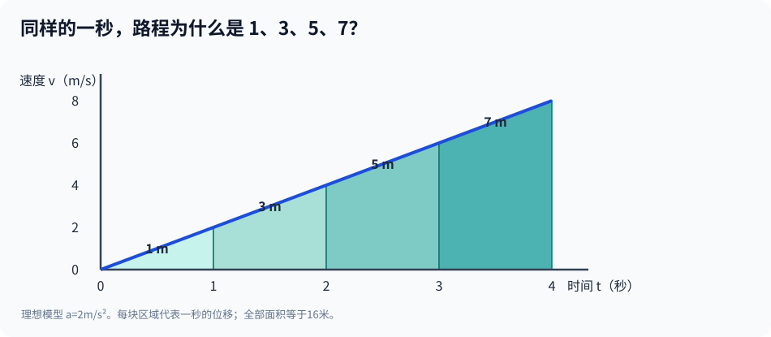

# 第二部·第六章｜伽利略：平均速度不等于瞬间的速度

假设有一颗小球，从一条光滑的斜坡顶端开始滚动。

第一秒，它走了一米。

第二秒，你继续计时。现在它又走了多远？

如果它一直保持相同速度，答案当然还是一米。

可是，小球正在加速。

在一种理想的匀加速模型里，第二秒走过的路，可能是**三米**。

第三秒呢？

**五米。**

第四秒？

**七米。**

一、三、五、七……

这串看起来与物理毫不相干的奇数，竟然能描述一个运动物体在连续相等时间间隔内经过的距离。

更奇妙的是，几个奇数加起来，总会得到一个平方数：

$$
1+3+5+\cdots+(2n-1)=n^2.
$$

这不是巧合。

它指向了伽利略在1638年正式出版的《两门新科学》中反复讨论的一条运动规律：**对于从静止开始、加速度恒定的理想运动，累计路程与时间的平方成正比。**

不过，我们不能只记住这个结论。

真正改变数学的，是结论背后另一道问题：

**一个物体的速度不断改变时，我们究竟在测量什么？**

## 一、平均速度为什么会欺骗你？

在日常生活中，速度似乎非常简单。

走了100米，花了20秒，平均速度就是

$$
\bar v=\frac{100}{20}=5\text{ 米/秒}.
$$

可这不等于说：这20秒里的每一瞬间，你都以每秒5米前进。

你可能开始很慢，中途加快，最后又放慢。

同样的总路程、同样的总时间，可以包含截然不同的运动过程。

这意味着，**平均速度把一段过程压缩成一个数字，同时也抹掉了内部的变化。**

如果研究的是匀速直线运动，问题不大。

但如果研究落体、斜坡上的小球或者天体在轨道上的运动，平均速度就远远不够。

我们还想知道：

刚松手的那一刻，速度是多少？

一秒以后，速度是多少？

两秒以后，又是多少？

这些问题不再只关心两点之间的距离，而是试图描述**每个时刻的运动状态**。

芝诺的飞矢悖论曾经逼问：箭在某个瞬间只有一个确定位置，为什么还能运动？

伽利略所处的时代，这个问题有了更加具体的科学形式：

不再只辩论「瞬间是否存在」，而要找到可以计算和检验的运动规律。

## 二、伽利略并不是第一个想到平均速度的人

这里需要先纠正一个非常流行的科学史叙述。

它常常把中世纪描述为一千多年的停滞，然后让伽利略突然出现，从零发明运动数学。

这样写会让故事更简单，却并不公正。

在14世纪，牛津默顿学院的学者已经研究过均匀变化的运动，并形成通常被称作**平均速度定理**的结论。

在适当条件下，一个速度均匀增加的物体，在某段时间内走过的距离，等于另一个物体以首末速度的平均值匀速运动相同时间走过的距离。

这一传统与威廉·海茨伯里（William Heytesbury）等人有关；尼科尔·奥雷姆（Nicole Oresme）也使用几何图形研究均匀变化量。[3]

这并不是说，中世纪学者已经建立了后来成熟的实验物理学。

也不是说，可以把所有伽利略的成果都简单归功于他的前辈。

真正需要区分的是：**运动的数学性质可以先作为逻辑与几何问题得到研究，而运动是否按这种规律发生，仍需要面对自然现象与实验。**

伽利略的重要贡献，正体现在将数学描述、理想化条件和关于实际运动的检验更加紧密地结合起来。

## 三、一个简单定义，把运动变成数学

在《两门新科学》第三日中，伽利略讨论「自然加速运动」。

他用这样的思路定义匀加速：在相等的时间间隔里，运动物体获得相等的速度增量。[1]

为了用现代语言理解，假设一颗理想质点从静止开始运动。

每过一秒，速度增加2米/秒。

于是：

| 时间 | 速度 |
|---:|---:|
| 0秒 | 0米/秒 |
| 1秒 | 2米/秒 |
| 2秒 | 4米/秒 |
| 3秒 | 6米/秒 |
| 4秒 | 8米/秒 |

速度与时间呈现一条直线关系。

现代记号把它写作：

$$
v(t)=at,
$$

其中 $a$ 是恒定加速度，代表每秒增加多少速度。

取 $a=2$ 米/秒²，便是

$$
v(t)=2t.
$$

注意，这仍然不是最终答案。

知道第二秒末的速度是4米/秒，并不意味着前两秒全部以4米/秒运动。

我们真正要计算的是：

**一条不断上升的速度曲线，怎样决定整段时间里实际走过的路程？**

这里，求局部变化与求整体累计，第一次清晰地迎面相遇。

## 四、速度画成三角形，面积居然代表距离

把时间画在横轴，速度画在纵轴。

如果加速度恒定，从静止开始，图像是一条从原点向上倾斜的直线。

横轴是时间，纵轴是速度，三角形的面积对应累计路程。这是**现代速度—时间图的教学回译**，不是伽利略原书的同一张图。

假设经过 $t$ 秒，最后速度为 $v$。

图下方围出的三角形，底边是 $t$，高是 $v$。

其面积为

$$
s=\frac12vt.
$$

这就是从静止开始匀加速的平均速度定理：

$$
\bar v=\frac{0+v}{2}=\frac v2.
$$

于是，在同样的时间里，物体虽然一直加速，但其总路程与「始终以末速度的一半运动」完全一样。

现在代入 $v=at$：

$$
s=\frac12at^2.
$$

这条式子解释了我们开头的奇数。

要注意：伽利略的原书使用古典几何比例论证；此处的 $v(t)$、$a$、现代坐标图和代数代换都是后世物理数学的重述。[1][2]

图中的面积不是某种玄学比喻。

对有限数量的时间小片段，若物体速度在每片段里变化很小，就可以用「速度乘时间」近似估计片段路程。

将这些片段相加并控制误差，现代积分理论便把它写成

$$
s=\int_0^t v(\tau)\,d\tau.
$$

但1638年的伽利略并没有使用这套后来的积分符号。

这只是在告诉今天的读者：历史上的平均速度定理，为什么与后来的微积分紧密相关。

## 五、奇数列背后藏着一条严格的规律

现在，让我们重新验证开头的一、三、五、七。

设初速度为0，加速度为2米/秒²。

那么时间 $t$ 秒后的路程是

$$
s(t)=t^2\text{ 米}.
$$

因此：

- 1秒末走过1米。
- 2秒末走过4米。
- 3秒末走过9米。
- 4秒末走过16米。

但这些是**累计路程**，不是每一秒分别经过的路程。

第一秒的距离：

$$
s(1)-s(0)=1.
$$

第二秒的距离：

$$
s(2)-s(1)=4-1=3.
$$

第三秒：

$$
s(3)-s(2)=9-4=5.
$$

第四秒：

$$
s(4)-s(3)=16-9=7.
$$

于是得到：

$$
1:3:5:7:\cdots.
$$

这一规律出现在伽利略《两门新科学》对于自然加速运动的讨论中。[1]

它有一个极其重要的特点：

**可以被实验检查。**

如果你能让一个物体沿着接近匀加速的方式运动，并测量不同时间对应的路程，就可以比较数据是否与平方比例相符。

这就把数学从「关于运动的一种漂亮说法」，推进成「能够受到现象检验的一种模型」。

但在17世纪，测量短暂落体过程本身并不容易。

## 六、让运动慢下来：斜面为什么重要？

一颗物体竖直下落，速度很快增加。

如果计时工具不够精细，很多关键变化会在短短一段时间里发生。

伽利略在《两门新科学》中描述过一种更便于研究的情形：让光滑的球沿着平整的斜槽滚动，并通过水流的重量估计不同运动过程的时间。[1][4]

他在书中称，经过重复比较，沿斜面的路程与时间的平方保持相应比例。

比如，如果走完全长需要某个时间，那么从静止出发走过全长的四分之一，大约需要全长时间的一半。

这与

$$
s\propto t^2
$$

正好一致。

这里值得强调三个限定。

**第一**，古书中的实验过程是作者的叙述。后世研究仍会讨论具体装置、计时精度和复现程度，不能把它写成今日无争议的完整原始数据集。

**第二**，沿斜面滚动的实心球会转动。现代力学计算要考虑转动惯量、接触条件和阻力；不能直接把所有滚球都当成无转动的质点，也不能在缺少条件时直接写 $a=g\sin\theta$。

**第三**，数学公式描述的是理想模型；真实观测允许测量误差。实验不是为了让自然每一次都精确符合纸上的小数，而是去检验模型解释事实的能力与适用范围。

这三点也让伽利略的故事比「他扔下一颗球，立刻发现公式」更加可信。

## 七、平均速度与瞬时速度，只差一个词吗？

现在你已经知道：

匀加速物体在前两秒的平均速度，可能是2米/秒。

但在第二秒末，它的瞬时速度却是4米/秒。

平均速度关心整个区间：

$$
\bar v=\frac{s(t_2)-s(t_1)}{t_2-t_1}.
$$

瞬时速度则试图只关心某一个时刻。

现代微积分把这个要求表达为：

$$
v(t)=\lim_{\Delta t\to0}\frac{s(t+\Delta t)-s(t)}{\Delta t}.
$$

取 $s(t)=t^2$，就有

$$
\frac{(t+\Delta t)^2-t^2}{\Delta t}
=2t+\Delta t.
$$

当 $\Delta t$ 越来越接近零时，上式趋近于

$$
v(t)=2t.
$$

这正好与前面由匀加速规律得到的速度表达吻合。

但要记住，**这个极限计算是现代数学的检验，不是伽利略的历史原文**。

而且，「把 $\Delta t$ 看得足够小」不是说可以随便先除以零，再把零消掉。

现代导数的定义要求对趋近过程作出严格解释。

这正是后来的微积分基础争论和19世纪严格化要解决的困难。

### 两个方向，正在靠拢

你现在可以看到两种运算：

给定速度，累积成路程：

$$
s(t)=\int_0^t v(\tau)\,d\tau.
$$

给定路程函数，求出瞬时速度：

$$
v(t)=\frac{ds}{dt}.
$$

在合适的连续性与可微性条件下，它们密切相关，后来微积分基本定理会把这种关系明确写出。

不要急着说「伽利略已经发现微积分基本定理」。

他的贡献在于推动了运动的定量描述，让瞬时与累积之间的矛盾愈发清晰。

真正把两边系统接起来，还需要更多数学家的工作。

## 八、从落体的速度，走向任意形状的体积

如果你沿着这条思路继续想下去，会发现它并不只适用于运动。

平均速度，是把很多时刻的变化概括成一个整体量。

而一个复杂物体的体积，也可以想象成许多薄薄的截面逐渐累积起来。

如果能知道各个位置截面的面积，那么把这些面积按照位置累加，就可能得到整个体积。

这和把速度随时间累加成路程，在现代积分语言里具有深刻的共同结构。

但在17世纪初，数学家尚无今天成熟的积分公式。

他们只能从具体图形、具体构造和各种求积技巧开始。

而其中一位研究者，恰好遇到一个极其实际的问题：

**一个外形并不规则的容器，其内部体积究竟该怎样计算？**

下一章，我们将把时间稍稍往回拨到1615年。

当时，开普勒不仅研究行星运动，还出版了一部专门研究各种立体形状体积的著作。

它的标题里，出现了一种很不寻常的几何对象：

**酒桶。**

这个话题听起来远没有行星轨道宏大。

可它逼出的数学，恰好成为后来积分方法发展的重要先行探索。

---

## 参考文献与史实边界

1. 伽利略，[《两门新科学》第三日（1638）英译文本](https://en.wikisource.org/wiki/Dialogues_Concerning_Two_New_Sciences/Third_Day)，关于匀速、自然加速运动、奇数法则及斜面实验的作者自述。
2. 苏黎世联邦理工学院图书馆，[《The Dialogue and kinematics》](https://library.ethz.ch/en/collections-and-archives/platforms/virtual-exhibitions/galileo-galilei/galileos-works/the-dialogue-and-kinematics.html)，引《伽利略全集》卷VIII中有关斜面关系与速度图形的内容。
3. 牛津默顿学院，[《The Merton Calculators》](https://www.merton.ox.ac.uk/sites/default/files/inline-files/The%20Merton%20Calculators.pdf)；与威廉·海茨伯里等人有关的平均速度定理。
4. University of Virginia，[《Galileo's Acceleration Experiment》](https://galileo.phys.virginia.edu/classes/109N/lectures/gal_accn96.htm)，引用《两门新科学》的实验描述并讨论现代教学复现。

**数学说明**：$s=\tfrac12at^2$、速度图像、导数与积分表达均为现代回译。本文不声称伽利略首次发现平均速度定理，也不把1638年的对话体著作当作逐字实验室记录，更不把滚球视为无转动的理想质点。