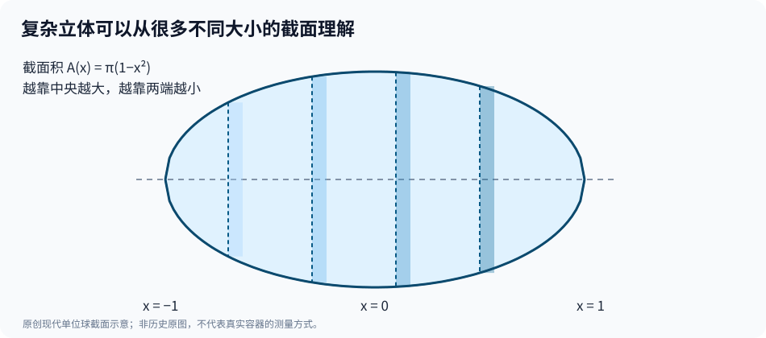

# 第二部·第七章｜开普勒的酒桶：为什么一种奇怪的形状，逼出了体积计算的新方法？

1613年，德国数学家兼天文学家开普勒在林茨再婚。

一段后来被数学史研究者反复提及的经历，与他此后研究的一道问题紧密相连：当时人们估算木桶内容量的方法，让他开始怀疑——**仅凭少量简单测量，真的能够决定一个曲面容器的体积吗？**[1]

请暂时忘掉木桶的实际用途，只看一个纯粹的几何事实：

两个容器，可以一样高，也可以有相同的端面宽度。

但如果其中一个中间鼓出得更多，另一个从头到尾都比较平直，那么它们的内部空间就可能相差很大。

换句话说：

**几条长度相同，并不能保证两个立体的体积相同。**

在现代数学课上，这是一道几乎不用犹豫的问题。

你会说：先给出曲面方程，再对截面积积分。

可是，1613年的开普勒没有一本可以翻到「定积分」一章的教科书。

他需要回答的是更原始的问题：

**怎样把一个形状复杂的整体，拆成自己会计算的小部分？**

这一问题，将在1615年成为一部专门著作的中心。

## 一、时间倒回1615年：它其实早于伽利略的《两门新科学》

必须先交代本书的时间顺序。

上一章讨论了1638年出版的伽利略《两门新科学》。

这一章却回到1615年。

这是按数学问题组织章节的**专题回溯**，不是说开普勒阅读过1638年才出版的书，才开始研究体积。

历史本来就不总沿着教科书的排列顺序前进。

17世纪初，运动学、几何求积、天体轨道和体积测量等问题正在各处被研究；它们相互映照，却并非都从某一位科学家那里依次传下来。

开普勒（Johannes Kepler，1571—1630）因行星运动研究闻名。

但他的数学兴趣并不局限于天上。

1615年，他在林茨出版了一部拉丁文著作：

*Nova stereometria doliorum vinariorum*。

可以意译为《酒桶新立体测量学》。Wellcome Collection 保存有该书1615年版本的馆藏目录，可核对其作者、书名与出版地点。[2]

今天的读者容易将开普勒与他的行星三定律绑定起来。

可在微积分发展史上，这本研究体积的书也不可忽略。

它所处理的并非一种孤立容器，而是许多由曲线旋转而成、形状并不简单的立体。

数学史介绍指出，书中研究了九十多种立体的体积问题，并在1616年出现面向更广读者的德文版本。[3][4]

为什么要研究那么多形状？

因为要建立一种有推广潜力的方法，仅仅解出某一个容器还不够。

你必须明白，不同曲面有哪些共同的构造方式。

## 二、一整块立体，不如先切成很多薄片

我们从一个简单问题入手。

一个圆柱体，底面圆的面积是

$$
A=\pi r^2,
$$

高为 $h$。

那么体积就是

$$
V=\pi r^2h.
$$

这条公式的背后，有一个极自然的图像：

把圆柱想象成很多层等大的薄圆片叠在一起。

如果每层厚度相同，底面积又相同，所有小片的体积相加，自然就得到底面积乘高度。

但假如立体中间宽、两端窄呢？

从左端到右端切出同样厚度的一层层薄片，每一层的圆面积就不相同。

这时已经不能再简单使用一个固定底面积乘上总高度。

然而，**把立体看成许多薄片叠加而成**，仍然是很有希望的思路。

开普勒发展和使用了把几何立体分解成许多薄层来讨论总体积的技巧。这些做法与此前阿基米德对曲面、立体的研究有联系，也成为后来17世纪不可分量方法发展的重要背景。[3][4]

如果用今天的语言说：

**不是先寻找整块体积的公式，而是先研究各个位置的截面。**

听起来只是换了一个看待物体的方向。

但这个变化非常有力量。

## 三、厚度越来越小，为什么会出现积分？

先建立一个现代教学模型。

想象有一个关于中间平面对称的旋转体。

沿它的中心轴取坐标 $x$。

在每个位置 $x$，与轴垂直的截面是一个圆，其半径为 $r(x)$。

这意味着，位置 $x$ 处的截面积为：

$$
A(x)=\pi[r(x)]^2.
$$

现在沿轴把整个立体切成很多小段。

第 $i$ 段宽度为 $\Delta x_i$，在段内选一个代表位置 $x_i$。

我们可以用一个很薄的圆柱近似这一小段的体积：

$$
\Delta V_i\approx \pi[r(x_i)]^2\Delta x_i.
$$

把所有小圆柱相加：

$$
V\approx\sum_{i=1}^n\pi[r(x_i)]^2\Delta x_i.
$$

切得越细，每一段的半径变化通常越小，这种近似也越有机会逼近真实体积。

但有一个重要前提：截面函数要足够规则，使这种求和过程确实具有稳定的极限。

对连续的半径函数，在我们这里的普通旋转体情形中，可以写：

$$
\boxed{V=\pi\int_a^b[r(x)]^2\,dx}.
$$

这一整套 $\Delta x$、求和符号与积分公式，都是后世建立的**现代数学回译**。

开普勒的书里没有今天的黎曼积分定义，也没有直接写出这个积分符号。

它帮助我们理解的，是他为何如此重视**把立体分解成许多薄片再处理**。

不过，另一个隐藏问题已经出现：

如果一片薄层真的没有厚度，那么它的体积不也应该是零吗？

**无穷多个“零厚度”的圆片，究竟怎样组成一个有体积的实体？**

这个令人不安的追问，我们将在下一章再次遇到。

## 四、让球体来检验切片法

为了避免复杂容器形状遮蔽真正的数学思想，我们换成一个完全规则的例子：单位球。

它的半径为1。

以球心为原点，让中心轴成为 $x$ 轴。

球面上任一点满足：

$$
x^2+y^2+z^2=1.
$$

固定一个 $x$，与轴垂直的截面是一个圆。

这个截面的半径为：

$$
r(x)=\sqrt{1-x^2}.
$$

所以，它的面积为：

$$
A(x)=\pi(1-x^2).
$$

请注意这里的几何变化：

在球的最左端 $x=-1$，截面积为零。

越接近中央，截面积越大。

到 $x=0$，面积达到 $\pi$。

继续向右，又逐渐减小，直到 $x=1$ 变成零。

*图为现代球体切片模型，不代表开普勒著作的具体原图，也不是任何实际容器的测量指南。*

现在，现代微积分可以把这些不同大小的截面面积累积起来：

$$
V=\pi\int_{-1}^{1}(1-x^2)\,dx.
$$

计算：

$$
V=\pi\left[x-\frac{x^3}{3}\right]_{-1}^{1}
=\frac{4\pi}{3}.
$$

这正是单位球的体积。

于是，你看到了一件非常值得记住的事：

**一个三维立体的体积问题，变成了一串二维圆面积的累积问题。**

我们并没有在这一章「证明开普勒已经有现代积分」。

相反，我们用现代计算解释一个从他的求积研究中可以看见的基本策略：

把不容易处理的复杂整体，转化成一系列更容易理解的截面。

## 五、同样高、同样宽，为什么体积仍可能不同？

再看一个容易被忽略的逻辑陷阱。

假设两个旋转体都有相同的长度，从 $x=-1$ 到 $x=1$。

它们在两端的截面半径也相同。

但甲的半径变化是 $r_1(x)$，乙是 $r_2(x)$。

如果乙在大部分位置的半径都比甲更大，且至少有一段确实大于甲，那么乙的截面积便相应更大。

在通常连续的条件下，有：

$$
\pi\int_{-1}^{1}[r_2(x)]^2\,dx
>
\pi\int_{-1}^{1}[r_1(x)]^2\,dx.
$$

这里我们假定 $r_2(x)\geq r_1(x)\geq0$，且严格大于在某个非零长度的区间上成立。

这解释了为何只靠几个外形尺寸，未必能决定完整体积。

因为体积并不是由某一个地方的宽度决定的。

它取决于**沿整个轴线的宽度分布**。

几何的困难就在这里：整体结果依赖每一个局部位置。

后来的积分理论正是为这种依赖关系提供了统一而严谨的表达。

在此之前，数学家只能为不同曲面寻找特定技巧，比较可知图形、构造近似体、分析它们之间的比例关系。

从这个意义上看，开普勒的工作连接了古典求积和后来更系统的积分方法。

## 六、另一道题冒了出来：多大才算最大？

体积可以怎么算，只是一半问题。

研究一组不同形状的立体时，你还会自然想到：

如果一个几何条件固定，那么什么样的形状能产生最大的体积？

注意，这已经不是求积问题。

求积问：

**给定形状，体积是多少？**

极值问题问：

**形状可以变化，哪一个体积最大？**

数学家当然可以比较几个候选形状。

但如果可选形状有无穷多种，只枚举几个例子就难以确保找到了最大的那个。

开普勒的研究也触及了这类体积极值问题。数学史材料指出，他注意到在接近最大值的情形下，形状尺寸的细小改变对体积的影响会变得相对不显著。[3]

这句话已经包含了后来微分学的一点影子。

今天我们会把某个几何体积写成一个函数：

$$
V=V(u),
$$

其中 $u$ 是允许变化的形状参数。

在内部最大点 $u_0$ 附近，如果函数足够光滑，且满足求导所需的条件，那么：

$$
V'(u_0)=0
$$

是一个必要条件。

但它不是充分条件。

导数等于零，也可能对应最小值或其他驻点。

更重要的是，这条公式是后来微分学的语言，不能说开普勒在1615年就已经使用了这套求导记号与完整的极值判据。

他的工作揭示的是一个迫切的问题：

**不仅要会累积局部得到总体积，还要能描述总体积如何随着形状细微变化而变化。**

求积与求极值，正好成为日后微积分发展中的两种重要问题。

## 七、从阿基米德到开普勒：相同的直觉，不同的证明要求

上一部中，我们讲到阿基米德如何用不断补入的三角形，求出抛物线弓形的准确面积。

那时我们强调：只知道无限级数之和还不够；还要证明剩余区域确实能够被穷尽。

面对各种复杂立体，开普勒的切片思路再次让类似问题显露出来。

一层越切越薄，确实更像原来的曲面。

但数学上的问题仍然是：

每层的误差怎样控制？

将无数层加在一起，为什么能够得到唯一而可靠的总体积？

在古典几何传统里，对具体图形的证明往往需要精巧的构造。

开普勒则更愿意在多种立体之间尝试薄片分解与求积技巧。

这些尝试具有很强的启发性和计算力，却不能简单地与19世纪严格的积分定义等同。

**计算方法的广泛成功，并不会自动替代所有逻辑基础。**

这也正是后来数学不断演变的动力。

## 八、接下来，数学家甚至想把面积看成线

到这里，17世纪求积研究中一个变化已经非常清楚了。

面对复杂图形，数学家越来越愿意把它们拆成一系列结构简单的东西。

曲边面积可以被看成无数细条的累积。

立体体积可以被看成无数薄片的累积。

一旦如此，新的诱惑便出现了：

既然片层可以越来越薄，为什么不直接把整个面积理解为一组没有宽度的直线，把体积理解为一组没有厚度的平面？

这样做会极大简化几何比较。

你甚至不需要算出每一片的面积，只要证明两种图形在相应位置的切片有固定的比例，是否就能知道它们的总体积比例？

可芝诺留给后世的那个问题仍然在：

**无穷多个没有宽度的东西，真的能组成有面积的图形吗？**

在开普勒之后，另一位意大利数学家卡瓦列里会把这种思路进一步系统化。

他的「不可分量」方法将成为17世纪求积史上的一次重要推进，也会引起新的质疑。

这将是下一章的主题：

**一条没有面积的线，究竟能不能组成面积？**

---

## 参考资料与史实说明

1. Roberto Cardil，[《Kepler: The Volume of a Wine Barrel》](https://old.maa.org/press/periodicals/convergence/kepler-the-volume-of-a-wine-barrel)，Mathematical Association of America，2012。关于1613年历史背景、1615年著作及求积研究路线。
2. Wellcome Collection，[《Nova stereometria doliorum vinariorum》1615年版本目录](https://wellcomecollection.org/works/fxgzpvhb)，林茨出版记录。
3. MAA Convergence，[《Kepler's Nova stereometria doliorum vinariorum》](https://old.maa.org/node/117625)，关于大量旋转体与薄片分割思路。
4. F. J. Swetz、Victor J. Katz，[《Mathematical Treasures—Kepler's Messekunst》](https://old.maa.org/node/116930)，MAA Convergence，关于1616年德文版本及体积研究。
5. F. Jongmans，[《In Vino Veritas, In Dolio Calamitas》](https://www.maths.usyd.edu.au/u/eseneta/vinoveritas.pdf)，*The Mathematical Scientist* 33 (2008)，1—7，提供后世桶形几何模型的史学比较。

**史实与数学边界**：本章的单位球切片公式、$\sum$、$\int$、函数 $V(u)$ 及导数判据属于现代回译；它们不是开普勒原著中的现代符号。书中酒桶事件仅作为体积几何史的背景，本文的计算模型均为抽象几何体，不提供现实饮用物容器的测量或使用指南。与上一章伽利略1638年文本相比，1615年开普勒研究属于时间回溯。