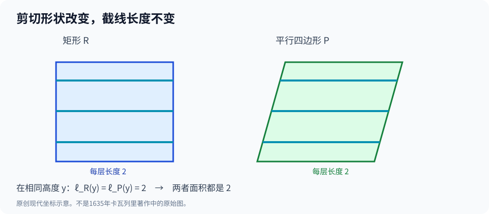

# 第二部·第八章｜卡瓦列里：一条线能够组成面积吗？

把一张方形纸片向右推斜，让它变成一个平行四边形。

只要底边与高度不变，它的面积就不变。

这看起来平平无奇。

可是现在，有人提出一个完全不同的解释：

**不必比较底边，也不必计算夹角。只要在两张纸上的每一个相同高度，横着切一刀，得到的线段都一样长，那么这两个图形的面积就一样。**

你可以把左边的横线向右挪一点，把中间的横线向右挪更多，最上面的横线再挪远一点。

只要每一层的长度没变，图形的外形就能变得很不一样。

但面积仍然不变。

这究竟是一种巧妙的直觉，还是可以用于复杂曲线的数学方法？

更危险的问题还在后面：

**每一条线都没有面积。无数条没有面积的线，凭什么能决定一个有面积的平面图形？**

十七世纪三十年代，卡瓦列里把这个问题推到了几何学的中心。

上一章的开普勒，把立体想象成无数薄片。

这一章，薄片似乎还要被进一步压到——**没有厚度**。

## 一、从开普勒到卡瓦列里：少了一种东西

开普勒面对复杂立体时，想办法把它分成很多小部分。

一个不规则的旋转体，可以沿着轴切成许多薄圆片。每片的体积很容易近似，难的是如何控制总误差。

但是，新的问题很快出现：

如果只是比较两个图形的面积，我们真的需要逐块切出一个有宽度的小长方形吗？

能不能直接比较它们在同一个高度上的**截线长度**？

假设图形甲的每一条水平截线，都能和图形乙在同一高度的截线一一对应，且长度完全相同。

那么，似乎没有什么理由认为两个图形的面积不同。

注意，关键不是「两个图形有很多横线」，而是：

**在每一个对应的高度，两条截线都要保持相等。**

这个思想在今天通常被讲成卡瓦列里原理。

但卡瓦列里当年的理论比一句现代教科书定义更复杂，涉及他所称的图形「所有的线」（*omnes lineae*）、立体「所有的面」（*omnes plana*）的比较方法。现代积分论的词汇，不能直接冒充他的原话。[1][2]

## 二、1635年，几何学被迫面对「所有的线」

博纳文图拉·卡瓦列里（Bonaventura Cavalieri，1598—1647）是意大利数学家，与伽利略保持长期联系，并在博洛尼亚任教。

研究他的生平时，需要分清两个年份。

**1627年**，他已经向伽利略等人报告相关几何著作手稿完成。

**1635年**，《Geometria indivisibilibus continuorum nova quadam ratione promota》才正式出版。[1][2]

一份完成的研究手稿，与一本正式出版、可被更广泛学者阅读和批评的书，不是同一件事。

这本书的核心方法，是通过比较图形中一族平行截线来讨论面积，再将类似思想扩展到一族平行截面来讨论体积。

它有很强的计算吸引力。

原来需要为每个复杂图形另找专门证明，如今似乎可以把难题变成一种相对统一的比较：

如果对应的截线成固定比例，那么总体面积是否也成相同的比例？

例如，假如甲在每个高度的横线都恰好比乙长两倍，而高度范围又完全一致，那么甲的面积是否就是乙的两倍？

对于我们现在熟悉的普通平面图形，在适当条件下，答案是肯定的。

但是，从这一点走向一种一般方法，并不意味着你已经建立了现代积分的全部基础。

卡瓦列里对连续体究竟如何理解、他的「不可分量」与现代所谓面积元素有何差别，至今仍是科学史研究需要仔细区别的问题。[2][3]

## 三、亲手做一次实验：把矩形推斜，面积究竟变了没有？

取一个长2、高1的矩形。

为了让计算透明，使用现代坐标：

$$
R=\{(x,y):0\le x\le2,\ 0\le y\le1\}.
$$

它的面积显然为：

$$
S_R=2\times1=2.
$$

现在把每一层水平线向右平移。

底部不动，中间平移一点，顶部平移1个单位。

平移后的图形变成：

$$
P=\{(x,y):y\le x\le y+2,\ 0\le y\le1\}.
$$

它是一个底为2、高为1的平行四边形。

看看两种图形在同一高度 $y$ 上的横线。

矩形的横线从 $x=0$ 延伸到 $x=2$，长度2。

平行四边形的横线从 $x=y$ 延伸到 $x=y+2$，长度还是2。

也就是说，无论你选哪个 $0\le y\le1$：

$$
\ell_R(y)=\ell_P(y)=2.
$$

这张原创教学图对应的就是「同高截线相等」的比较。图形被推斜了，但每个高度的蓝绿色线段仍然有同样的长度。

于是它们的面积相等：

$$
S_R=S_P=2.
$$

你也可以完全不用不可分量法，直接根据平行四边形底乘高得到2。

**两种算法得出相同答案。**

但卡瓦列里方法的价值并不在这道简单的习题上。

它在暗示：即使图形轮廓非常复杂，只要能建立对应截线的关系，也许就不必直接处理复杂的边界。

这意味着求面积的问题，可能被转化为**比较长度**的问题。

## 四、如果每个截面一样大，体积就真的一样吗？

继续将思想推进一个维度。

假设有两个同高的立体。

在它们的同一个高度，放入一张水平纸片，截出两个平面形状。

如果每个高度的截面积都相同，那么两个立体的体积是否也相同？

对通常可测、截面函数可积的立体，这就是我们今天所熟悉的卡瓦列里原理的一种表达。[3]

它真正节省的工作量，远比刚才的矩形例子可观。

因为两个立体的轮廓可以非常不一样。

你可能根本不知道怎样直接计算第一个立体的体积，却恰好知道第二个的体积。

只要证明它们每个对应高度的截面积相等，就可以把已知体积转移过去。

为了看见这种方法的威力，我们做一个经典的**现代几何演示**。

取半径为 $r$ 的球。

把它放入一个半径同样为 $r$、高为 $2r$ 的圆柱中，令球心与圆柱中心重合。

再在圆柱内部想象一个特殊的「双圆锥」：尖端在中间，向上和向下各展开一个圆锥，底面分别落在圆柱的上下端。

这样，圆柱减去双圆锥，得到一个中间空出、上下环绕的立体。

球和这个「圆柱挖去双圆锥」的形状，明明完全不同。

可是，它们每一个高度的截面积却恰好相等。

## 五、球与「挖空圆柱」：原理为什么如此有力？

把球心高度设为 $z=0$，球的上下端分别为 $z=-r$ 和 $z=r$。

在高度 $z$，球的截面是半径为 $\sqrt{r^2-z^2}$ 的圆。

截面积为：

$$
A_{\text{球}}(z)=\pi(r^2-z^2).
$$

在同一高度，整个圆柱的截面积是：

$$
A_{\text{柱}}(z)=\pi r^2.
$$

双圆锥在高度 $z$ 的截面半径为 $|z|$，因此它占去的面积是：

$$
A_{\text{锥}}(z)=\pi z^2.
$$

圆柱剩下的环形截面积为：

$$
A_{\text{剩}}(z)=\pi r^2-\pi z^2.
$$

所以：

$$
A_{\text{球}}(z)=A_{\text{剩}}(z).
$$

这个等式对球内部每一个高度都成立。

于是两种立体体积相同。

而第二个立体的体积很好算：

圆柱体积为

$$
V_{\text{柱}}=2\pi r^3.
$$

上下两个圆锥，每个高为 $r$、底面积为 $\pi r^2$，合起来：

$$
V_{\text{双锥}}=2\cdot\frac13\pi r^3=\frac23\pi r^3.
$$

因此：

$$
V_{\text{球}}=V_{\text{柱}}-V_{\text{双锥}}
=2\pi r^3-\frac23\pi r^3
=\frac43\pi r^3.
$$

惊不惊人？

一个球的体积，没有通过「先写出球的积分」来计算，而是借助**与另一个立体的每层截面积完全相等**。

这个球—圆柱—圆锥的比较，与阿基米德古典几何传统也有深厚联系。

这里是为讲解卡瓦列里原理所设计的**现代回译示例**，不能说是卡瓦列里1635年原书刚刚首次发现、逐字写下的计算。

它证明的是这类方法的数学力量，而非某一个独创权故事。

## 六、真正的麻烦：零面积的线，能够凑成面积吗？

现在轮到反对者提出问题了。

如果把矩形想象成「所有横线」的集合，每一条横线在二维面积意义上确实都是零面积。

那么：

$$
0+0+0+\cdots
$$

不是仍然等于零吗？

这正是最容易误导现代读者的地方。

因为一个平面区域内的水平线，不是**可数多个**，而是由连续高度索引的**不可数多个**。

我们平常熟悉的「有限多个或可数多个零面积集合的并，仍然零面积」，不能直接延伸为「任意不可数多个零面积集合的并也零面积」。

举个最简单的例子：

一个单位正方形中，每条水平线段的二维面积为零，但这些线段随高度 $y$ 取遍 $[0,1]$，它们的并集就是整个单位正方形，面积为1。

这里并没有算出「许多个0等于1」。

真正的问题是：**对连续索引的所有截线，如何定义与控制整个集合的二维面积？**

现代测度论和积分论可以给出严格的答案。

比如，在适当的可积性条件下，如果每个高度的截线长度为 $\ell(y)$，则

$$
S=\int_a^b \ell(y)\,dy.
$$

它不是把某条线段的二维面积直接加起来，而是让**横线的长度**与**高度方向的累积**结合起来。

这是后世数学的解释，不能假称卡瓦列里已经掌握测度理论。

不过，从今天看，这一区别确实揭示了不可分量方法的力量和它当时的逻辑薄弱处。

## 七、古尔丁的质疑，为什么并非没有道理？

卡瓦列里的方法受到真实而尖锐的批评。

其中著名的反对者是数学家保罗·古尔丁（Paul Guldin）。

他不满意以「所有的线」直接解释连续平面图形，也质疑这种新方法与古典几何证明之间的关系。[2]

这场争论不能被简化为：

勇敢的科学家发现真理，一群不懂数学的保守者出来阻挠。

古尔丁对连续性、几何构造、无穷对象与证明标准的忧虑，具有清楚的数学内容。

**如果一种新方法得出了很多正确结果，它的推理过程就一定已经足够严谨吗？**

答案当然是否定的。

卡瓦列里确实在大量求积问题中展示了方法的效率。

但反对者也指出：不能只靠一串令人满意的结果，就跳过对「把所有线一起比较」这件事究竟意味着什么的说明。

1647年，卡瓦列里又出版了《Exercitationes geometricae sex》（《六篇几何练习》），进一步发展并回应了此前引发的争议。[3]

同一时期，托里拆利等人也在使用和扩展不可分量技术；1644年托里拆利关于无穷延伸立体的体积研究，被后世数学史视作另一条重要进展。[4]

但**1644年的托里拆利成果不能反过来写成卡瓦列里1635年已经完成的结论**。

科学史必须承认成果之间的时间差和不同贡献。

## 八、方法的胜利，会不会成为新危机的开端？

让我们回望这一章走过的路。

古典穷竭法想要严密控制剩余误差。

开普勒大胆地将立体分解成大量薄片。

卡瓦列里则进一步强调：比较对应截线和截面，有时比真正计算每一块面积或体积更有效。

而反对者追问：

零厚度的对象究竟是什么？为什么通过比较它们就能得出整个连续图形的结论？

这种方法在实际计算上的成功，与其哲学基础上的困难，可以同时存在。

接下来一个改变即将发生。

截至目前，我们始终在谈「圆」「三角形」「抛物线」「截线」。

每解决一种图形，数学家就得找到它特有的性质。

如果能把图形直接翻译成字母与方程，情况会不会更简单？

也许你不必总是盯着图形。

你可以先写下一个等式：

$$
y=x^2.
$$

然后让代数运算替你寻找这条曲线的其他秘密。

问题是：

**一个等式，凭什么能够代表一条真实的曲线？**

1637年，笛卡尔的《几何学》将给出一条重要的路线。

下一章，我们从不断比较的线段，走向可以运算的曲线方程。

---

## 参考资料与史实边界

1. Mathematical Association of America，[《Cavalieri’s Geometria Indivisibilibus》](https://old.maa.org/press/periodicals/convergence/mathematical-treasure-cavalieri-s-geometria-indivisibilibus)，含1635年版本与卷七命题的原书图像。
2. MacTutor，[《Bonaventura Cavalieri》](https://mathshistory.st-andrews.ac.uk/Biographies/Cavalieri/)，关于1627手稿、1635出版、截线原理以及古尔丁批评。
3. MAA，[《Cavalieri’s Indivisibles》](https://old.maa.org/press/periodicals/convergence/mathematical-treasure-cavalieris-indivisibles)，关于1647年《六篇几何练习》。
4. Stanford Encyclopedia of Philosophy，[《Infinity》](https://plato.stanford.edu/entries/infinity/)，§2.2关于17世纪不可分量理论与托里拆利的后续工作。

**数学与历史边界**：矩形剪切、球与挖空圆柱、现代积分和测度论解释属于后世回译。卡瓦列里并没有建立19—20世纪的测度论；不能把他的「所有的线」直接理解成把可数多个零面积值作普通加法。