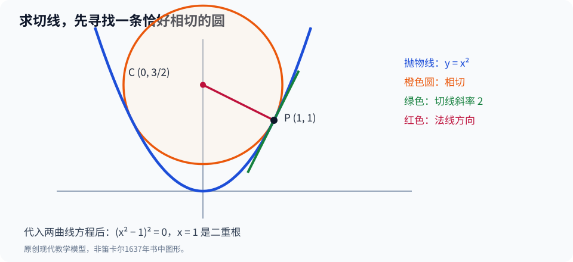

# 第二部·第九章｜笛卡尔：把曲线写成方程

想象一张纸上，画着一条弯曲的线。

你知道它经过哪些点，甚至能看出它向哪里弯曲。

可是，假设有人突然问：

**这条曲线在某一个指定点的切线，究竟朝哪个方向？**

用直尺比一比，似乎能猜到。

但「似乎」没有数学上的说服力。

如果是一条圆弧，你可以先找到圆心：圆心到切点的半径与切线垂直。

如果是一条更复杂的曲线呢？

我们难道要为每一种曲线，都重新发明一套几何技巧？

十七世纪初，一个改变逐渐变得清晰：

**一条曲线，除了是纸上的图形，还能是一条代数关系。**

比如今天人人熟悉的：

$$
y=x^2.
$$

一旦你能够把曲线翻译成等式，你就不只拥有一张图。

你还拥有一种可以变形、消元、比较系数的数学语言。

1637年，笛卡尔的《几何学》把这种思想推向了一种极富影响力的体系。

但有必要在一开始就打破一个常见的传说：

**笛卡尔的重要性，并不是某天在纸上画了一个十字坐标轴，从此人类第一次知道怎样标记位置。**

他的突破更加复杂，也更有价值。

## 一、在几何里，什么才叫「解出」一个问题？

先回到《几何学》诞生之前的世界。

古希腊数学家非常擅长用直线、圆和圆锥曲线构造图形。

欧几里得《几何原本》为几何证明建立了极为严格的规范。

帕普斯（Pappus）等古代几何家的著作，又保存了复杂曲线与轨迹问题，其中一些问题不容易靠圆规和直尺完成。

到十六、十七世纪，欧洲数学家重新研究这些古代材料，面临一项深刻的困难：

**如果一个问题必须使用抛物线、双曲线，甚至更复杂的曲线才能解决，这还算不算真正合法的几何学？**

这些曲线应该怎样构造？它们与直线、圆之间又是什么关系？

这不是哲学家与数学家闲暇时的文字游戏。

因为某一种曲线若被排除在「可接受的几何工具」之外，许多原本能用它解决的问题，就又会被认为没有得到满意的解答。

笛卡尔所处的时代，维耶特等数学家已经推动了符号代数的发展；费马也在研究如何把几何轨迹转译成代数关系。

所以，不能说「在笛卡尔之前没有人把几何和代数联系起来」。

真正的历史问题在于：**如何把这种联系发展成更广泛的解题程序，并重新界定哪些曲线应当进入几何学？**[1]

## 二、1637年，一部写在《方法谈》后面的数学书

1637年，笛卡尔发表《方法谈》。

它附有三篇用于展示其方法的论文：《折光学》《气象学》和《几何学》（*La Géométrie*）。

《几何学》是其中最后一篇，而不是一本在同年独立现身、只讲现代坐标系的教材。[1][2]

在其中，笛卡尔尝试将几何问题转化为量之间的关系，再使用代数方法处理这些关系。

它的重要性可以用一句话概括：

**把复杂几何问题中的未知线段，当成可以参加代数运算的量。**

古典几何和算术之间本来存在严格区分。

两个长度相乘，得到的是一个面积量；三个长度相乘，得到的是体积量。

如果只从几何维度来看，长、宽、体积等似乎不能随意放在一个方程中比较。

笛卡尔运用单位线段和几何比例等工具，使乘法、除法、开方等代数运算可以在几何问题中系统地表达。

这样一来，不必每碰到一个复杂形状都另造纯图形推理。

你可以先把未知的长度命名，然后用代数逐步求解。

不过，那个时代的代数记号与现代教科书仍有差异；今天的 $x$、$y$ 图像只是理解这一计划的一种方便方式。[1]

## 三、一条抛物线，为什么能藏在四个字符里？

用现代高中数学做一次小实验。

假设一条曲线上的点 $(x,y)$ 满足：

$$
y=x^2.
$$

这意味着：

当 $x=0$，$y=0$。

当 $x=1$，$y=1$。

当 $x=2$，$y=4$。

当 $x=-2$，$y=4$。

这样，你就得到一系列确定的点。

把所有满足这一关系的点一起考虑，它们构成一条抛物线。

但代数真正的力量，并不在于替你画出许多点。

它在于**同一条等式，可以同时描述曲线上无数个点**。

你甚至可以不用把所有点都画出来，就开始分析其形状。

比如，对任意实数 $x$：

$$
x^2\geq0.
$$

所以这条抛物线永远不在横轴下方。

又因为

$$
(-x)^2=x^2,
$$

因此图形关于纵轴对称。

没有借助大量测量，我们已经推导出几何性质。

这就是代数化几何的魅力：图形性质不必全部从眼睛里读出来，也可以从等式中**算出来**。

不过，别因此以为笛卡尔原书就是把现代方格纸上所有曲线画出来。

他使用的量、参考直线和构造方法，与今天统一的直角坐标体系并不完全相同。

现代所称「笛卡尔坐标系」，是随后数学长期发展、整理和教学标准化的结果，而不是一张单独被发明出来的标准坐标纸。[1]

## 四、帕普斯难题：有些几何轨迹，直接画不出来

笛卡尔《几何学》为何如此重视把问题化成方程？

一个核心背景是古代流传的**帕普斯问题**。

问题的具体形式并非简单的「给两个数，求一个未知数」。

它涉及若干条固定直线，要求寻找点，使从点向这些直线作出的某些线段的长度乘积满足指定的比例关系。

假设我们只考虑一个便于理解的现代简化模型。

在平面上找点 $(x,y)$，让两个量的乘积等于某个常数：

$$
xy=6.
$$

如果固定 $x=1$，则 $y=6$。

固定 $x=2$，则 $y=3$。

固定 $x=3$，则 $y=2$。

所有这样的点不再构成一条直线，而是双曲线的一部分。

你也可以改写成：

$$
y=\frac6x,\qquad x\ne0.
$$

这让我们看见：一个关于**长度乘积**的条件，可以变成一条曲线的方程。

这只是说明帕普斯问题为什么具有代表性的**现代简化例子**，并不是把1637年帕普斯问题的全部几何条件缩减为 $xy=6$。

真正的帕普斯问题会随所给直线数量增加而变得复杂。

笛卡尔在《几何学》第一卷和第二卷里研究它，借此说明如何将几何轨迹转化成代数关系，并依据所得方程的次数对曲线进行分类。[1]

这一步对后世影响巨大。

几何问题逐渐获得一种新的组织方式：

你不只问「这条线怎么画」。

你还问「决定它的方程是什么」。

## 五、算出曲线还不够，能不能算出切线？

回到开头的难题。

有了一条曲线方程，我们就能求切线吗？

今天，如果曲线是

$$
y=x^2,
$$

我们知道它在 $x=a$ 处的切线斜率是 $2a$。

可是，这句话使用了后来才逐渐建立的导数概念。

1637年的笛卡尔没有一套通用的

$$
\frac{dy}{dx}
$$

求导程序。

他的做法更有几何色彩，也更出人意料：

**先找一条与曲线相切的圆，再由圆心连向切点的半径确定法线。**

所谓法线，是通过曲线上给定点、垂直于该点切线的直线。

对于圆，我们已经知道半径垂直于切线。

所以，如果能找到一个圆，在指定点与原来的曲线「恰好贴住」，圆的半径方向就提供了曲线的法线方向。

难点被转换了：

不再直接问「切线斜率是多少」。

改问：

**怎样用代数判断一个圆与曲线是在某一点相切，而不是直接穿过去？**

这就是笛卡尔法线法的核心思想之一。与此相关的原始问题涉及特殊曲线及其构造；后世研究特别讨论过他对光学曲线的研究背景。[3]

## 六、两个交点合成一个：重根的力量

当两条曲线普通相交时，通常会形成不同的交点。

当我们连续改变某个参数，让两个交点互相靠近，最后它们在某个位置合并，代数方程就可能出现**重根**。

对于多项式方程，如果一个数 $a$ 是二重根，那么相应的多项式就含有因子

$$
(x-a)^2.
$$

笛卡尔的几何方法，正是把「圆与曲线恰好相切」的问题转成具有相等根的代数问题。[3][4]

我们现在做一次完全可复算的现代演示。

取抛物线：

$$
y=x^2.
$$

希望在点

$$
P=(1,1)
$$

找到它的切线。

考虑一个圆，其圆心在纵轴上，坐标是

$$
C=\left(0,\frac32\right),
$$

半径平方为

$$
R^2=\frac54.
$$

因此圆的方程为：

$$
x^2+\left(y-\frac32\right)^2=\frac54.
$$

把抛物线方程 $y=x^2$ 代入这个圆的方程：

$$
x^2+\left(x^2-\frac32\right)^2=\frac54.
$$

整理得到：

$$
x^4-2x^2+1=0,
$$

也就是：

$$
(x^2-1)^2=0.
$$

你看见了什么？

$x=1$ 是二重根。

在 $(1,1)$ 处，这个圆与抛物线有二重交点，几何上表现为相切。

由于图形的对称性，$x=-1$ 也是二重根，圆在 $(-1,1)$ 同样与抛物线相切；这并不妨碍我们研究指定的右侧切点。

从圆心 $C$ 连到 $P$，方向向量为：

$$
P-C=\left(1,-\frac12\right).
$$

法线斜率是：

$$
-\frac12.
$$

所以与它垂直的切线斜率为：

$$
m=2.
$$

切线方程便是：

$$
y-1=2(x-1).
$$

这与我们使用现代导数得到的结果完全一致。

不过，有两层限制不能忽略。

第一，这组整齐的 $y=x^2$、圆心和坐标数字，是专为本书设计的现代教学模型，**不是笛卡尔1637年原文里的演算题**。

第二，二重根与切线的联系还依赖曲线的局部性质，不能对任意奇异曲线不加条件地照搬。

故事真正值得注意的，是算法的转向：

**求切线的问题，可以被代数方程中的重根条件接管。**

## 七、为什么如此巧妙的方法，仍然让人不满足？

从历史上看，笛卡尔的方法很强大。

但它也有明显成本。

为了在复杂代数曲线上找到一个法线，你可能需要设立辅助圆，联立方程，消去未知量，得到高次多项式，再计算重根所需的条件。

当方程变复杂，运算量就可能迅速膨胀。

而且，他对什么算作「几何曲线」仍然设有特殊标准；并不是所有今天可以写成方程的函数曲线，在他的原有分类中都自动拥有同等地位。[1]

从现代读者角度，这形成一个非常有吸引力的反差：

你手上明明只有

$$
y=x^2,
$$

这么简单的方程。

若能直接从平方运算里读出切线斜率，何必要先搭一整套辅助圆？

但对笛卡尔而言，维持几何证明的清晰性和构造上的合法性，同样是他追求的重要目标。

**他所追求的，不只是计算快，还包括什么才算几何上可以接受的解答。**

这也是为什么他与同时代其他数学家的分歧，不能简单归结为某种「笨办法输给聪明办法」。

不同数学家对于方法普遍性、严谨性与适用图形的边界，有不同的标准。

## 八、有人有了更短的路：但那条路也有漏洞

就在笛卡尔发表《几何学》的前后，另一条切线与极值研究路线也在发展。

它来自法国数学家费马。

但这里的时间必须往回拨。

费马的相关极值研究可追溯到1620年代末；笛卡尔《几何学》发表于1637年，而双方关于切线方法的著名争论从1638年前后展开。[4][5]

所以，本书下一章将采取**专题回溯**，而不是假装费马看到笛卡尔的书，才第一次开始思考极值。

费马的方法，与笛卡尔的辅助圆路线大不一样。

他不是先造一个圆，逼两个交点重合。

他考虑的是：

当变量只改变极小的一点，原来的表达式会改变多少？

在最大值附近，数值的改变似乎具有一种特别的「平坦性」。

假设一块长方形的周长固定。

你把它的长增加一点、宽减少一点，面积会怎样变？

究竟在什么比例下，**怎样细微地调整都不再让面积变大**？

费马把这种近似比较称为「拟等」。

而他的步骤中有一个最容易引起质疑的地方：

先引入一个额外的量，再把它除掉，最后又把含有它的剩余项丢弃。

这究竟是可靠运算，还是一场貌似成功的代数冒险？

下一章，我们就从一个只有十个单位长度的矩形出发，认真检查这个问题。

---

## 参考资料与史实边界

1. Stanford Encyclopedia of Philosophy，[《Descartes’ Mathematics》](https://plato.stanford.edu/entries/descartes-mathematics/)，2025年4月修订，§1、§3；关于帕普斯问题、曲线分类及代数几何方法。
2. Philip Beeley，[《Geometry》](https://www.cambridge.org/core/books/abs/cambridge-descartes-lexicon/geometry/1A4CC31CA915B00F7CCC91FEABBE9A0B)，*The Cambridge Descartes Lexicon*，2016；关于1637年《几何学》出版背景。
3. Sébastien Maronne，[《The ovals in the Excerpta Mathematica and the origins of Descartes’ method of normals》](https://www.sciencedirect.com/science/article/pii/S0315086010000261)，*Historia Mathematica* 37(3)，2010，460—484。
4. AMS *Notices*，[《The Rise of Calculus》](https://doi.org/10.1090/noti2593)，2022；对笛卡尔的辅助圆法、重根思路与费马拟等法的比较。
5. Evelyne Barbin，[《Universality versus generality: an interpretation of the dispute over tangents between Descartes and Fermat》](https://academic.oup.com/edited-volume/41254/chapter-abstract/350819321)，2017；对1638年前后切线方法争论的研究。

**历史与数学边界**：今天标准的 $(x,y)$ 坐标图、$y=x^2$、二重根教学计算、切线斜率及导数符号，是便于复核的现代回译。笛卡尔不应被写成孤立的坐标系发明者；其几何曲线的允许范围以及辅助圆求法线的历史算法，都不同于现代任意可微函数的求导法。