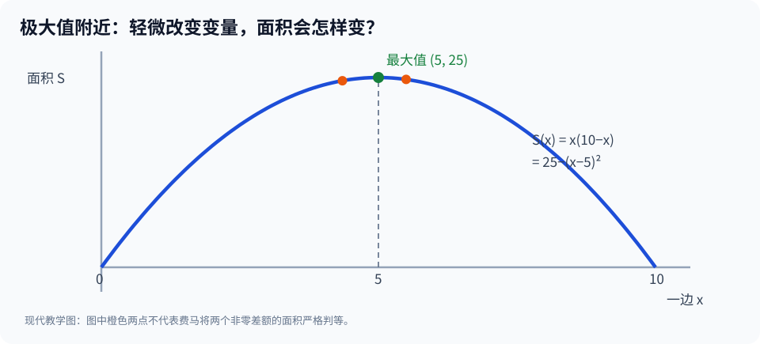

# 第二部·第十章｜费马的拟等法：几乎相等，到底算不算相等？

给你一根长10个单位的绳子。

现在把它剪成两段，用这两段分别作为一个长方形的长和宽。

请回答：

**长与宽分别是多少，才能让长方形的面积最大？**

如果你学过初中数学，很可能立刻答出：

长和宽都等于5。

因为正方形是周长相同的所有长方形中面积最大的那个。

但这道题真正值得讲的，不是答案。

而是下面这个追问：

**假如不知道「正方形最大」，有没有一种通用的运算步骤，可以直接找到最大值？**

你可以把其中一边设成 $x$，另一边就是 $10-x$，于是面积为：

$$
S=x(10-x).
$$

现在请你观察一种有些古怪的做法：

把 $x$ 换成 $x+e$。

比较改变前后的两个面积。

先把它们**当作几乎相等**，然后约去共同部分，除以 $e$，最后再把含有 $e$ 的项丢掉。

结果，就会得到：

$$
x=5.
$$

听起来像不像一场作弊？

**刚刚用来除的量，为什么随后又能被忽略？**

这正是费马的拟等法（*adequality*）在今天仍然值得讲述的原因。

它把极值问题推进到一种惊人高效的代数步骤，也留下了一道直到微积分基础重新建立时才得到更统一回答的逻辑难题。

## 一、在费马之前，「最大」常常是一道特殊的几何题

古希腊数学家已经研究过许多极值和切线问题。

欧几里得、阿波罗尼奥斯的几何传统中，也存在不少需要证明某条线段、某个面积最大或最小的构造。

但往往每换一个对象，就需要重新组织几何证明。

一个圆的极值问题，和一条抛物线的切线问题，似乎属于两套不同的技巧。

到了十六、十七世纪，代数符号逐渐变得更有力量。

维耶特等人的工作，使未知量可以较系统地参加代数变换。

这为另一个问题创造了条件：

**能不能不为每条曲线发明新几何术，而是建立一套对许多极值和切线都有效的代数程序？**

法国数学家皮埃尔·德·费马（Pierre de Fermat）就是在这样的背景下展开研究。

他是法律职业人士，也从事数学研究。

根据数学史传记材料，他在1620年代末已在波尔多参与数学交流，围绕极大极小等问题形成早期成果；1630年代又通过通信与巴黎数学圈建立了更广泛的联系。[1]

这里必须区分：某项研究在手稿和私人通信中出现，与它后来被编辑、刊印，不是一回事。

我们的主要一手文本来自19世纪整理出版的《费马全集》所收录的拉丁文原稿。它能让我们追索方法内容，却不能让我们假装亲临某一场没有记录的讨论。

更重要的是：

费马早期极值研究可以追溯至笛卡尔1637年《几何学》发表之前。

本章因此是一次**专题性回溯**，并非费马读过上一章的笛卡尔著作之后，才第一次想到「拟等」这种运算。

## 二、原始方法的第一步：让同一个量发生微小改变

回到那块长方形。

设一边为 $a$，另一边为 $10-a$。

面积是：

$$
f(a)=a(10-a)=10a-a^2.
$$

让 $a$ 增加一个辅助量 $e$。

新的面积便成为：

$$
f(a+e)=(a+e)(10-a-e).
$$

把它展开：

$$
f(a+e)=10a-a^2+10e-2ae-e^2.
$$

两者之差为：

$$
f(a+e)-f(a)=10e-2ae-e^2.
$$

整理：

$$
f(a+e)-f(a)=e(10-2a-e).
$$

到这一步，没有任何古怪之处。

无论 $a$ 和 $e$ 是什么，等式都成立。

数学上的关键变化发生在下一步。

费马考虑的是极大值附近的比较。他把原值与加入辅助量后的值进行一种**拟等**比较。

在其《Methodus ad disquirendam maximam et minimam》中，确有先引入辅助量、比较两种表达、约去公同部分、除以该量、最后去掉仍含该量之项的步骤。[2]

但需要立刻说清：

**拟等不是把 $f(a+e)=f(a)$ 当成对每个非零 $e$ 都严格成立的普通等式。**

如果严格相等，那绝大多数 $a$ 和 $e$ 根本不满足。

费马要抓住的是极值处发生的某种特殊关系，而不是宣布每一次改变都不改变面积。

而「拟等」到底应该如何翻译、如何理解其近似性质，现代数学史学者存在不同解释。[3]

所以，我们可以学习这套算法如何工作，却不能假装已经毫无争议地复原了费马当时对每一步的哲学理解。

## 三、最诡异的三步：约掉、除掉、舍掉

继续把步骤写完。

比较：

$$
f(a+e)\ \overset{\text{拟等}}{\sim}\ f(a).
$$

这里的符号只是本书临时使用的**教学记号**，不代表费马写过这个波浪线。

约掉双方共有的部分后，我们得到拟等关系：

$$
e(10-2a-e)\ \overset{\text{拟等}}{\sim}\ 0.
$$

如果先把 $e$ 当作非零辅助量，就可以进行除以 $e$ 的代数操作：

$$
10-2a-e\ \overset{\text{拟等}}{\sim}\ 0.
$$

然后，按照费马的方法，去掉仍然含有 $e$ 的项，得到一个普通方程：

$$
10-2a=0.
$$

因此：

$$
\boxed{a=5}.
$$

于是长与宽都等于5，面积为25。

注意这张图的用途。

图上橙色的点不是某个「神秘小量」的真实大小；它只是用现代函数图像展示：当 $a$ 靠近5时，面积变化具有特殊的平坦趋势。

最值得研究的不是最后的5。

而是：

**为什么在除以 $e$ 以后，又可以把 $e$ 相关的项舍去？**

如果 $e=0$，前面的除法没有定义。

如果 $e\ne0$，又没有理由把它当作严格的零。

在普通代数中，不能两头都占。

这就是拟等法最令人不安、也最富创造性的地方。

## 四、先验证答案：这不是一次碰巧猜中的数字

为了避免「算法得出5，所以5一定对」的循环论证，我们再用完全不同的方式检查。

原面积为：

$$
f(x)=10x-x^2.
$$

配方：

$$
f(x)=25-(x-5)^2.
$$

由于任意实数的平方都不小于零：

$$
(x-5)^2\ge0,
$$

所以：

$$
f(x)\le25.
$$

等号恰好在 $x=5$ 时成立。

因此在允许的范围 $0\le x\le10$ 内，面积的**全局最大值**确实是25。

这是一份独立而严格的证明。

你甚至不需要知道费马，也不需要学微积分。

但是，它和拟等法解决的问题并不相同。

配方对于这道二次函数题很有效。

若面积变成一个三次、四次，甚至更复杂的表达式，依靠「看出平方差」可能就没那么容易了。

费马的方法想做的，是建立**一种更一般的搜索步骤**。

不管表达式的细节怎样变化，都尝试比较原变量与加入辅助量后的结果，约掉公共部分，再提取极值条件。

这是一种算法思想。

正因如此，它后来才会被放入微积分诞生的前史中反复讨论。

## 五、用现代极限，再解释一次「丢掉e」

今天，我们可以给出一套更精确的推导。

对于 $e\ne0$，先计算真正的差商：

$$
\frac{f(a+e)-f(a)}{e}=10-2a-e.
$$

再令 $e$ **趋近于**0。

注意，不是先把 $e$ 设成0。

是在每一个非零 $e$ 上计算差商，然后研究它在 $e$ 越来越小时趋向哪个数。

于是得到：

$$
f'(a)=\lim_{e\to0}(10-2a-e)=10-2a.
$$

如果 $a$ 是函数定义区间内部的一个可微局部极大值点，那么由费马定理：

$$
f'(a)=0.
$$

因此：

$$
10-2a=0,
$$

得出 $a=5$。

你会发现，现代导数算法与前面的拟等法在表面步骤上非常相似。

先做差。

再除以变化量。

最后只保留变化量消失时的主要关系。

但如果把这两个过程直接画上等号，科学史就出问题了。

**现代极限给出了一套后世明确表述的数学解释；它不是证明费马本人已经写出了19世纪的极限定义。**

费马原文使用的是拟等、除去辅助量、舍弃剩余相关项等步骤。

现代极限理论则将除法有效的条件和趋近过程明确分开。

我们可以说这是一种值得注意的**结构相似性**。

却不能说它们是完全相同的历史语言。

## 六、一个反例：导数等于零，不一定取得最大值

这里出现了另一个非常重要的边界。

刚才我们说：函数在内部可微的极大值点，导数必须为零。

反过来成立吗？

未必。

看一个简单的函数：

$$
g(x)=x^3.
$$

它在原点的导数为零：

$$
g'(0)=0.
$$

但 $x=0$ 根本不是最大值，也不是最小值。

因为当 $x<0$ 时，$x^3<0$；当 $x>0$ 时，$x^3>0$。

函数只是穿过原点，局部切线变得水平，却继续增长。

所以：

**零导数只是内部可微极值的必要条件，不是充分条件。**

更进一步，如果最大值出现在区间端点，或者函数在某处不可微，那么直接套用「导数为零」也可能漏掉答案。

这不是对费马的嘲笑。

它提醒我们：从一些成功例子提炼出的算法，想变成一条普遍定理，还需要仔细说明**适用条件**。

后来的微积分发展，正是不断在算法的威力与基础的严谨之间寻找平衡。

## 七、费马不仅研究极值，他还研究切线

现在，让我们把视线从最大面积转向曲线。

假设今天要求抛物线：

$$
y=x^2
$$

在某个横坐标 $x=a$ 处的切线。

先取曲线上一点：

$$
P=(a,a^2).
$$

再取附近一点：

$$
Q=(a+e,(a+e)^2).
$$

连接两点，得到割线。

割线斜率是：

$$
m_e=\frac{(a+e)^2-a^2}{e}.
$$

展开后：

$$
m_e=2a+e.
$$

当 $e$ 趋向零时，割线斜率趋向：

$$
m=2a.
$$

于是切线方程成为：

$$
y-a^2=2a(x-a).
$$

例如当 $a=1$ 时，切线斜率就是2。

如果你记得上一章，就会发现：

这和笛卡尔借助相切圆的重根求出的结果完全一致。

**目标相同，但思维路径完全不同。**

笛卡尔采用辅助圆、法线和代数重根的构造。

费马则利用一种来自极值研究的拟等比较，去确定与曲线性质相符合的切线。

不过，有一条重要的史料边界：

上面展示的**两点割线斜率取极限**，是现代微积分最常见的教学推导，并不是费马原文切线法的逐句复现。

在费马《Maxima et Minima》的切线段落里，他考虑抛物线、切线交轴的位置以及相关几何比例，并借助拟等法求出所需关系。[2]

真正的史学讲述，必须分清「现代数学能够说明同一结果」与「历史人物当时正是这样计算」之间的差别。

## 八、1638年的争论：两条路线为何彼此不服？

在数学发展中，某种方法看上去更短，并不意味着所有人都必须接受它。

笛卡尔与费马围绕切线方法，在1638年前后发生过著名的争论。[4]

笛卡尔的方案更强调：在他认为可接受的几何曲线范围内，通过方程和几何构造获得确定的法线。

费马的方案则试图把比较极大极小的运算步骤拓展到切线问题。

两者都在追求更普遍的方法，但各自看重的东西并不完全一样。

一方不满意对方计算中的模糊步骤。

另一方可能认为对方处理复杂题目时，需要的代数工作实在太繁重。

后世数学史研究将这场争论理解为对方法的**普遍性、适用范围与几何严格性**的不同追求。[4]

不应把它编成两个人在一间屋子里互相嘲讽的对白。

更不应宣布：某一方已经掌握19世纪完整的函数理论，所以另一方只是「没学会求导」。

1638年，真正成熟的现代微积分还没有诞生。

他们都在探索怎样把一些特定的切线、极值技术发展为更一般的办法。

我们今天知道，两条路线留下的有用思想会被后人继续吸收。

这才是争论在数学史上的真正意义。

## 九、拟等，究竟是什么意思？历史研究仍有分歧

既然这套方法这么重要，为什么不能简单把拟等翻译成「无限接近」？

原因是史料和解释并不允许我们这么快下结论。

费马在文本里使用了 *adaequatio* 等拉丁词，并将相关词义联系到丢番图的希腊数学术语。[2]

但是，近似究竟意味着数量上的接近？

是否涉及某种特殊的小量？

在不同类型的计算问题里，费马是否使用了相同的解释？

这些都属于后世数学史研究的讨论范围。[3]

有的研究倾向用无穷小变化理解其步骤，有的解释则强调代数方法和近似相等关系的多重含义。

我们不需要把任何一种现代哲学框架伪装成费马从未写下的定义。

能够确认的是：

他留下了一种从微小改变量提取有用条件的算法传统。

它在很多极值、切线问题上能迅速产生正确结果。

而当人们继续追问「为什么可以约掉，再丢掉」，这种方法又暴露了严密基础尚不充分的地方。

**正确的答案可以先于完整的理由出现；但数学不会永远满足于只知道答案正确。**

这是贯穿整部微积分史的一条暗线。

## 十、切线与面积，为什么好像越来越接近？

现在，我们可以把第二部已经讲过的几条道路放在一起。

伽利略研究运动，速度随时间变化；整体路程是变化的积累。

开普勒研究体积，复杂物体可以由截面逐渐累积。

卡瓦列里研究不可分量，截线和截面的比较有时足以替代复杂的面积计算。

笛卡尔研究解析几何，使曲线能够被代数式描述。

费马研究拟等法，让极值和切线问题开始出现可重复的运算套路。

这些研究并非一条完全顺序的师承链。许多人同时代研究、相互讨论，也各自有自己的问题背景。

但当我们从今天回望，会看见一个越来越清晰的模式：

**求面积，需要把无数局部的量累加为整体。**

**求切线，需要从邻近位置的变化中提炼一个局部方向。**

这看起来是两个方向相反的任务。

前者从局部走向整体。

后者从整体函数里提取局部。

可如果能够找到一个统一的运算框架，也许两件事根本不是彼此孤立的技巧。

下一章，沃利斯、格雷戈里和巴罗等数学家将进一步推进级数求积、运动、切线之间的联系。

在那里，一个比「怎样求导」更加深刻的问题即将浮现：

**如果你知道每个位置的变化率，能不能恢复原来的整体？**

再往前一步，就是微积分基本定理的历史背景。

费马没有把这一整套现代语言写完。

但他已经帮助数学家走到一个新的门槛前：

**不要只研究一个图形最后长什么样，还要研究当它的变量改变一点点时，结果究竟怎样变化。**

---

## 参考文献与史实边界

1. MacTutor，[《Pierre de Fermat》](https://mathshistory.st-andrews.ac.uk/Biographies/Fermat/)，尤其其1620年代末波尔多研究和1630年代通信记录。
2. 费马，[《Œuvres de Fermat》第一卷，“Maxima et Minima”](https://fr.wikisource.org/wiki/%C5%92uvres_de_Fermat/I/Maxima_et_Minima)，Paul Tannery 编订，1891，pp.133—180；首篇“Methodus ad disquirendam maximam et minimam”及抛物线切线段。包含辅助量E与拟等法的原文步骤。
3. Katz、Schaps、Shnider，[《Almost equal: Method of adequality from Diophantus to Fermat and beyond》](https://arxiv.org/abs/1210.7750)，2012，数学史解释性研究；支持拟等一词的语义及现代复原存在不同观点。
4. Evelyne Barbin，[《Universality versus generality: an interpretation of the dispute over tangents between Descartes and Fermat》](https://academic.oup.com/edited-volume/41254/chapter-abstract/350819321)，2017；关于1638年切线方法争论和两种方法追求的比较。
5. AMS *Notices*，[《The Rise of Calculus》](https://doi.org/10.1090/noti2593)，2022；关于笛卡尔、费马及后续切线方法的数学史综述。

**重要限定**：在 $f(a+e)$ 的教学推导中，$\sim$ 表示为解释拟等而临时采用的记号，并非费马原文；长为10的具体数值、现代导数符号与 $\lim$ 也属于教学重构。费马方法的历史适用性、拟等含义和现代极限解释必须分开。不能把「除以非零 $e$」与「随后令 $e=0$」写成普通等式链条。