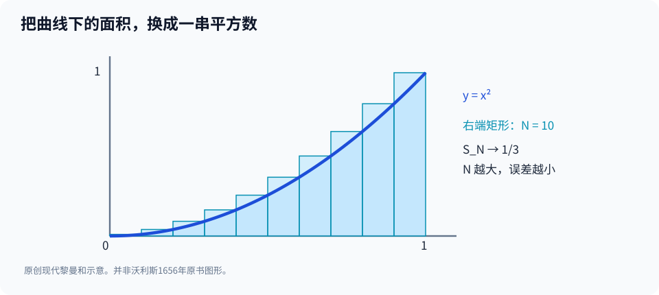

# 第二部·第十一章｜沃利斯、格雷戈里与巴罗：两种问题接近汇合

如果你知道一辆车在每一个时刻的速度，你能算出它总共走了多远。

反过来，如果你知道从起点到每一时刻的累计路程，你又可以尝试求出这一瞬间的速度。

这两句话似乎再平常不过。

可是，将车换成曲线，问题突然变得惊人。

**如果知道一条曲线每个位置的高度，就能算出曲线下方的面积。那么，如果已经算出从起点到某处的面积，能否反过来找回那个位置的曲线高度？**

这就是求积与求切线之间可能存在的秘密。

两个世纪之前，阿基米德在曲线内补入三角形；上一章费马用拟等寻找极值与切线。它们看起来完全不像同一个问题。

现在，十七世纪的数学家开始怀疑：

**求面积和求瞬时变化，会不会是一对彼此反向的操作？**

不过，怀疑不是定理。

一位数学家必须先让面积问题变得易于计算，另一些人再从中发现局部变化与整体累积之间的几何联系。

这里有三个名字：沃利斯、詹姆斯·格雷戈里、巴罗。

他们并没有携手写成一本现代微积分教材，也不是排成一条精确无误的师承链。

但从他们的工作中，确实可以看见一座桥正在搭成。

## 一、求积为什么一直像一门「手艺」？

先回忆我们已经掌握的工具。

阿基米德可以求出抛物线弓形的面积，但需要利用那个图形独有的几何性质。

卡瓦列里可以比较两个图形「所有的截线」，却仍面临不可分量究竟是什么的基础质疑。

笛卡尔把曲线写进方程，费马又为切线和极值开发了通用性更强的代数步骤。

可是，这些技巧还没有自然组合成一部可以反复调用的计算手册。

比如：

$$
y=x,\qquad y=x^2,\qquad y=x^3.
$$

三个表达式只有指数不同。

如果每换一次指数，就要重新设计复杂的几何图形，求积仍然很费事。

最理想的情形是：

**有一条法则，只要看见指数，就能快速给出面积。**

这听起来像今天的积分公式：

$$
\int_0^1 x^n\,dx=\frac1{n+1}.
$$

然而，不能把这行现代符号直接送回1656年。

历史问题恰恰是：人们如何在尚未拥有这套统一记号时，沿着无穷求和与几何比较摸到它？

## 二、沃利斯：把面积算成一串数

约翰·沃利斯（John Wallis，1616—1703）长期在牛津大学担任萨维尔几何学教授。

他在1656年出版的《Arithmetica infinitorum》（通常译作《无穷算术》），是17世纪求积发展中的一部关键著作。[1][2]

它并不是一本现在意义上的积分学讲义。

但是沃利斯不断做一件很有力量的事：

把曲线下的面积转化为某些数列求和的比例。

例如，考虑单位正方形内的曲线：

$$
y=x^2,\qquad 0\le x\le1.
$$

曲线下方的面积究竟是多少？

我们先按照现代方式，沿横轴平均分成 $N$ 份。

第 $k$ 个分点是：

$$
x_k=\frac{k}{N}.
$$

如果用每个小区间右端的高度做矩形，其总面积为：

$$
S_N=\frac1N\sum_{k=1}^{N}\left(\frac{k}{N}\right)^2.
$$

将各项合并：

$$
S_N=\frac1{N^3}\sum_{k=1}^{N}k^2.
$$

这就是把几何问题变成算术的瞬间。

一张图、一条曲线，竟然被换成了：

$$
1^2+2^2+3^2+\cdots+N^2.
$$

于是，一个新的问题取代了旧问题：

**我们能不能算出平方数的和？**

## 三、三分之一的面积，从哪里冒出来？

平方和有一个已知的有限求和公式：

$$
1^2+2^2+\cdots+N^2
=\frac{N(N+1)(2N+1)}6.
$$

代入刚才的矩形面积：

$$
S_N
=\frac{N(N+1)(2N+1)}{6N^3}
=\frac{(N+1)(2N+1)}{6N^2}.
$$

把分子展开：

$$
S_N=\frac13+\frac1{2N}+\frac1{6N^2}.
$$

当分割越来越细，也就是 $N$ 越来越大：

$$
S_N\longrightarrow\frac13.
$$

所以，单位正方形中抛物线下方的面积为：

$$
\boxed{A=\frac13}.
$$

这幅图用现代右端矩形展示了求和逼近。矩形总面积从上方逼近曲边区域。它不是沃利斯原书的复制品。

如果你愿意仔细检查，会发现：

我们最后得到的不是一个四舍五入的小数。

而是一个精确的分数。

从这里，继续研究：

$$
1+2+\cdots+N,
$$

$$
1^3+2^3+\cdots+N^3,
$$

以及更高次幂的和，就能自然想到一条模式：

$$
\int_0^1 x^n\,dx=\frac1{n+1}
$$

——至少先对非负整数指数成立。

这是**现代极限与积分语言的重构**。沃利斯的原始论证采用当时的无穷算术、比例、插值等办法，不能说他亲笔写下我们这里的求和符号和极限箭头。[1][3]

它的意义在于另一件事：

**面积不再只是某个特定图形的几何特权，而越来越像可以按指数计算的代数对象。**

## 四、整数指数还不够：根号会怎么办？

一条规律刚刚显露，人们马上会碰到它的边界。

如果

$$
y=x^{1/2}=\sqrt{x},
$$

是不是也有：

$$
\int_0^1\sqrt{x}\,dx=\frac{1}{1+\frac12}=\frac23?
$$

结果确实是对的。

但问题在于：你不能仅凭前面几个整数例子，就宣布分数指数也自动适用。

因为从：

$$
n=1,2,3,\ldots
$$

到：

$$
n=\frac12,\frac13,\ldots
$$

中间跨越了需要额外解释的数学步骤。

沃利斯对这种从已知情形推向更广情形的**插值**方法尤其感兴趣，甚至用类似的冒险思想研究圆面积与沃利斯乘积。[1][2][4]

有时这种推广能给出令人惊讶的正确答案。

但它也提醒我们：

**计算规律被猜中，与推广过程已经得到严格证明，是两回事。**

这与费马拟等法的故事几乎形成镜像。

费马通过操作微小改变量，迅速得到切线和极值。

沃利斯则通过操作无穷数列和指数，迅速得到一些面积。

二者计算能力很强，却都留下了基础层面的问题。

## 五、詹姆斯·格雷戈里：切线和面积之间似乎有一条暗道

现在，故事从牛津移向另一位研究者。

詹姆斯·格雷戈里（James Gregory，1638—1675）是苏格兰数学家。

他在1667年出版《Vera circuli et hyperbolae quadratura》，1668年又出版《Geometriae pars universalis》。这些著作研究曲线、无穷过程与求积的关系。[5]

后世数学史研究特别强调，1668年著作已经触及**求切线的方法与求面积的方法之间的反向联系**。

某些历史概述甚至把它称为最早试图系统组织类似微积分知识的著作之一。

这里有必要留一条明确边界：

**格雷戈里并没有因此得到我们今天整套微积分基本定理、完整函数概念和普遍积分技巧。**

他所研究的仍是当时具体的几何对象和计算方法。

并且，他的数学研究中也有不成立的论证。比如，有关圆周率更深层代数性质的某些结论，不能因为他在无穷方法上富有创造力，就一并当作定理接受。[5]

科学史中最值得写的人物，不一定每次都正确。

重要的是：在什么地方，他把原有问题向前推进了一步？

对于格雷戈里而言，这一步就是让求积与切线之间的关系更加清晰。

然而，为什么两者会反向？

只说“它们有联系”，仍然不够。

下一位人物，会把这种联系做成非常有说服力的几何论证。

## 六、巴罗：从一个面积函数里，竟然读得出曲线的高度

艾萨克·巴罗（Isaac Barrow，1630—1677）是剑桥数学家，后来成为牛顿的老师和同事。

他的《Lectiones Geometricae》（《几何讲义》）于1670年印行。相关授课内容与书稿形成过程早于出版时间，不可把“1670年出版”理解为“1670年才产生全部思想”。[6][7]

巴罗的几何思想中，有一项对我们今天尤其重要：

**在适当几何情形下，求积与求切线可以被看成彼此反向的过程。**

来做一项现代数学重述。

在平面上画曲线

$$
y=x^2,\qquad x\ge0.
$$

从原点开始，到位置 $x$ 为止，曲线下方的面积记作：

$$
A(x).
$$

上一节已经得到：

$$
A(x)=\frac{x^3}{3}.
$$

现在问题反过来了。

已知面积函数，能否求出它在某个位置增加得有多快？

我们把右边界向右挪一小段 $h$，其中 $h>0$。

新增面积为：

$$
A(x+h)-A(x).
$$

这片新增区域夹在两个简单矩形之间。

左端高度是 $x^2$，右端高度是 $(x+h)^2$。

所以：

$$
x^2h
\le A(x+h)-A(x)
\le(x+h)^2h.
$$

再把各项除以正数 $h$：

$$
x^2
\le
\frac{A(x+h)-A(x)}{h}
\le
(x+h)^2.
$$

当 $h$ 逐渐缩小，左右两个界同时逼近 $x^2$。

因此：

$$
\boxed{A'(x)=x^2}.
$$

你看见了吗？

原来要求的是曲线下方的**整体面积**。

但只要研究这个面积随右边界移动而增加的速度，答案竟然恰好回到了曲线在该位置的**高度**。

**整体累积的信息里，藏着局部变化；局部变化又能告诉你整体怎样增长。**

这正是我们追寻许久的那个联系。

## 七、这不是巧合：为什么面积每次增加的速度等于高度？

如果刚才的公式让你觉得像某种神奇的符号游戏，不妨再回到图形。

当右边界向右移动 $h$，新增面积是一条很窄的曲边带。

如果 $h$ 很小，这条带的高度在大部分位置都接近 $x^2$。

于是新增面积大约是：

$$
\Delta A\approx x^2h.
$$

所以单位水平长度产生的面积增量约为：

$$
\frac{\Delta A}{h}\approx x^2.
$$

刚才的不等式，把这个直觉进一步变成了有条件的严格证明。

在更一般的现代情形下，若函数 $f$ 在点 $x$ 附近连续，定义：

$$
A(x)=\int_a^x f(t)\,dt,
$$

那么：

$$
A'(x)=f(x).
$$

注意，这里明确需要连续性等相应条件。

对非常不规则的函数，这个公式必须按具体的积分与微分理论重新检查；不能只靠画一张平滑图就断言处处成立。

对17世纪的格雷戈里与巴罗，我们应该说：

他们已经在若干几何框架中触及了这类**反向关系**。

但我们使用的 $A'(x)$、$\int$、函数连续性和现代证明语句，并非他们的原始符号体系。[5][6]

这是一个至关重要的史学区别。

否则，我们只是把后来的教材复制回过去，再给古人贴上名字。

## 八、为什么巴罗没有直接写出一本现代《微积分学》？

如果反向关系已经出现，为什么后面还需要牛顿和莱布尼茨？

因为一个漂亮的几何原则，不等于拥有了可广泛重复使用的算法。

巴罗偏重经典几何方法，对复杂的代数运算路线并不像一些同时代研究者那样热衷。[6]

因此，即使你能在一张图上理解“面积函数的切线对应原曲线高度”，遇到复杂多项式、根式、不同变量和隐式关系时，仍需要一套可以连续运转的规则。

沃利斯的求积方法更算术化，却没有与各种切线问题结合成统一的现代符号算法。

格雷戈里已经深入探索两类运算的联系，但其研究表述、适用对象和传播情况同样有历史边界。

而后来的牛顿与莱布尼茨，分别将早期积累的方法推进成更有体系的运算理论。

这不是说所有前人的成果都被他们“收集整理”而已。

他们自己的数学创造非常重要。

但也不能把1680年代以后的微积分想象成无中生有。

**一套新理论的诞生，往往不是第一次有人看见某个结果，而是许多局部方法突然有了可以一起使用的语言。**

## 九、一个年轻人开始抄写这些书里的方法

回到1660年代的剑桥。

有一位年轻学生，正试着把从几何与代数著作中读到的技巧，整理成他自己的计算工具。

他读过笛卡尔，接触了沃利斯的《无穷算术》，也在剑桥接受与巴罗有关的数学环境影响。[8]

此人的名字当然是牛顿。

但是，在进入下一章之前，我们必须拦住一种太容易写出的传奇：

“1666年，大学因为瘟疫关闭。牛顿独自回到乡间，在苹果树下突然发明微积分。”

这样的故事虽然简单，却把真正的数学研究全部抹去了。

他的手稿显示，重要的准备工作早在1664年就已展开。

从二项式展开到切线求解，从数列求和到曲线求积，每一步都不是一枚从天而降的苹果。

而是接触旧方法、发现其局限、改造并组合它们的长期过程。

下一章，我们将打开牛顿1664—1666年的数学笔记。

那里没有现成的现代求导公式。

却已经出现一个极具野心的计划：

**能不能用同一套方法，处理不断流动的量、曲线的切线和曲线下的面积？**

---

## 来源与历史范围

1. MacTutor，[John Wallis](https://mathshistory.st-andrews.ac.uk/Biographies/Wallis/)，1656《无穷算术》及面积、插值研究。
2. Oxford Mathematical Institute，[John Wallis in the Busbridge lecture](https://www.maths.ox.ac.uk/about-us/history/busbridge-lecture)，对其数学传承与牛顿阅读的说明。
3. MAA Convergence，[Wallis’s 1655–56 Works on Quadrature](https://old.maa.org/press/periodicals/convergence/mathematical-treasures-walliss-1655-56-works-on-quadrature)，原书书名、图像与计算脉络。
4. J. A. Stedall，[Reading between the lines: John Wallis’s Arithmetica infinitorum](https://academic.oup.com/book/6773/chapter-abstract/150896337)，Oxford UP，2003，pp.155—182。
5. MacTutor，[James Gregory](https://mathshistory.st-andrews.ac.uk/Biographies/Gregory/)，1667与1668著作、求积与切线的反向联系及研究局限。
6. MAA Reviews，[The Geometrical Lectures of Isaac Barrow](https://old.maa.org/press/maa-reviews/the-geometrical-lectures-of-isaac-barrow)，几何求切线、求积和微分三角形。
7. MacTutor，[Chronology 1650–1675](https://mathshistory.st-andrews.ac.uk/Chronology/11/)，1668格雷戈里、1670巴罗出版时间。
8. Newton Project，[Introduction to the Texts](https://www.newtonproject.ox.ac.uk/texts/introduction)，牛顿1664—1665年读书与数学笔记的来源。

**回译声明**：$S_N$、$A'(x)$、现代定积分公式及不等式证明是为帮助读者理解而给出的现代数学模型，不能被当成沃利斯、格雷戈里或巴罗的原文。个别历史著作关于“首位发现反向关系”的评断可能不一致，本书采用分贡献、分证据的叙述，不以单一口号判定优先权。