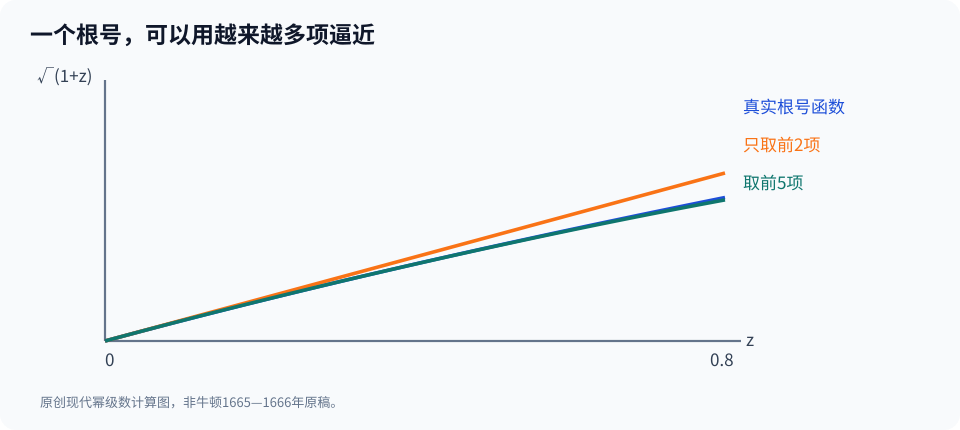

# 第三部·第十二章｜1666年的牛顿：一组手稿为什么改变数学

1666年，英国遭受瘟疫的冲击。剑桥大学一度停课，年轻的牛顿在那段时期大部分时间待在家乡伍尔索普。

后来，人们把这一阶段称为他的“奇迹之年”。

在最简单的版本里，故事是这样的：

大学关闭。

牛顿回到乡下。

某天，一只苹果落下。

他突然理解了万有引力，发明微积分，还顺手揭开了光的秘密。

**这个版本太方便，以至于最重要的东西被整个省略了：数学家究竟怎样做数学？**

我们拥有更可靠、也更难得的东西。

不是凭空重构出来的房间、雨声或者内心独白。

而是他的数学笔记与一份可以准确定位的手稿。

那份手稿写于**1666年10月**，今天仍保存于剑桥大学图书馆的馆藏中，并由牛顿研究项目提供转写和目录信息。[1][2]

与其说这是天才的一次闪电式顿悟，不如把它当作一个更有力量的谜题：

**一位二十多岁的数学研究者，怎样把当时分散的求积、切线、无穷级数和运动学方法，逐渐组织成同一组问题？**

## 一、一个真正困难的任务：别再为每道题发明新技巧

上一章结束时，我们看见三条研究道路正在接近。

沃利斯用数字和指数研究曲线下的面积。

格雷戈里追踪面积与切线的反向联系。

巴罗则以几何方式显示，整体累积的变化速度与原曲线高度密切相关。

可是，假设你现在碰到下面三个问题。

第一：

$$
y=x^2
$$

在任意位置的切线怎么求？

第二：

$$
y=\sqrt{1+x}
$$

能不能像多项式一样拆开计算？

第三：

如果物体的位置随时间改变，位置函数的瞬时变化和整个运动的累计结果，能不能使用同一套运算语言？

这三个问题的外形完全不同。

一个属于几何。

一个属于代数级数。

一个属于运动。

**微积分真正的难度，不是逐个算出答案，而是把不同问题变成某种可以重复执行的通用步骤。**

牛顿在1660年代的工作，正是沿着这个方向推进。

但这项研究并不是从1666年凭空开始的。

## 二、先把神话的时间表改正确

牛顿于1661年进入剑桥大学三一学院。

1664年前后，他开始系统地研读超出常规大学课程的数学材料，包括维耶特、笛卡尔、沃利斯等人的著作。[3][4]

这些名字并非装饰。

笛卡尔提供了将几何轨迹与代数关系联系起来的方法。

沃利斯的《无穷算术》展示了通过幂和、插值研究曲线面积的道路。

巴罗所在的剑桥数学环境，也让求切线、运动和几何论证不再彼此隔绝。

牛顿先读懂这些方法，再遇到它们的困难。

牛顿研究项目对其数学笔记的介绍，明确记载：他在1664—1665年阅读沃利斯有关求积的著作，随后扩展出对负整数和分数指数都适用的广义二项式研究。[3]

请注意这个顺序。

**不是瘟疫让他第一次接触数学。**

瘟疫期间的离校生活，为一段已经展开的研究提供了特殊的环境。

根据现代权威传记，牛顿从1665年夏至1667年春，大部分时间在伍尔索普，期间既研究数学，也研究光学与运动等问题。[4]

然而，我们不能把这段时期写成“一年里所有结论都已经完善”。

独立研究、手稿写成、与同行交流、公开出版，本来就是不同事件。

牛顿后来仍不断重写和扩展自己的方法。

如果只把1666年当作一个神奇年份，反而看不见发明从何而来。

## 三、真正的新武器：把根号拆成无穷多项

现在，来到这一章最值得亲手计算的地方。

今天，如果你想把

$$
(1+z)^2
$$

展开，几乎不用思考：

$$
(1+z)^2=1+2z+z^2.
$$

这是普通二项式公式。

把指数换成3、4、5，也可以得到有限多项式。

但如果指数是分数呢？

比如：

$$
(1+z)^{1/2}=\sqrt{1+z}.
$$

你再使用普通乘法，还能把它变成一个有限多项式吗？

通常不能。

因为根号并不是一个只有固定几项的多项式。

牛顿的广义二项式研究，让分数指数和负指数也能够进入一种有规则的级数展开。[3]

在现代符号下：

$$
(1+z)^\alpha
=1+\alpha z+\frac{\alpha(\alpha-1)}{2!}z^2
+\frac{\alpha(\alpha-1)(\alpha-2)}{3!}z^3+\cdots.
$$

当 $\alpha$ 不是非负整数时，这通常是一条无限级数。

对实数 $\alpha$，取 $|z|<1$ 时，这条展开有良好的通常收敛意义。

令 $\alpha=1/2$，得到：

$$
\sqrt{1+z}
=1+\frac z2-\frac{z^2}{8}+\frac{z^3}{16}
-\frac{5z^4}{128}+\cdots.
$$

这并不是说牛顿在1665年写下了这个完全一样的现代 $\alpha$ 与阶乘记号。

它是对他那类成果的现代代数回译。[3][5]

但这个思路本身极其强大：

**一个不能轻易作为多项式运算的根式，被展开成一串可以逐项处理的幂。**

一旦有了这条路，许多复杂表达式就能被转化成运算规则较简单的项。

## 四、为什么无穷多项，反而比一个根号更好算？

我们用一个极简单的数字验证。

取：

$$
z=\frac14.
$$

原来的量是：

$$
\sqrt{1+\frac14}=\sqrt{\frac54}
\approx1.118033989.
$$

现在不用直接开方，而是把前几项加起来：

$$
1+\frac{1}{8}
-\frac{1}{128}
+\frac{1}{1024}
-\frac{5}{32768}.
$$

这些项分别来自：

$$
1,\quad \frac z2,\quad-\frac{z^2}{8},
\quad\frac{z^3}{16},\quad-\frac{5z^4}{128}.
$$

相加得到：

$$
1.118011475\ldots
$$

和真实数值之间的差距只有大约 $0.0000225$。

这里的数字是现代高精度计算的教学示例，并不是牛顿手稿中的逐位记录。

你当然可以用更先进的方式直接计算平方根。

但牛顿时代重要的不是“这比现代计算器快多少”。

而是：

**对一整类表达式，你可以创造一种可逐步加精度的算法。**

不管需要多少精度，只要你能证明截断误差得到控制，就可以继续计算后面的项。

更进一步，如果一个复杂函数能分解为许多幂函数，那么原本针对 $x^2$、$x^3$ 之类的求积技巧，也有机会延伸过去。

这就是广义二项式与曲线求积研究紧密联系的原因。

## 五、当级数遇上面积：数学变成了一种「替换游戏」

先考虑一个我们已经会算的量。

$$
\int_0^1 x^2\,dx=\frac13.
$$

如果函数是：

$$
f(x)=1+x+x^2,
$$

那么现代线性性质使我们可以逐项求积：

$$
\int_0^1(1+x+x^2)\,dx
=1+\frac12+\frac13.
$$

于是：

$$
\int_0^1(1+x+x^2)\,dx=\frac{11}{6}.
$$

只要表达式是有限多项式，问题往往很简单。

现在，如果函数能被展开为：

$$
f(x)=a_0+a_1x+a_2x^2+\cdots,
$$

我们自然会想：

为什么不把每一项的面积都算出来，再相加？

在适合的收敛条件下，现代数学允许我们把积分与无穷求和交换：

$$
\int_0^r f(x)\,dx
=\sum_{n=0}^\infty a_n\frac{r^{n+1}}{n+1}.
$$

但请停一下。

这个式子比刚才的有限多项式更危险。

因为“无穷多项可以逐项积分”不是一条不加条件就能使用的普遍规则。

它需要关于级数收敛的论证；对在收敛半径内部的幂级数，这种操作确实能够成立。

**我们正在看到一种未来会非常有效、但也会不断遭到严密性追问的方法。**

牛顿的早期级数与求积研究，正是许多这样的具体数学问题的交汇点。[3]

不能说他在1666年已经解决了后来关于一致收敛、函数空间的所有问题。

但可以说，他显著扩展了“把曲线面积算出来”这一任务的工具范围。

## 六、1666年10月，手稿上究竟记录了什么？

到这里，终于可以回到那份最重要的文献。

牛顿研究项目收录了一份明确标为 **The October 1666 Tract on Fluxions** 的手稿。

目录信息是：

**1666年10月，29页，现藏剑桥大学图书馆 MS Add.3958.3，叶码48v—63v。**[1]

这份手稿的经过编辑正规化的转写文本，同样可以公开查看。[2]

文本中研究的对象，不止一个。

包括如何通过运动理解几何量的变化，怎样处理曲线的切线和曲率，以及在一些构造中怎样解决面积或体积问题。

这与我们对现代微积分两大任务的理解有明显联系：

求某个量变化得多快。

反过来，怎样从变化和局部结构中恢复整体。

但不能因此说手稿中已经整齐排着现代微积分课程的每一个章节。

原文符号、几何对象和推导组织，与今天差异很大。

它更像研究正在形成的现场证据。

尤其重要的是：

**1666年10月是这份手稿的写作时间，不是它在1666年被印成书公开销售的时间。**

直到后来的1669年、1671年，牛顿还在继续整理和发展相关方法。

再过更久，部分内容才进入印刷传播。

对科学史来说，一条公式何时被某个人写下，与它何时能被其他数学家读到、复用和批评，同样重要。

## 七、苹果为什么不应该抢走这章的主角？

提到牛顿，许多人总先想到苹果。

关于苹果引发他思考引力的叙述，确有后来牛顿本人谈及的回忆传统。[6]

但是，这并不意味着我们拥有一份1666年同一天的完整实验记录，能够精确写出苹果落下的位置、他的表情、他内心冒出的第一句想法。

更不能把苹果与微积分直接捆绑起来：

“苹果落下，所以牛顿立刻写出求导法则。”

这是将两个不同层次的历史故事硬拼在一起。

**牛顿研究运动和引力，与他研究求积、流数和级数，确实有思想上的联系；但数学上的进展首先需要看他的笔记和演算。**

研究史的真正戏剧性，甚至比苹果轶事更加深刻。

因为你可以在史料中看到：

他不是找到了一个万能答案，然后一劳永逸。

而是尝试让几种已经部分有效、却仍互不统一的技术，进入一套更有组织的算法。

## 八、比“发明公式”更重要的是发现共同结构

我们现在可以整理出牛顿1664—1666年工作最值得重视的几个方面。

从沃利斯那里，求积问题可以转成幂和与级数。

从笛卡尔等人的代数几何传统，曲线和切线可以用代数关系处理。

在研究运动时，各种几何量都可以被想象成随某个共同参数连续改变。

当这些视角结合，一种新问题逐渐形成：

**如果两个量随时间一起变化，而它们之间始终满足某个方程，我们怎样直接求出它们变化速度之间的关系？**

例如：

$$
y=x^2.
$$

设 $x$ 随时间改变。

那么 $y$ 也随之改变。

我们希望寻找的，不是某两个固定数之间的比例，而是：

$$
\text{“}x\text{ 的变化速度”}
\quad\text{与}\quad
\text{“}y\text{ 的变化速度”}
$$

之间的关系。

在现代微积分里，这几乎是常规的求导题。

但在牛顿面前，它代表着一条尚在建立的通用道路。

它将不再只研究几何图形的形状，而是把量的**生成与流动过程**也纳入数学。

## 九、在牛顿眼中，变量为什么会「流」？

到这里，前面几章的线索终于合拢。

伽利略让运动的速度成为可以数学表达的量。

笛卡尔让曲线写成方程。

费马尝试通过辅助小量探索切线与极值。

沃利斯把求积算成无穷算术。

格雷戈里与巴罗让切线、面积的反向联系愈发清楚。

牛顿则提出了一个更统一的出发点：

**不先把变量看作桌面上一张静止图画里的长度，而把它看作某个不断生成、不断改变的量。**

随着时间过去，量也在改变。

量本身可以称为“流量”；它变化得多快，对应“流数”。

不过，这些术语与符号体系也经过了逐步形成的过程；不能说它们在1666年的每一张纸上都已经使用统一的点号记法。[7]

下一章，我们就从牛顿的流数法出发。

只用一条曲线：

$$
y=x^2,
$$

去推导一套可以重复使用的变化规则。

接着，我们还会反过来尝试：

如果知道流数，能否找回流量？

这将把我们带到微积分两大问题真正相接的地方。

---

## 史料与核验边界

1. Newton Project，[1666年10月流数手稿目录](https://www.newtonproject.ox.ac.uk/catalogue/record/NATP00100)，MS Add.3958.3 ff.48v—63v。
2. Newton Project，[The October 1666 Tract on Fluxions（转写）](https://www.newtonproject.ox.ac.uk/view/texts/normalized/NATP00100)，可对照保留删改的版本。
3. Newton Project，[Introduction to the Texts](https://www.newtonproject.ox.ac.uk/texts/introduction)，1664—1665年数学读书笔记、沃利斯方法与广义二项式。
4. Stanford Encyclopedia of Philosophy，[Isaac Newton](https://plato.stanford.edu/entries/newton/)，1661入学、1664研究、1665—1667大学关闭期间的生活时间范围。
5. MacTutor，[Chronology 1650–1675](https://mathshistory.st-andrews.ac.uk/Chronology/11/)，1665年广义二项式与初期微分研究概览。
6. Newton Project，[The Life and Work of Isaac Newton at a Glance](https://newtonproject.ox.ac.uk/his-life-and-work-at-a-glance)，包括苹果叙述的晚年回忆性质。
7. MAA Convergence，[Math Origins: The Language of Change](https://old.maa.org/press/periodicals/convergence/math-origins-the-language-of-change)，早期点号记法与牛顿手稿的区别。

**说明**：广义二项式、数值误差、逐项积分及 $\int$ 均为现代解释，不应倒灌入1666年原稿。本文不虚构瘟疫期间的场景对白，不把数学、光学、引力的成熟成果说成同一日完成，更不把1666手稿当作同年公开出版的定稿。