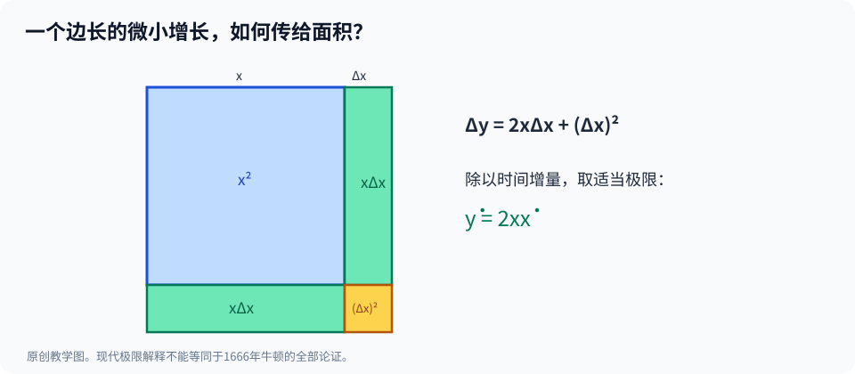

# 第三部·第十三章｜流数法：牛顿从时间出发理解微分

假如一条线的长度是5，它就只是5。

假如一块正方形的面积是25，它也只是25。

在静止的几何图形里，长度、面积、体积通常被当作已经给定的大小。

但是现在，我们换一种看法。

**假设这条线正在不断变长，正方形也跟着不断扩大。**

一秒以后，边长变为6。

再一秒，变成7。

面积从25变成36，又从36变成49。

同样是边长增加1，面积第一次增加11，第二次却增加13。

于是，两个问题出现在面前：

**边长变得有多快？**

**面积又变得有多快？**

这不是同一个问题。

对于牛顿来说，一个很有力量的选择是：

让这些量随时间一起流动。

量本身是一种**流量**（fluent）。

变化的速度是一种**流数**（fluxion）。

当你接受这个视角，原本静止的代数关系就能够被重新理解成运动中的约束。

一条简单的式子：

$$
y=x^2
$$

将变成一条关于**两种变化速度之间关系**的定律。

这就是我们接下来要亲手推导的东西。

## 一、先厘清三个年代：1666、1671、1736

在深入公式之前，先把文献时间线摆正。

牛顿在1665—1666年已经发展与变化速度、切线、求积有关的方法；1666年10月的手稿至今有明确的馆藏与转写。[1]

但他并没有在1666年将一部完整的《流数法》教材印刷发行。

到**1671年**，他写成了更系统的有关级数与流数的长篇研究，后来通常以 *De Methodis Serierum et Fluxionum* 一名为人熟悉。[2]

这部著作的英文译本直到**1736年**才以 *The Method of Fluxions and Infinite Series* 的题名出版——已经在牛顿去世之后。

中间，还有1669年前后写成、1711年才印行的 *De Analysi*，以及1704年公开刊出的 *De Quadratura Curvarum* 等不同文本。[3]

这些日期非常重要。

因为一种方法可能早就在手稿中出现，却在许多年后才通过出版与广泛教学进入学术共同体。

如果把“写出”“让少数人读到”和“公开传播”当成一回事，后面谈牛顿与莱布尼茨的优先权争论，就必然会误判。

另一个细节也要讲清：

**牛顿并不是从第一天开始，就统一使用我们今天在字母上方加点的符号。**

点记法在牛顿著作与后来的流数传统中十分重要，但早期手稿不同版本的记号存在差异，有研究特别提醒不能把后来的整齐符号完全回填至1665年。[4]

所以，本章将用现代读者熟悉的点符号讲数学，同时随时标明它属于方便阅读的标准化表示。

## 二、什么叫流量，什么叫流数？

想象有一条线段，其长度随着时间改变。

记它的长度为：

$$
x(t).
$$

这里的 $t$ 是时间。

而 $x(t)$ 表示到了时刻 $t$，这条线段究竟有多长。

如果

$$
x(t)=t^2,
$$

那么：

当 $t=1$，长度是1。

当 $t=2$，长度是4。

当 $t=3$，长度是9。

但光知道这些长度，仍然没有告诉我们，它在某个时刻增长得究竟有多快。

在现代语言里，这个变化速度是：

$$
\dot x=\frac{dx}{dt}.
$$

字母上方的小点，就是后来牛顿流数记号最有辨识度的样子之一。

如果 $x=t^2$，那么：

$$
\dot x=2t.
$$

意味着到了 $t=2$ 时，长度的瞬时增长速度是每单位时间4个长度单位。

在牛顿的数学理解里，“时间”也可以被当作量的连续生成或变化所依赖的共同参数；不必认为每一道几何题都需要一只真实存在的时钟。[1][2]

从历史角度看，牛顿将这种共同变化的观点推广到曲线、面积和其他量。

从现代角度看，我们将其理解为：

**任何随一个参数变化的量，都可以研究它相对于该参数的变化率。**

但要避免把这句话里的完整现代函数定义当作牛顿原书的形式化定义。

## 三、边长增长，为什么面积增长得更快？

现在设一个正方形的边长是：

$$
x(t).
$$

面积是：

$$
y(t)=x(t)^2.
$$

我们知道：

$$
\dot x=\frac{dx}{dt}.
$$

那么面积的流数是多少？

先取一个很短的时间间隔 $\Delta t$。

这段时间里，边长变化了 $\Delta x$。

新面积为：

$$
(x+\Delta x)^2.
$$

因此面积变化为：

$$
\Delta y=(x+\Delta x)^2-x^2.
$$

展开：

$$
\Delta y=2x\Delta x+(\Delta x)^2.
$$

注意，最后一项是变化量的平方。

用时间长度来除：

$$
\frac{\Delta y}{\Delta t}
=2x\frac{\Delta x}{\Delta t}
+\frac{(\Delta x)^2}{\Delta t}.
$$

如果 $x$ 在这里可微，而时间增量趋近零，则 $\Delta x$ 本身趋近零，并且 $\Delta x/\Delta t$ 趋近一个有限的速度。

所以第二项可以写成：

$$
\Delta x\cdot\frac{\Delta x}{\Delta t}\longrightarrow0.
$$

剩下：

$$
\boxed{\dot y=2x\dot x}.
$$

图中大正方形原面积为 $x^2$，新增长方形合计面积为 $2x\Delta x$，角落的小方块面积为 $(\Delta x)^2$。在计算变化率时，后者是更高阶的小量。

这就是后来熟悉的平方求导规则，在时间变化语言中的一种形式。

它告诉你：

同样的边长增长速度，原来的正方形越大，其面积增长的速度就越快。

如果边长是2，每秒增加1，面积的瞬时增长速度是4。

如果边长是5，每秒仍然增加1，面积的瞬时增长速度已经是10。

数学规律完全符合图形直觉。

## 四、危险的一步：能直接把小方块丢掉吗？

在上一章费马的拟等法里，我们已经遇见一个令人不安的操作：

把一个辅助量引入式子，除去它，然后舍弃仍含这个量的项。

牛顿研究小增量时，也有必须仔细处理的高阶项问题。

比如刚才：

$$
\Delta y=2x\Delta x+(\Delta x)^2.
$$

倘若你只是说：

“$\Delta x$ 很小，所以 $(\Delta x)^2=0$。”

这在严格代数里显然不成立。

只要 $\Delta x\ne0$，其平方通常就不为零。

更不能先把 $\Delta x$ 设成零，再拿它作除数。

我们在现代推导里采用的解释是：

**先在非零的时间增量上进行合法计算，再讨论时间增量趋近零时的比值。**

这说明为何高阶项对瞬时变化率的极限不再贡献有限的主导部分。

但这里的极限论证，是后来的数学分析对于流数算法的一种严密重建。

不能说牛顿在1671年已经掌握19世纪所发展出的全部极限—连续性定义。

实际上，流数、矩、初末比等概念在牛顿不同时期的写法中还有变化。

对于科学史，我们需要一边承认他的算法力量，一边保留基础论证尚在发展的事实。[2][4]

## 五、如果两个量同时变化，乘积变化得多快？

平方只是开始。

现在设有两个随时间改变的量：

$$
x(t),\qquad y(t).
$$

定义它们的乘积：

$$
z(t)=x(t)y(t).
$$

经历一段短时间后：

$$
z+\Delta z=(x+\Delta x)(y+\Delta y).
$$

把右边展开：

$$
z+\Delta z=xy+x\Delta y+y\Delta x+\Delta x\Delta y.
$$

减去原来的 $z=xy$：

$$
\Delta z=x\Delta y+y\Delta x+\Delta x\Delta y.
$$

再除以非零的 $\Delta t$：

$$
\frac{\Delta z}{\Delta t}
=x\frac{\Delta y}{\Delta t}
+y\frac{\Delta x}{\Delta t}
+\Delta x\frac{\Delta y}{\Delta t}.
$$

如果两个量在该时刻都可微，最后一项随 $\Delta t\to0$ 消失。

因此：

$$
\boxed{\dot z=x\dot y+y\dot x}.
$$

这就是乘积法则。

它看起来只是一条公式，但意义很深。

因为许多几何关系都可以写成乘积。

长方形面积等于长乘宽。

圆柱体积等于底面积乘高。

当相关的长度同时变化，你就可以不必重画整个复杂图形，而是依据代数关系直接计算面积或体积的变化速度。

例如，取：

$$
x(t)=t^2,\qquad y(t)=t.
$$

那么：

$$
z(t)=t^3.
$$

按乘积法则：

$$
\dot z=x\dot y+y\dot x
=t^2\cdot1+t\cdot2t=3t^2.
$$

直接对 $t^3$ 求现代导数，也会得到同一个结果。

两种计算路线彼此核对。

**这就是算法一旦通用之后的力量：不用为每一种几何物体重新发明求变化的方法。**

## 六、三个量纠缠在一起，依然能算

再给自己设置一道稍微复杂的题。

假设：

$$
y=x^3.
$$

而 $x$ 随时间的变化是：

$$
x(t)=t^2.
$$

于是：

$$
y(t)=t^6.
$$

直接从时间来看：

$$
\dot y=6t^5.
$$

但是，如果暂时不把 $x=t^2$ 代进去，而是先研究立方关系，会发生什么？

我们可以得到：

$$
\dot y=3x^2\dot x.
$$

随后代入：

$$
x=t^2,\qquad\dot x=2t,
$$

于是：

$$
\dot y=3(t^2)^2(2t)=6t^5.
$$

结果再次吻合。

这里出现了后人用链式法则系统化的一种结构：

**一个量如何变化，取决于它对中间量的变化关系，也取决于中间量本身变得有多快。**

这正适合从时间出发研究不断关联变化的变量。

在这种框架里，圆、抛物线和其他代数曲线，也能以同样的思路处理。

## 七、一个圆在运动：切线的方向会自己出现

让我们再解决一个老问题。

给定半径固定的圆：

$$
x^2+y^2=r^2.
$$

设圆上的一个点在运动，因此 $x$ 和 $y$ 都随时间改变。

半径 $r$ 不变。

对这个恒成立的关系求流数：

$$
2x\dot x+2y\dot y=0.
$$

如果 $y\ne0$，则：

$$
\dot y=-\frac{x}{y}\dot x.
$$

若再有 $\dot x\ne0$，那么点的运动轨迹在该位置的切线斜率是：

$$
\frac{\dot y}{\dot x}=-\frac{x}{y}.
$$

例如，一个半径为5的圆，在点 $(3,4)$ 处：

$$
m=-\frac34.
$$

这恰好与半径向量 $(3,4)$ 的方向垂直。

因为方向向量 $(4,-3)$ 与半径向量的点积为：

$$
3\cdot4+4\cdot(-3)=0.
$$

你看见了什么？

我们没有先为圆额外造一个相切圆，也没有通过画图猜一条直线。

而是直接从曲线方程与两个量的变化关系出发，算出了切线方向。

这并不意味着牛顿在所有历史问题中都只写这种现代符号。

这里是对流数思路的**教学复算**。

它展示的是：一套统一的变化规则，为什么可能替代许多特定图形各自独立的切线技巧。

## 八、反过来：知道流数，能不能找回流量？

到现在为止，我们一直在做同一件事：

给定一个流量，计算它变化得有多快。

但回忆第十一章：

求切线与求面积，在适当条件下竟然可能是两种反向操作。

那么，从流数法的角度，有没有对应的反向问题？

当然有。

假设某个量 $A$ 随时间变化，它的流数满足：

$$
\dot A=t^2.
$$

我们希望找一个函数 $A(t)$，使得它的变化率恰好是 $t^2$。

现代数学告诉我们，可以取：

$$
A(t)=\frac{t^3}{3}+C.
$$

其中 $C$ 是常数。

因为：

$$
\frac{d}{dt}\left(\frac{t^3}{3}+C\right)=t^2.
$$

如果再给出初值：

$$
A(0)=0,
$$

那么 $C=0$，于是：

$$
A(t)=\frac{t^3}{3}.
$$

你刚刚完成了一件与求流数方向相反的事。

前者：已知量，求它的流数。

后者：已知流数，反求原来的量。

在牛顿的研究框架里，反向的求积与反流数问题，是他不断发展的重要内容。[1][3]

不过，仍要谨慎：反求原函数未必总能用简单多项式做到，也不是任意给出一条不规则的速度函数就能无条件完成所有经典积分操作。

**找到一般方向，不等于所有问题都已经得到机械式解答。**

## 九、面积函数和时间流数，终于出现一座桥

现在，把两条路线真正接到一起。

设曲线为：

$$
y=x^2,\qquad x\ge0.
$$

从0到位置 $x$ 的曲线下方面积是：

$$
A(x)=\frac{x^3}{3}.
$$

如果右边界 $x$ 随时间变化，就可将面积也看成一个随时间改变的量。

于是：

$$
\dot A=x^2\dot x.
$$

这条关系非常重要。

因为它说：

**面积的增长速度，等于当前位置的曲线高度，乘上横向移动速度。**

如果右边界每单位时间刚好前进1个长度单位，即 $\dot x=1$，则：

$$
\dot A=x^2=y.
$$

你不必知道全部面积的形状细节，就能直接从边界变化看到新增面积速度。

换个方向，如果已知面积增长速度与位置变化率，反过来就可以试着恢复面积。

这与第十一章从几何上证明 $A'(x)=x^2$ 的事实，互相照应。

这里，我们终于能够更具体地解释：

**为什么微分与积分会逐渐被理解为彼此关联、甚至在合适条件下互逆的运算。**

但是，“在合适条件下”这几个字绝不可以删掉。

不同函数类别、不同初始条件、不同变量和积分定义，会影响定理究竟以什么形式成立。

这些问题将留到本书第十五章，再完整介绍现代微积分基本定理。

牛顿的重要贡献，是在17世纪的数学语言中大幅推进了这种联系的通用计算能力，而不是提前写出了我们今天的所有严密性条件。

## 十、如此好用的办法，为什么没有立刻传播全欧洲？

现在问题变成了历史的。

如果流数法已经如此强大，为什么牛顿还需要后来多年不断整理？

为什么更多读者不是在1666年就读到完整教材？

答案的一部分就藏在本章第一节的时间线里。

1671年的系统手稿并没有立即公开印刷成书。

1704年、1711年、1736年，相关内容才以不同版本陆续传播。

手稿可能在有限的通信与学术圈内流转，但这与完整的、正式出版的通用教科书仍然不是一回事。[2][3]

因此，不能只凭某份手稿写作得早，就推断另一个数学家一定看过它，或者后来一切成果都应由它决定归属。

数学思想的历史，既包括研究本身，也包括**谁在什么时候有机会接触、验证、修改与推广它**。

还有一种障碍来自算法语言。

牛顿的做法以量随时间流动为重要出发点，点记法又十分适合描述速度、加速度。

可是，几何学家不只研究现实时间。

有些问题中，曲线的横向变量只是一个任意位置参数。

有没有另一种方法，能直接谈两个量之间的无限微小变化，而不必始终把时间放在中心？

在欧洲大陆，有一位数学家正沿着不同的概念路线寻找答案。

他叫莱布尼茨。

## 十一、下一章的悬念：一个点，还是两个字母？

我们刚刚学会用点记号表达：

$$
\dot x,\qquad \dot y.
$$

它们强调两个量**随着共同时间怎样改变**。

而莱布尼茨将发展更强调量之间微小差异的符号：

$$
dx,\qquad dy.
$$

当你写出：

$$
\frac{dy}{dx},
$$

你想问的已经不必总是“每秒变化多少”。

还可以直接问：

**当 $x$ 变化一点点，$y$ 相对于 $x$ 改变多少？**

再进一步，一个像拉长的字母S的符号：

$$
\int
$$

将成为研究累积求和的重要工具。

两套语言会走向惊人相似的数学结果，却拥有不同的起点、书写习惯与传播路径。

它们之间后来甚至引发了著名的发现者争论。

但那不是下一章最重要的事情。

在争论优先权之前，我们首先要弄清：

**为什么改变符号，就可能改变整门数学的传播速度与思考方式？**

这就是莱布尼茨登场的真正理由。

---

## 参考资料与史实边界

1. Newton Project，[The October 1666 Tract on Fluxions](https://www.newtonproject.ox.ac.uk/view/texts/normalized/NATP00100)，提供1666年手稿的数学研究上下文。
2. Newton Project，[History of the Method of Fluxions（diplomatic）](https://newtonproject.ox.ac.uk/view/texts/diplomatic/NATP00356)，牛顿对1671长篇手稿和流数命名的后期回顾；有后来的优先权论争背景，不能当作完全中立的定年报告。
3. Niccolò Guicciardini，[Overture: Newton’s Published Work on the Calculus of Fluxions](https://www.cambridge.org/core/books/abs/development-of-newtonian-calculus-in-britain-17001800/overture-newtons-published-work-on-the-calculus-of-fluxions/34A683F2787FB593C6C4ABAA56F129E7)，Cambridge UP，关于1704、1711、1736各著作出版时间及其内容差异。
4. MAA Convergence，[Math Origins: The Language of Change](https://old.maa.org/press/periodicals/convergence/math-origins-the-language-of-change)，关于流数点记号的发展及其早期手稿日期的不确定性。
5. Newton Project，[Early mathematical tracts](https://www.newtonproject.ox.ac.uk/view/contexts/CNTX00003)，牛顿1666年手稿与流数框架的逐步发展。

**数学说明**：本章点号配合 $\tfrac{dx}{dt}$ 的写法、乘积法则的现代极限推导、圆的隐式求导及面积函数例子，都是为读者设计的教学回译。牛顿1671年的流数文献并不直接等于现代分析的完整ε–δ定义，流数与反流数法的历史技术细节也不能被单个现代公式取代。