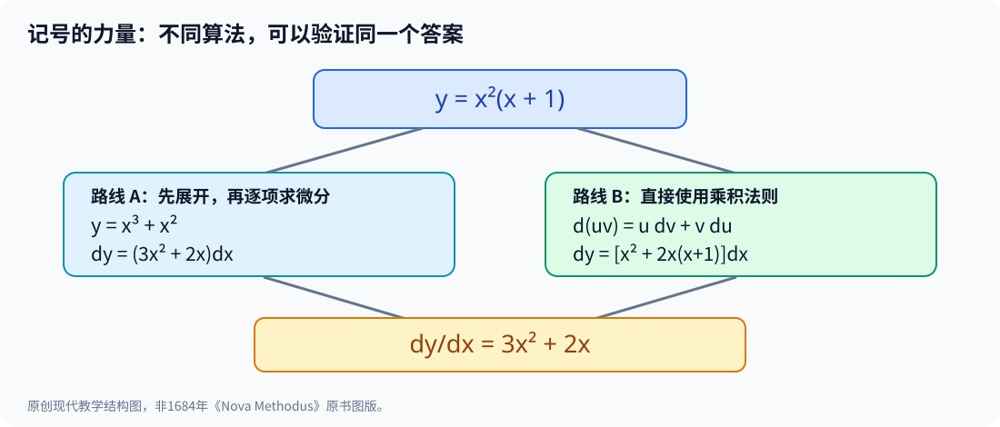

# 第三部·第十四章｜莱布尼茨的 d 与 ∫：为什么记号会改变数学

想象你已经发明了一种足以改变数学的计算方法。

它可以求出曲线的切线，可以寻找最大值和最小值，还能把复杂的面积问题变成一步步可执行的运算。

可是，你的发现藏在几十页密密麻麻的几何论证里。

别人想学会它，不仅得读懂你的结论，还得从头学会你的一套私人表达方式。

于是，一个比“我能算出来”更难的问题出现了：

**怎样让没有参与最初发现的人，也能重复你的计算？**

答案或许没有新的圆锥曲线，也没有更复杂的方程。

而是两个今天看起来再普通不过的符号：

$$
d,\qquad \int.
$$

一个用来研究变化。

一个用来表达累积。

符号并不能代替证明。但是，当一个符号能够承载可反复使用的运算规则，它就不再只是记笔记的方便办法。

它会改变人们思考问题的路径。

在牛顿的流数法之后，我们要遇到另一位共同塑造微积分的研究者——莱布尼茨。

## 一、先别急着问谁发明了微积分

从前一章走到这里，最容易发生一个误会。

牛顿在1660年代研究流数，那么莱布尼茨必然是看了牛顿的成果，才用另一套字母改写一遍。

但现存手稿和数学史研究并不支持这种简单的抄写故事。

莱布尼茨于1672年赴巴黎，在那里接触惠更斯等数学家，系统加深自己的数学研究。到1670年代中期，他逐渐形成了自己的微分和求积方法。[1]

这里需要把至少三个日期分开。

**1675年11月21日**：莱布尼茨一份数学手稿使用了积分符号，并同时出现与微分乘积规则相关的演算。

**1684年10月**：他在莱比锡的《学者纪事》（*Acta Eruditorum*）刊出介绍微分方法的论文。

**1686年6月**：他又在同一刊物发表讨论求积的论文，积分记号正式进入公开印刷的数学文献。[1][2][3]

手稿记录一个研究者当时在想什么。

刊物使研究方法进入更广泛的同行阅读与批评过程。

二者都重要，却不是同一回事。

如果只问“哪个人最早脑中闪过某个念头”，我们很可能错过一种数学工具最重要的成长阶段。

**一个方法必须能够被讲述、检验和继续发展，才有机会成为一门学科。**

## 二、一个小小的 d，竟然能代替整段几何描述

先回忆上一章。

牛顿研究两个量随着时间变化：

$$
\dot x,\qquad \dot y.
$$

如果

$$
y=x^2,
$$

那么在现代流数记号中：

$$
\dot y=2x\dot x.
$$

这套表达非常适合运动问题。

但如果我们不想问“每秒变化多少”，而只想知道“当 $x$ 改变时，$y$ 相对于它怎样改变”呢？

莱布尼茨的写法提供另一条道路：

$$
dy=2x\,dx.
$$

进一步，在允许形成相应比率的条件下，可以写成：

$$
\frac{dy}{dx}=2x.
$$

这不意味着 $dx$ 是普通意义上的任意非零实数、$dy$ 又是另一种独立的普通实数，随后随意约分即可。

它们在莱布尼茨的原始几何与无穷小思想中有自己的含义；在现代微积分里，$dy$ 和 $dx$ 的关系又可以借助微分映射或导数得到严谨解释。[4]

但从计算角度看，魅力已经出现。

你不必给每个新问题都重新画一幅图，寻找辅助圆或讨论一大段特殊比例。

符号本身可以参加规则运算。

这就是莱布尼茨形式主义最显著的优点之一。

## 三、第一次真正看到规则：平方为什么变成 2x？

让我们通过现代教学重构检验：

$$
y=x^2.
$$

把 $x$ 增加一个实际的、非零的小变化量 $h$。

则

$$
\Delta y=(x+h)^2-x^2.
$$

展开：

$$
\Delta y=2xh+h^2.
$$

如果现在直接说“$h^2$ 很小，所以它等于零”，就犯了上一章已经指出的逻辑错误。

$h$ 只要不是零，$h^2$ 当然仍不为零。

现代数学的做法是先计算差商：

$$
\frac{\Delta y}{h}=2x+h,
$$

然后令非零的 $h$ 趋近于零，得到：

$$
\frac{dy}{dx}=2x.
$$

这就是我们今天理解的导数。

莱布尼茨在1684年论文里使用了微分规则，但**并没有写出19世纪意义上的完整极限证明**；当代史学材料特别指出，早期论著的规则陈述和后来严格化的理论不是一个层次。[2][4]

为什么还要讲这个区别？

因为一个方法可以先变得极其有用，随后才逐渐获得适合所有边界情况的严谨基础。

微积分的发展史正是如此。

## 四、两条计算路线，为什么能得到同一个切线？

现在我们测试这个新工具到底有多强。

取：

$$
y=x^2(x+1).
$$

要计算在任意位置的变化率。

第一条路线，是直接展开：

$$
y=x^3+x^2.
$$

按照幂的微分规则：

$$
dy=(3x^2+2x)\,dx.
$$

所以：

$$
\frac{dy}{dx}=3x^2+2x.
$$

这一切看起来还算简单。

可是，如果式子并不能轻易展开呢？

例如一个表达式本来就由两个复杂函数相乘，我们还必须先把每一部分改写成多项式吗？

莱布尼茨的论文提供了一个非常有用的规则：

$$
d(uv)=u\,dv+v\,du.
$$

这就是微分的**乘积法则**。[2][4]

现在把它用于同一个例子。

设：

$$
u=x^2,\qquad v=x+1.
$$

那么：

$$
du=2x\,dx,\qquad dv=dx.
$$

于是：

$$
dy=u\,dv+v\,du
=x^2dx+(x+1)2x\,dx.
$$

合并：

$$
dy=(3x^2+2x)\,dx.
$$

两条路线得到同一个结果。

现在把 $x=2$ 代进去。

曲线上的点是：

$$
y=2^2(2+1)=12.
$$

切线斜率是：

$$
3\cdot2^2+2\cdot2=16.
$$

所以，切线方程为：

$$
y-12=16(x-2).
$$

这就是“记号改变数学”的一个具体而非夸张的含义：

**只要掌握少数规则，就可以把一个复杂问题拆成较简单、可组合的局部运算。**

## 五、为什么乘积法则不是再多一个高阶项？

你也许仍然疑惑：

$$
d(uv)=u\,dv+v\,du
$$

为什么没有出现 $du\,dv$？

如果把 $du$ 和 $dv$ 看成实际的有限增量，展开确实会得到：

$$
(u+\Delta u)(v+\Delta v)-uv
=u\Delta v+v\Delta u+\Delta u\Delta v.
$$

最后那一项没有凭空消失。

它在现代导数推理中的处理，需要依赖可微性和极限：

如果 $u(t)$、$v(t)$ 在某个点可微，$h$ 是非零参数变化，则

$$
\frac{\Delta u\Delta v}{h}
=\Delta u\cdot\frac{\Delta v}{h}
\longrightarrow0.
$$

因此，对乘积的**一阶变化率**来说，二阶混合项没有贡献。

这正解释了规则如何从有限增量推导出来。

但这里仍然是我们今天提供的证明，而不是对莱布尼茨1684年文章逐句复写。

在17世纪，怎样理解这些被舍去的高阶无穷小，是一个仍然需要解释的问题。

也因此，微积分的成功和微积分的基础危机可以同时成立。

## 六、一个被拉长的 S，为何可以代表面积？

到现在，我们只讨论了 $d$。

另一位主角终于要出场。

$$
\int
$$

它看起来像一个拉得很长的字母 S。

这种设计并非巧合。

在莱布尼茨的符号实践中，它来自表示**求和**的思想；如果一片面积可以理解为许多窄条贡献的累积，那么求积也就与求和联系起来。[1][3][5]

取最简单的曲线：

$$
y=2x.
$$

从 $x=0$ 到 $x=2$，曲线与横轴围出一个三角形。

面积按照初等几何为：

$$
S=\frac12\cdot2\cdot4=4.
$$

现在用积分记号表达：

$$
\int_0^2 2x\,dx=4.
$$

这个公式中，$2x$ 告诉你每一位置的高度。

$dx$ 暗示沿横向的累积变量。

积分号把各处的贡献组织为一个整体量。

这是**现代定积分记法**对莱布尼茨思想的回译；上下积分限作为今天的标准化表达，与早期具体手稿中的排版不能一概而论。

更令人兴奋的是：

如果知道

$$
d(x^2)=2x\,dx,
$$

那么反过来：

$$
\int 2x\,dx=x^2+C.
$$

这里 $C$ 是任意常数。

因为对常数求导得到零，所以仅凭变化率无法确定原来的量在起点有多高。

**同一行式子，正着是微分，反过来就是恢复累积量。**

1686年莱布尼茨的积分论文，就已经对微分与求和的反向关系作出明确表述。[3]

这不是说他在1686年就拥有了现代教材里对所有连续函数的完整定理。

真正意义在于：两种长期分头发展的问题，开始共用一套可以运算的语言。

## 七、一部论文只有几页，却能改变别人如何做数学

1684年10月，莱布尼茨的《Nova Methodus pro Maximis et Minimis...》出现在《学者纪事》第467—473页。[2]

论文不仅介绍新的微分记号，也给出和、差、乘积、商与幂等运算规则。

这里要避免另一种夸张：

“这几页论文第一次完整证明了整个微积分。”

并不是。

相关史学材料明确指出，1684年论文以规则和例子为主，论证解释并不符合后来成熟微积分的完整标准。[1][4]

但正因为规则可操作，其他数学家就有机会把它们用于新的曲线问题。

你可以在纸上写：

$$
d(x+y)=dx+dy.
$$

可以写：

$$
d(xy)=x\,dy+y\,dx.
$$

对于非零的 $y$，也可以按相应规则处理：

$$
d\left(\frac xy\right)=\frac{y\,dx-x\,dy}{y^2}.
$$

重要的不在某一道题的答案。

而在于**不同题目开始遵循可复用的语法**。

一名读者只要了解这套语法，便可以进入更多问题，而不用完整重演发明者走过的每一步。

这正是数学传播史上一个很值得注意的机制。

## 八、记号如此有用，为什么没有消除无穷小的争论？

记号可以使推演短而流畅。

但短，不代表自动严密。

例如：

$$
dy=2x\,dx
$$

究竟是什么意思？

如果 $dx$ 是真正非零的微小量，那么某些高阶项如何处理？

如果 $dx$ 被解释为零，又怎么理解它出现在分母里的比率？

这些问题不可能只靠给字母写得更漂亮来解决。

莱布尼茨的无穷小与连续性思想具有丰富的哲学背景，现代史家对其具体解释也需要结合不同时期的文本。[4]

把它完全翻译成“他早已知道现代极限理论”，会抹平真实的历史困难。

但把它说成“当时只是毫无意义的形式游戏”，也无法解释它为何如此有效。

更恰当的说法是：

**这是一套计算威力很强、适用范围不断拓宽，同时仍需要不断澄清基础的数学语言。**

而这样的语言一旦建立，问题就变了。

此前，数学家费力追问“切线怎么算”“面积怎么算”。

现在，更深的追问是：

**为什么用 $d$ 找变化率，再用 $\int$ 求回去，常常能回到原来的量？**

能否把这件事写成一条可严格证明、并带有适用条件的定理？

## 九、下一章：两个符号，竟然连接了整门学科

从牛顿的流数到莱布尼茨的微分，我们已经看到两种不同表达。

一种强调量随时间流动。

另一种强调不同量之间的微小变化和求和。

两者都试图解决切线、极值和求积等问题。

它们各自的发展并非完全孤立于整个欧洲数学传统，但也不能以相似的结果就断言一方直接复制了另一方。

而关于优先权的争论，暂时先放到第十六章。

眼下更值得解决的是一个纯数学问题。

在第十一章，我们曾把曲线

$$
y=x^2
$$

从0到 $x$ 的面积记作：

$$
A(x)=\frac{x^3}{3}.
$$

当时发现：

$$
A'(x)=x^2.
$$

也就是说：

**求积得到的面积函数，再求变化率，竟然把原来的高度还原了。**

从莱布尼茨的符号来看，这仿佛就是：

$$
\frac{d}{dx}\int_0^x f(t)\,dt=f(x).
$$

但这行式子什么时候成立？

积分号里真的可以放任何函数吗？

如果曲线突然跳了一下，或者出现尖角，还能照样操作吗？

只有回答这些问题，“两个运算好像互逆”才能变成真正的数学定理。

下一章，我们不再只介绍历史上的发现者。

我们要**亲手证明这座桥为什么能够站住**。

---

## 参考资料与历史边界

1. MacTutor，[Gottfried Wilhelm von Leibniz](https://mathshistory.st-andrews.ac.uk/Biographies/Leibniz/)，巴黎阶段、1675年11月21日手稿、1676年幂法则、1684与1686出版。
2. Mathematical Association of America，[Leibniz’s Papers on Calculus — Differential Calculus](https://old.maa.org/press/periodicals/convergence/mathematical-treasure-leibnizs-papers-on-calculus-differential-calculus)，1684年10月《Acta Eruditorum》pp.467—473原文图像与说明。
3. MAA，[Leibniz’s Papers on Calculus — Integral Calculus](https://old.maa.org/press/periodicals/convergence/mathematical-treasure-leibnizs-papers-on-calculus-integral-calculus)，1686年6月pp.292—300及第297页微分—求和互逆表述。
4. Stanford Encyclopedia of Philosophy，[Continuity and Infinitesimals](https://plato.stanford.edu/entries/continuity/)，早期微分规则及基础问题。
5. MAA，[Leibniz’s Papers on Calculus](https://old.maa.org/press/periodicals/convergence/mathematical-treasure-leibnizs-papers-on-calculus)，1675、1684、1686、1693的材料索引。

**回译说明**：本章的 $dy/dx$、标准上下限积分、函数记号、严格差商与极限均采用现代课堂语言。莱布尼茨的历史微分与无穷小不能被直接等同于19世纪严密极限定义；原论文图版有馆藏使用规定，故示意图为本书原创。