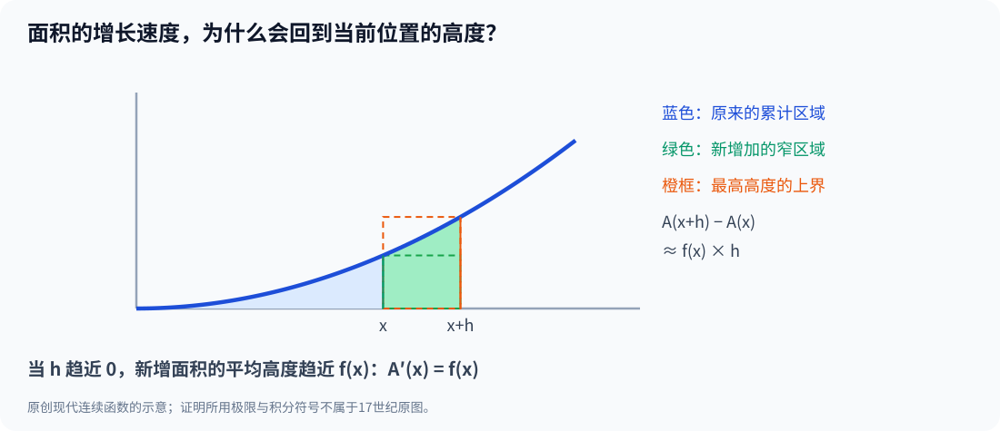

# 第三部·第十五章｜微积分基本定理：面积与变化率竟是同一件事

有一道题，数学家曾经用了许多不同的办法去解。

它看起来很简单。

画一条曲线，把曲线下方的区域涂上颜色，然后问：

**这块面积究竟有多大？**

阿基米德想到不断补进三角形。

卡瓦列里比较同一高度的截线。

沃利斯将面积化为数列求和。

开普勒将立体分成薄片。

这些方法都在尝试解决一个问题：

**怎样把无数局部贡献累积成整体？**

而费马、笛卡尔、牛顿研究的切线问题，表面上完全反着来。

给定一条曲线，怎么只看某个位置，找出它瞬间朝向哪里？

于是出现一个几乎不合常理的猜想：

如果从某一点开始不断计算“截至当前位置的累计面积”，那么这个**面积函数的瞬时变化率**，会不会恰好等于当前位置的**曲线高度**？

如果答案是肯定的，那么两种花了几个世纪分别研究的任务，可能根本不是两门孤立的手艺。

**微积分基本定理，正是这座桥。**

今天我们要做的，不只是记住它的名字。

而是把它拆开，亲手证明为什么桥能够站住，也找出它不能随意通行的地方。

## 一、最让人困惑的变化：一块面积，竟然也能成为函数

先画一条曲线：

$$
y=x^2,\qquad x\ge0.
$$

把从原点到横坐标 $x$ 之间、曲线下方的面积记为：

$$
A(x).
$$

注意，这里有一个非常关键的思维转变。

当 $x$ 是一个固定数字时，面积是一个固定值。

但如果右边界可以移动，面积就会随着 $x$ 改变。

所以：

$$
A(1)=\frac13,
$$

$$
A(2)=\frac83,
$$

$$
A(3)=9.
$$

这三块面积不再是彼此孤立的几何结果。

它们属于同一个函数：

$$
A(x)=\frac{x^3}{3}.
$$

在上一部我们学会了求这类面积，如今问题换了。

假设右边界正停在 $x=2$。

再让它向右前进一点点。

**面积每增加一点水平长度，到底会增加得多快？**

你可以不用知道任何神秘的新曲线公式，只从图上去猜。

当右边界接近2时，曲线高度接近4。

往右扩一小段宽度 $h$，新增加的狭长区域，看起来就像高约4、宽为 $h$ 的矩形。

所以新增加的面积，应该大约是：

$$
4h.
$$

因此，面积相对于水平位置的变化率，似乎就是4。

但这还只是直觉。

数学不应只满足于“似乎”。

## 二、把猜想变成定理：第一部分说了什么？

现代微积分基本定理的第一部分可以这样表述。

假设函数 $f$ 在闭区间 $[a,b]$ 上连续。

定义一个新函数：

$$
A(x)=\int_a^x f(t)\,dt.
$$

这里，$t$ 只是积分中的临时变量；真正可以自由改变的是积分上限 $x$。

那么对区间内部的任意 $x$：

$$
\boxed{A'(x)=f(x)}.
$$

请你仔细看这行式子。

左边是**累计量的变化率**。

右边是**正在累积的原始函数值**。

它不是说“面积等于高度”。

而是说：

**面积随右边界移动而增加的瞬时速度，等于那一位置的曲线高度。**

如果 $f$ 为正，$A$ 可以理解为通常的曲线下方面积。

但如果 $f$ 允许为负，积分应当理解成**带符号的累计量**，不能把负区域自动当作正面积相加。

这一个限定以后非常重要。

另外，上面的连续性不是装饰。

它保证移动边界附近的高度没有突然跳跃，使“窄条高度接近当地曲线高度”的直觉可以真正转成证明。[1]

## 三、为什么新增面积一定能逼出曲线高度？

让我们给定理一个足够严谨、但不难看懂的证明。

固定区间内部一点 $x$。

选择一个很小的正数 $h$，让 $x+h$ 仍在区间内。

新增的带符号面积是：

$$
A(x+h)-A(x)=\int_x^{x+h}f(t)\,dt.
$$

设 $m_h$ 是 $f$ 在短区间 $[x,x+h]$ 上的最小值，$M_h$ 是最大值。

由于每个位置都满足：

$$
m_h\le f(t)\le M_h,
$$

把这些高度在宽度 $h$ 上累积，就有：

$$
m_hh\le A(x+h)-A(x)\le M_hh.
$$

因为 $h>0$，可以除以它：

$$
m_h\le\frac{A(x+h)-A(x)}h\le M_h.
$$

现在，真正的关键来了。

**连续**意味着：当 $h$ 缩小到越来越接近零时，这个短区间内的函数高度都越来越接近 $f(x)$。

所以：

$$
m_h\longrightarrow f(x),
\qquad
M_h\longrightarrow f(x).
$$

夹在两者中间的面积差商，当然也只能趋向同一个值。

于是：

$$
\lim_{h\to0^+}\frac{A(x+h)-A(x)}h=f(x).
$$

从左边接近时，选择负数 $h$，同样把有向积分除以这个负数，化为短区间内函数值的平均高度，也得到同一极限。

因此，左右两侧一致：

$$
\boxed{A'(x)=f(x)}.
$$

这幅原创图表达的不是某位17世纪数学家的原始证明图，而是我们今天借助连续性和夹逼过程理解定理的方式。

证明真正说明的是：

**无数个局部贡献如何累积，与累积结果在某一点的增长速度，存在一种可以明确验证的关系。**

## 四、只要知道求导，为什么面积就能算出来？

现在我们已经证明第一部分。

但是，如果目的只是求一个具体面积，我们仍然需要先求出整个 $A(x)$ 吗？

未必。

因为从

$$
A'(x)=f(x)
$$

可以想到：

如果已经有一个熟悉的函数 $G(x)$，满足

$$
G'(x)=f(x),
$$

那么 $G$ 与面积函数 $A$ 的导数相同。

在一个连通区间内，两个可微函数的导数处处相同，它们只能相差一个常数。

也就是说：

$$
A(x)=G(x)+C.
$$

而由于

$$
A(a)=\int_a^a f(t)\,dt=0,
$$

得到：

$$
0=G(a)+C,
$$

即：

$$
C=-G(a).
$$

所以：

$$
A(x)=G(x)-G(a).
$$

把 $x=b$ 代入：

$$
\boxed{\int_a^b f(x)\,dx=G(b)-G(a)}.
$$

这就是现代基本定理的第二部分——常见的牛顿—莱布尼茨公式。

它告诉我们：**只要找到原函数，就可以通过两个端点的函数值之差计算定积分。**

请特别注意，这里的“原函数”是现代数学术语：指某个函数的导数等于被积函数。

这也解释了为什么“积分常数”不能被随意忘掉。

如果只给出变化率，你通常只知道原函数之间相差一个常数；当计算两端之差时，常数才会相互抵消。

## 五、一行运算，为什么能够替代无数矩形求和？

做一个你能独立检查的例子。

计算：

$$
\int_0^2(3x^2+2)\,dx.
$$

如果只采用原始的“很多小矩形累加”的想法，我们可以将区间分成很多份，再逐份算高度、宽度与面积。

这样当然可行。

但是基本定理让我们寻找一个原函数。

注意：

$$
\frac{d}{dx}(x^3+2x)=3x^2+2.
$$

因此，可以取：

$$
G(x)=x^3+2x.
$$

于是：

$$
\int_0^2(3x^2+2)\,dx
=\left[x^3+2x\right]_0^2.
$$

算出：

$$
=(8+4)-(0+0)=12.
$$

所以：

$$
\boxed{\int_0^2(3x^2+2)\,dx=12}.
$$

如果把积分上限换成任意非负 $x$，就有：

$$
A(x)=x^3+2x.
$$

再次求导：

$$
A'(x)=3x^2+2.
$$

原来的曲线高度恰好被还原。

这不是简单的“答案相同”。

它展示了一个可以普遍调用的思想：

**原来十分繁琐的累积求和问题，很多时候可以通过反向寻找变化规律来完成。**

当曲线特别复杂时，求原函数也可能很困难，甚至无法用初等函数表达。

基本定理保证联系，并不保证所有题目都能被最熟悉的几个公式解决。

## 六、一个反例：曲线突然跳一下，定理还会原样成立吗？

现在必须为这条大定理加上限制。

否则，我们只是给读者一把没有刹车的工具。

定义一个简单的阶跃函数：

$$
f(x)=
\begin{cases}
0,&x<0,\\
1,&x\ge0.
\end{cases}
$$

它在 $x=0$ 处突然从0跳到1。

从 $-1$ 开始累积：

$$
A(x)=\int_{-1}^{x}f(t)\,dt.
$$

那么，当 $x\le0$：

$$
A(x)=0.
$$

当 $x>0$：

$$
A(x)=x.
$$

所以面积函数其实是：

$$
A(x)=\max(x,0).
$$

它的图像在原点拐成一个尖角。

在原点左侧，变化率是0。

右侧，变化率是1。

因此：

$$
A'(0)
$$

**不存在。**

而函数本身在0处被定义为1。

这说明不能在函数有跳跃的地方，不加条件地写：

$$
A'(0)=f(0).
$$

你看见连续性为何重要了吧？

如果原函数在某处不连续，累计面积仍可能完全可以计算，但第一部分的“处处求导等于原函数”就不能照搬。

这里更精确的结论是：对于通常可积的函数，面积函数在原函数连续的点往往仍然有导数并等于那里的值；但在跳跃点，可能失去可微性。

这正是19世纪、20世纪严格分析逐渐澄清的边界之一。[1][2]

## 七、另一种陷阱：净面积等于零，并不意味着什么都没有

积分还有一个容易被忽略的区别。

看：

$$
f(x)=2x-2,\qquad0\le x\le2.
$$

在 $0\le x<1$ 时，曲线在横轴下面。

在 $1<x\le2$ 时，曲线在横轴上面。

现代定积分为：

$$
\int_0^2(2x-2)\,dx
=\left[x^2-2x\right]_0^2=0.
$$

但这绝不意味着图下没有区域。

横轴下方是一个面积为1的三角形。

横轴上方也有一个面积为1的三角形。

有向积分把上方面积记为正，把下方面积记为负，所以总和抵消了。

**几何面积之和是2，但带符号积分是0。**

这项区别，对于日后理解速度的正负、净位移与实际路程同样重要。

而且，它再次说明：

“积分就是面积”只是一个有用的初级直觉；严谨地说，积分的意义比普通的正面积更广。

## 八、这是谁发现的？没有简单的一人答案

到这里，我们可以回到历史问题。

巴罗已经借助几何方法研究过切线与求积之间的逆向关系。

格雷戈里在1668年的著作里也推进了相关思想。

牛顿1666年前后的手稿把反向求积问题放进正在形成的流数体系。

莱布尼茨1686年的公开论文对求和与微分的反向关系有明确讨论，1693年又发表把求积归约为由切线规律寻找曲线的几何论证。[3][4][5]

这些贡献并不一样。

有人证明了特定的几何关系。

有人找到了越来越普遍的运算规则。

有人提供了便于传播的符号系统。

有人把关系写成更系统的求积算法。

就连后世关于巴罗与莱布尼茨1693年几何证明之间相似性的研究，也提醒我们：不同著作之间可能有吸收、改写与传承，但不能把“方法受到前人启发”一律说成“抄袭整个微积分”。[6]

**历史中的“谁先想到”“谁先证明”“谁首先系统运用”“谁先公开发表”，本来就是四个不同的问题。**

因此，本书用“微积分基本定理”称呼今天已经成熟的统一数学关系，并不意味着一份17世纪文献已经包含全部现代证明和边界条件。

## 九、当两种方法成为一门学问，争论也就不可避免

现在，前十五章的一条重要主线已经完成。

求曲线下面积，本来像是要把无数小部分加起来。

求曲线切线，本来像是要把两点间隔压缩到某个瞬间。

而微积分基本定理告诉我们：

在适当条件下，这两件事可以通过一对逆向运算关联起来。

$$
\frac{d}{dx}\int_a^x f(t)\,dt=f(x).
$$

以及：

$$
\int_a^b f(x)\,dx=G(b)-G(a)
\quad\text{当 }G'=f.
$$

这套语言能够回答各种曲线求积、速度累积、形状变化的问题。

牛顿和莱布尼茨则分别从流数与微分、求和的思想出发，将许多早期方法组织成越来越有力的计算体系。

然而，正是这种成果的巨大价值，制造出下一道令人不舒服的问题。

如果两个人在不同时期形成了相似的核心方法：

一个人的研究手稿更早。

另一个人的公开论文更早。

其中又有跨国通信和后续著作的相互接触。

那么，**“第一个发明微积分的人”究竟应该怎样判定？**

这个问题接下来不只是数学问题。

它将牵涉原始手稿、国际通信、学术期刊、皇家学会的权威、私人和国家声望，以及同行团体之间的分歧。

下一章，我们要把这些证据逐一摊开。

---

## 参考资料及数学史限定

1. OpenStax，[Calculus Volume 1 §5.3 The Fundamental Theorem of Calculus](https://openstax.org/books/calculus-volume-1/pages/5-3-the-fundamental-theorem-of-calculus)，现代两部分定理与证明。
2. MIT OpenCourseWare，[RES.18-001 Calculus](https://ocw.mit.edu/courses/res-18-001-calculus-fall-2023/mitres_18_001_f17_full_book.pdf)，§5C，连续性、面积差商与阶跃反例。
3. MacTutor，[The Rise of Calculus](https://mathshistory.st-andrews.ac.uk/HistTopics/The_rise_of_calculus/)，格雷戈里、巴罗、牛顿及反向求积的历史。
4. Mathematical Association of America，[Leibniz’s Papers on Calculus — Integral Calculus](https://old.maa.org/press/periodicals/convergence/mathematical-treasure-leibnizs-papers-on-calculus-integral-calculus)，1686论文p297微分与求和的互逆讨论。
5. MAA，[Leibniz’s Papers on Calculus — Fundamental Theorem](https://old.maa.org/node/641733)，1693年几何求积与切线问题。
6. Michael Nauenberg，[Barrow, Leibniz and the geometrical proof of the fundamental theorem of the calculus](https://pubmed.ncbi.nlm.nih.gov/24908795/)，*Annals of Science* 71(3)，2014，335—354；其学术解释仅作为证据比较，不视作全部学界定论。

**历史和证明边界**：本章的定积分、面积函数、夹逼及不连续反例均为**现代数学证明**，并非任何17世纪原书的逐字公式。第一部分以 $f$ 连续为明确前提；第二部分通过原函数与面积函数导数相同推导。讨论的是有向积分，不把所有积分一律认作正几何面积。