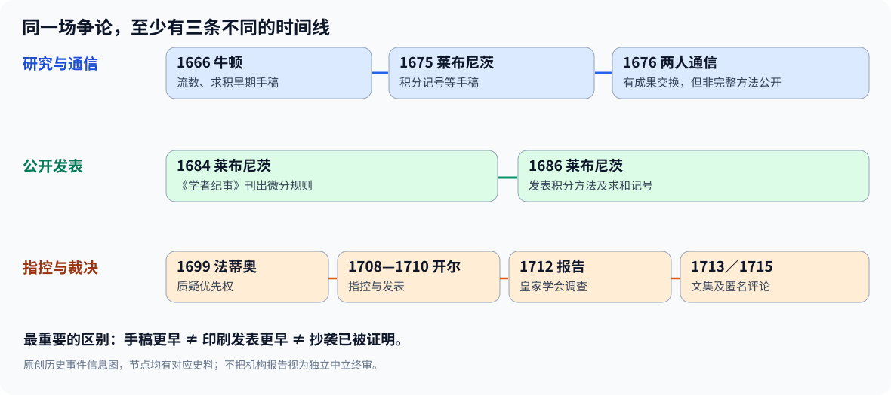

# 第三部·第十六章｜牛顿与莱布尼茨：发现者之争究竟争什么

1713年，一部关于数学发明权的文集在伦敦刊行。

它有一个很长的拉丁文标题，通常被简称为《书信汇编》（*Commercium Epistolicum*）。

英国皇家学会的委员会已经审阅了有关手稿与通信，结论有利于牛顿。

如果只看这一步，故事似乎可以结束了。

既然有学术机构调查，而且文集附有早期通信与手稿，这不就是历史上的最终裁决吗？

**恰恰不是。**

后来研究者逐渐查明，这场调查并非一场与当事人利益毫无关联的中立评审。

皇家学会主席正是牛顿本人，而那份报告的文字也由牛顿深度参与撰写。[1][2]

可是，这样一来，另一个极端结论是否就成立了？

既然调查不能当作中立终审，牛顿就必然没有率先发现相关方法？

同样不是。

牛顿1660年代的数学手稿确实存在。

莱布尼茨1680年代公开发表的微分、积分论文也确实存在。

双方的技术成果还真的十分接近。

问题因此比“选一个发明者”复杂得多：

**当两个人在不同时间形成相近的方法，彼此之间又有通信，那么谁先研究、谁先公开、谁真正独立发现，应该怎样分别判定？**

我们不必编一场两位数学家面对面的争吵。

只需要把能够核对的史料按顺序摆出来，戏剧性就已经足够强烈。

## 一、争论其实从一个错误的问题开始

如果你问：

“牛顿和莱布尼茨，谁发明了微积分？”

这个问题看起来只有两个候选答案。

可它把至少五件事混成了一件。

第一，谁最早写出接近微积分的数学方法？

第二，谁最早形成比较系统的微分与求积算法？

第三，谁最早把具体方法发表给更广泛读者？

第四，双方之间是否存在真实的思想接触？

第五，如果发生了接触，是正常的学术交流、具体技巧借鉴，还是对核心成果的直接占有？

这些问题需要不同的证据。

一张写有公式的手稿，主要证明某个人在特定时期曾研究过那个问题。

一篇公开刊物的文章，主要证明相关方法从什么时候进入可以被其他读者使用的公共文献。

一封信可以证明双方交流了某些信息。

但是，一封信的存在，**不会自动证明收件人已经学会寄件人所有未公开的方法**。

而一篇论文比另一人的手稿发表得更早，也不会自动否定手稿作者在更早时候的独立研究。

如果没有先分清这些层次，所有的“谁第一”判断都会变成含混的口号。

## 二、1660年代与1670年代：两条路线最初并不同步

先看牛顿。

我们已经在第十二、十三章详细检查过他1664—1666年的数学笔记。

1666年10月的流数手稿有明确的馆藏信息，证明他在那个时期已经研究以变化率、切线、求积为核心的问题。[3]

后续的1669年《分析论》手稿、1671年流数法著作，又进一步整理了相关技术。

所以，牛顿确实有相当早的数学研究证据。

但请注意：

**早写成，不等于早在学术刊物系统发表。**

1671年写成的流数研究，并没有在1671年成为欧洲数学家都可以购买的印刷教材。

后来其英文版要到1736年才刊出。[4]

再看莱布尼茨。

他在1672—1676年的巴黎阶段形成自己的微分和求积技术，1675年留下与积分记号有关的手稿。

到了1684年，他将微分规则发表在《学者纪事》上；1686年又发表了积分研究。[5]

这给出一组必须同时承认的事实：

**牛顿的相关手稿研究更早。**

**莱布尼茨对微分和积分方法的系统公开发表更早。**

这并非一人赢了一半、为了公平硬凑出来的结论。

它们分别对应不同类型的史料证据。

同时，现代专业数学史研究一般认为，莱布尼茨的发现具有独立性，而不是简单抄写了牛顿整个微积分体系。[1][6]

## 三、1676年的通信：有过接触，就能断言抄袭吗？

真正使这场故事变得复杂的，是双方并非完全没有联系。

1676年，牛顿与莱布尼茨通过伦敦皇家学会秘书亨利·奥尔登堡等人进行过数学通信。

牛顿于**1676年6月13日**和**10月24日**发出的两封信，是这场争论中反复被研究的关键文献。[6]

这些信包含牛顿的重要数学结果以及关于方法的线索。

但第二封信在关键处使用了字母重排式的隐写表达，使某些更深层技术没有以普通、直接的步骤全部向对方展开。

请把这点和另一个时间顺序放在一起看。

莱布尼茨1675年已有记录自身微分、求积研究的手稿。

牛顿1676年才通过通信向他传递部分成果。

仅凭二人通信这一事实，不能得出“莱布尼茨一定是从牛顿信里首次得到微积分核心方法”的结论。

当然，也不能从“莱布尼茨已有手稿”就进一步断言：两者之后绝对不存在任何具体技巧的影响和交流。

学术交流本来就可能影响研究者如何改写、推广、表述一个方法。

真正要排除的是更严重的逻辑跳跃：

**知道对方有某项成果，不等于照搬对方完整成果。**

这是历史证据判断必须遵守的一条底线。

## 四、为什么两套记号看起来如此像，却又不一样？

要把争论看明白，最好先真的算一道题。

设：

$$
y=x^2.
$$

如果从牛顿的流数思想出发，让 $x$ 与 $y$ 都随时间改变，就可以得到：

$$
\dot y=2x\dot x.
$$

在 $\dot x\ne0$ 的地方，点沿曲线的瞬时切线斜率为：

$$
\frac{\dot y}{\dot x}=2x.
$$

如果从莱布尼茨的微分记号出发，则写成：

$$
dy=2x\,dx,
$$

进而：

$$
\frac{dy}{dx}=2x.
$$

最后得到的切线斜率相同。

在 $x=3$ 处，两者都给出：

$$
m=6.
$$

同一道题，答案确实一致。

但原始的出发点各有侧重。

牛顿流数法强调量随共同时间参数流动，以及量和变化速度之间的关系。

莱布尼茨的微分方法更强调相互关联的变量及其微小差异，形成了适于符号操作的微分规则。

这张原创时间轴把“研究/手稿”和“公开发表/争论”分开表示。

数学上的相通，绝不意味着史学上可以仅凭两个公式的相似，就裁断一方借用了另一方。

如果今天两位研究者独立用不同符号写出相同正确结论，公式相同当然是重要事实，但不是一份足以证明抄袭的完整证据。

还必须具体比较他们何时接触哪些文本、文本到底包含什么、先前手稿写过哪些步骤。

## 五、1699年：第一波公开指控出现

两人在1670年代通信以后，并没有立刻爆发最激烈的公开争论。

时间来到1699年。

瑞士数学家尼古拉·法蒂奥·德·迪耶（Nicolas Fatio de Duillier）公开主张牛顿在微积分发现上具有更早的优先权，并留下对莱布尼茨极不利的暗示。[2][7]

这是争议逐渐公开化的一个重要节点。

但应避免把1699年写成“牛顿第一次正式把莱布尼茨告上法庭”。

当时并不存在这样一场现代意义上的知识产权诉讼。

争论主要发生在通信、科学刊物、匿名评述和数学家群体的公共讨论里。

它涉及个人荣誉，却不只涉及个人荣誉。

德国地区、英国、法国以及其他欧洲数学中心之间的交流条件，本来就各不相同。

“谁的数学方法能够成为权威”会影响哪些术语被教授、哪些论证方式受到信任、哪些学派形成共同标准。

不过，不能把这些复杂的学术网络简化成“英德民族仇恨从一开始决定一切”。

史学研究强调，当时的政治因素、王位继承和宫廷关系确实让争论加剧，但数学方法上的真实分歧同样存在。[1]

## 六、1708年到1713年：争论为什么升级成机构调查？

下一位关键人物是约翰·开尔（John Keill）。

根据现代数学史研究，开尔在1708年形成相关指控，随后发表于皇家学会《哲学汇刊》的论文在1710年前后进入公开传播；因此，不同史料有时分别用1708年和1710年描述这次事件。[1][8]

开尔直接将问题从“谁研究得更早”，推向莱布尼茨是否借用了牛顿方法的严重指控。

莱布尼茨对此提出异议，并要求皇家学会纠正相关说法。

皇家学会成立委员会，审阅先前的手稿、书信和有关证据。

到**1712年**，委员会已有报告。

随后，包含通信、手稿摘录及调查材料的《书信汇编》在**1713年**出版。[2][7]

这组日期必须分开。

1712年报告不等于1713年才第一次有相关研究。

1713年出版，也不等于牛顿直到1713年才第一次写出自己的计算方法。

但这份文集还有一个比时间更敏感的问题。

**谁有权为一场涉及自己利益的争论撰写“客观裁决”？**

## 七、牛顿既是当事人，又参与了裁决文本

这场争论中，皇家学会具有很高的学术地位。

而牛顿当时是皇家学会主席。

牛顿在报告撰写、材料组织与后续宣传中发挥了实质作用，已为现代专业史学研究所指出。[1][2]

所以，《书信汇编》不能被当作一份完全与双方利益无关、独立中立的现代研究结论。

但这并不意味着文集中所收的每一封信、每一份手稿都失去史料价值。

必须把两类东西拆开：

**原始文献本身**——可能真实保存了某个人在某个日期写过的内容。

**文献的选择、排序和结论**——有可能受收集者的立场与目标影响。

两者的史学价值不同。

如果一份史料确实证明牛顿早在1666年研究某个方法，我们应当接受这一事实。

但从该事实跳到“因此莱布尼茨只能抄袭”，就需要额外的证据。

皇家学会当时倾向于牛顿的报告结论，并不能自动完成后一个推理。

这也解释了为什么后来仍然需要研究者回到原始手稿，而不是简单重复18世纪某一派的控诉。

## 八、1715年的匿名文章，为什么让事情更耐人寻味？

委员会报告和文集出版之后，争论并没有就此停止。

1715年，《哲学汇刊》又刊出一篇匿名评论，讨论这本关于优先权的《书信汇编》。

后世研究指出，相关匿名评论由牛顿本人撰写。[2][7]

这就形成了一幕很特别的史学局面：

一个深度参与调查材料和报告的当事人，又以匿名形式回应围绕这份材料的争论。

你不必编造他在书桌前的心理活动，也不需要为这篇文章添加没有证据的对白。

仅仅交代文稿身份、发表时间和机构关系，读者已经能够理解它为什么影响这场裁决的可信度。

更何况，1716年莱布尼茨去世。

冲突并未因此立即消散。到牛顿去世后的1720年代，围绕不同数学方法及科学理论的争论仍会继续。[1]

它的影响超出了两个人的私人关系。

## 九、现代史学给出的结论，为什么与当年的口号不同？

如果现在重新整理证据，会出现一幅比双方支持者的指控更清楚的图景。

牛顿在1660年代留下的手稿，支持他较早发展出流数与求积方法。

莱布尼茨1670年代的手稿，支持他在自己的研究道路上形成微分与积分工具。

莱布尼茨于1684和1686年发表相关论文，先将一套可计算的微分、积分记号公开展示给广泛读者。

双方1676年存在真实的通信往来，但现存记录并不构成“莱布尼茨从牛顿那里抄来整套微积分”的证明。

因此，现代专业数学史的一般结论更接近：

**牛顿与莱布尼茨独立发展了微积分的核心方法，各自有重要而不同的贡献。**[1][6][9]

独立发现并不等于两人完全不知道彼此存在。

而是说，有证据支持各自形成核心成果的研究过程，不能把相似结果机械地解释成盗取他人成果。

至于某些具体几何证明、术语和技巧是否受到此前书籍影响，那又是另一个可以细致研究的问题。

不能将“在一个具体问题上受到启发”，扩大成“整套体系没有独立性”。

这是科学史研究必须具备的区分能力。

## 十、这场争论真正留下了什么？

到了这里，我们已经能够回答开头的问题。

“谁发明微积分”不是一个只要记住两个年份就能解决的判断。

它至少包含四种值得比较的贡献：

**研究的优先性**：谁先在可核实手稿中形成相关技术？

**公开发表的优先性**：谁先将方法完整地放到学术共同体面前？

**理论的通用性**：谁把局部技巧发展成能反复使用的系统？

**传播和继承的作用**：哪种语言更容易让后续数学家计算、讨论、发现新问题？

牛顿的流数思想在研究运动与量的变化中极富力量。

莱布尼茨的 $d$ 与 $\int$ 记号则为现代微分与积分运算留下了高度可复用的表达方式。

而在两人之前，阿基米德、卡瓦列里、费马、沃利斯、格雷戈里、巴罗以及许多其他研究者，已经解决过这门学科的部分问题。

所以，**数学史真正值得讲的并不是某个人从无到有“拥有”了一门学科，而是它如何逐步形成共同的、可检验的理论。**

但是，这场争论还有一个讽刺性的后果。

就在研究者们争论某种方法到底属于谁时，欧洲数学家已经开始用这些方法解决更惊人的问题。

其中一道问题看起来几乎带着挑衅意味：

一颗物体，在重力作用下从高处滑向低处。

它究竟沿着哪条曲线，才能用最短的时间到达终点？

最短的路，不一定是最快的路。

你或许记得，这正是本书序章留给读者的悬念。

下一章，我们将回到**1696年最速降线挑战**。

那时，比起追问公式是谁写的，数学家终于要拿出这些刚刚成形的运算工具，去挑战一类更复杂的极值问题。

一个新时代的数学考试，正式开始。

---

## 主要资料与史学边界

1. Niccolò Guicciardini，[The Newton–Leibniz Calculus Controversy, 1708–1730](https://academic.oup.com/edited-volume/34749/chapter-abstract/296599634)，*Oxford Handbook of Newton*，2017，争议年代、开尔指控、政治背景及方法观差异。
2. [The Oxford Handbook of Leibniz — Life and Works](https://academic.oup.com/edited-volume/34667/chapter/295383476)，皇家学会委员会、牛顿介入报告、1713年出版及独立发现的手稿证据。
3. Newton Project，[The October 1666 Tract on Fluxions](https://www.newtonproject.ox.ac.uk/catalogue/record/NATP00100)，1666年10月手稿目录与存世定位。
4. Niccolò Guicciardini，[Overture: Newton’s Published Work on the Calculus of Fluxions](https://www.cambridge.org/core/books/abs/development-of-newtonian-calculus-in-britain-17001800/overture-newtons-published-work-on-the-calculus-of-fluxions/34A683F2787FB593C6C4ABAA56F129E7)，1669、1671手稿与后续发表时间。
5. MAA，[Leibniz’s Papers on Calculus](https://old.maa.org/press/periodicals/convergence/mathematical-treasure-leibnizs-papers-on-calculus)，1684、1686公开出版材料。
6. AMS *Notices*，[The Rise of Calculus](https://doi.org/10.1090/noti2593)，牛顿1660年代、莱布尼茨1670年代及1676年两封信的比较。
7. Newton Project，[The Life and Work of Isaac Newton at a Glance](https://www.newtonproject.ox.ac.uk/his-life-and-work-at-a-glance)，1699、1712、1713、1715年重要节点。
8. MacTutor，[Gottfried Leibniz](https://mathshistory.st-andrews.ac.uk/Biographies/Leibniz/)，1710年前后开尔言论与委员会历史。
9. A. Rupert Hall，[Fluxions and Fury, 1677–1712](https://www.cambridge.org/core/books/abs/isaac-newton/fluxions-and-fury-16771712/C6B885AE943E040FCD8C8C160B57C5D3)，早期英国数学家对莱布尼茨独立研究的看法与联系中断背景。

**重要限定**：皇家学会的历史报告不是今天独立中立的终审；现存史料支持牛顿较早的研究与莱布尼茨独立发展的现代史学判断。数学公式比较是现代教学分析，不能仅凭符号相似推断剽窃。历史叙述不虚构两位人物的私下交锋和心理活动；1699初次指控、1708/1710开尔发表、1712报告与1713印行的时间层次分别保留。