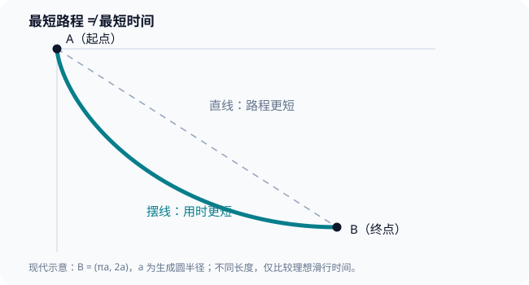

# 第四部·第十七章｜1696年最速降线：直线为何不是最快路线

> **工作初稿｜历史非虚构；尚未通过项目正式 draft 闸门及独立双审。** 本章回收[序章](00.md)的悬念，深入解释伯努利的解题机制及「最优」何以需要证明。历史与现代推导分层；所述理想轨道不是工程设计通则。

## 一、最短的路，为什么反而输掉了比赛？

1696年6月，德国莱比锡出版的《学术纪事》（*Acta Eruditorum*）刊出一道新问题：竖直平面上给定高处的A点和低处的B点，一个物体从A开始，在重力作用下沿哪条路下降，才能最早抵达B？

提问的人是约翰·伯努利。

这个问题在序章已经出现过。我们甚至算过一个例子：一条弯曲的轨道虽然长于直线，却可能先抵达终点。

但真正的难题，当时还没有回答。

**证明一条曲线比直线快，只是击败了一个对手；证明它是最速降线，必须击败所有符合条件的候选曲线。**

想象你负责设计一条滑道。工程师给出十张图纸，你逐个计算时间，选出最快的一条。这仍然无法保证，第十一张没画出来的图纸不会更快。

而这道题的备选图纸有无穷多张。

问题比「求一个函数的最大值」多迈了一步：**我们需要改变的，正是函数本身。**

对于刚刚学会微分和求积的17世纪数学家，这是一种全新的压力。[1][2]

## 二、伽利略已经看见了难题，却没有给出正确的终局

说到最速降线，常见讲法会让人以为，只有牛顿或伯努利才第一次怀疑直线。

其实更早的伽利略就研究过相关的下滑问题。

在1638年的《两门新科学》中，他比较了斜面与其他路径的下降时间。他知道路程长短不是唯一变量，也讨论了组合线段可以改变到达时间。不过，他进一步认为最速路线是一段圆弧，这个一般性结论并不成立。[2]

这里需要公平地看待伽利略。

他不是「连物体会加速都不知道」。恰恰相反，正是对加速运动的理解，让后来人能够知道：**同一物体下降得越深，通常速度越大。**

错误不在于忽略了重力，而在于从若干有优势的曲线，跳到了对所有曲线的最优性判断。

这给后来研究者留下一道更细致的题：

如果起初陡降能让物体更快，究竟该陡到什么程度？什么时候开始变缓？这一安排该怎样沿整条曲线协调？

有趣的是，约翰·伯努利并没有首先拿普通的速度—时间表求答案。

他去研究另一种会拐弯的东西——光。

## 三、第一把钥匙：让滑动的物体假装是一束光

光从空气斜着进入水面时，路径会发生折射。

为什么不走一条笔直的线？

在不同介质里传播速度不一样。如果目标是以最短时间穿过两点，直线未必最划算。与费马最短时间原理相联系的折射定律，便为这类问题提供了数学关系。

约翰·伯努利借用了这样的策略：把滑道所处的竖直平面分成许多**水平薄层**。先假定每层里的速度近似不变。

物体经过层与层的边界时，轨道允许改变方向。将折线一段一段连接，整条道路便类似穿过不同介质的折射光线。

层越薄，速度变化就越平滑；折线也趋向一条连续曲线。

这一历史方法见于伯努利1697年的解答；Henry与Wanner的专门研究对照了当年的原题、折射论证和后续曲线方程。[1，印刷页147—149]

我们现在使用现代记号把它翻译出来。**这不是1697年论文的逐字转写。**

从A向下量深度为 \(y\)，向右量水平距离为 \(x\)，重力加速度为 \(g>0\)。

假定物体从静止出发，无摩擦、无空气阻力，且重力恒定。现代能量公式给出：

\[
v(y)=\sqrt{2gy}.
\]

如果一段轨道与竖直方向形成夹角 \(\phi\)，那么它在水平方向的比例是 \(\sin\phi\)。

把相邻薄层之间的最短时间折射条件写成现代形式：

\[
\frac{\sin\phi}{v}=\text{常数}.
\]

请不要把这个式子误读成普通课堂上反射角等于入射角的规律；这里涉及的是**速度不同的层与层之间的最短时间路线**。

若轨道写为 \(y=y(x)\)，则：

\[
\sin\phi=\frac{dx}{ds}
=\frac{1}{\sqrt{1+(y')^2}},
\qquad y'=\frac{dy}{dx}.
\]

因此，

\[
\frac{1}{\sqrt{2gy}\sqrt{1+(y')^2}}=\text{常数}.
\]

移项并把正的常数记作 \(2a\)，便得到一条极有分量的条件：

\[
\boxed{y\bigl(1+(y')^2\bigr)=2a},\qquad a>0.
\]

这个关系不是在问轨道「某一点有多陡」。

它规定：**轨道每个位置的深度与倾斜程度必须彼此配合。**

越靠近起点，\(y\) 越小，为保持乘积不变，斜率的绝对值就需要越大；越往下，曲线可以逐渐变缓。

我们终于把「起初急降，后来转平」的直觉变成可检验的数学条件。[1][2]

## 四、第二把钥匙：这条曲线居然由一只滚动的圆画出

对于刚才的微分方程，可以找出一组参数表示：

\[
\boxed{
x=a(\theta-\sin\theta),\quad
y=a(1-\cos\theta)
}
\]

其中 \(\theta\) 是滚动角度。我们先研究 \(0\leq\theta\leq\pi\) 的一段。

从几何上讲，让半径为 \(a\) 的圆沿直线滚动，圆周上的标记点会描出一条**摆线**；将其置于下落的方向，就得到我们需要的形状。

它有一处和普通圆弧不同的细节：起点附近形成尖点，切线趋向竖直。正是这种初始几何性质，使物体能够在理想模型中尽早积累速度。

*上图为项目原创的现代数学示意，不是伯努利原刊插图。*

不用信任图形；我们可以亲自验证摆线满足刚才的条件。

首先求出参数导数：

\[
\frac{dx}{d\theta}=a(1-\cos\theta),\qquad
\frac{dy}{d\theta}=a\sin\theta.
\]

因此在 \(0<\theta<\pi\)：

\[
y'=\frac{\sin\theta}{1-\cos\theta}
=\cot\frac{\theta}{2}.
\]

另一方面：

\[
y=a(1-\cos\theta)=2a\sin^2\frac{\theta}{2}.
\]

所以：

\[
y\bigl(1+(y')^2\bigr)
=2a\sin^2\frac{\theta}{2}
\left(1+\cot^2\frac{\theta}{2}\right)
=2a.
\]

恰好符合。

这一串运算的历史意义在于：折射类比不是一句漂亮比喻，它能够导出**真正确定曲线形状的约束**。[1]

不过，到了这里仍要保留数学上的谨慎：

**满足最优路径应满足的条件，不自动等于已经证明它在所有允许路径中取全局最小值。**

就像一元函数的导数等于零，可能对应最大值、最小值或其他驻点。对整条曲线优化也是如此。要完成严格的全局最优论证，还需要额外条件与比较方法；现代变分法对这一区别有系统处理。

伯努利的折射路线提供了最短时间原理下构造最优轨道的有力几何论证，但不能把上面的微分方程单独冒充一份普适的现代全局最优性证明。

## 五、第三把钥匙：为什么它真的能赢过直线

现在回收序章留下的数字悬念，但这一次，我们先明确**究竟证明了什么**。

取摆线从尖点出发到最低点的一半拱形：

\[
A=(0,0),\qquad B=(\pi a,2a).
\]

沿摆线的弧长微元为：

\[
ds=2a\sin\frac{\theta}{2}\,d\theta.
\]

由 \(v=\sqrt{2gy}\) 以及 \(y=2a\sin^2(\theta/2)\)：

\[
v=2\sqrt{ag}\sin\frac{\theta}{2}.
\]

相除后出现令人惊讶的简化：

\[
dt=\frac{ds}{v}=\sqrt{\frac ag}\,d\theta.
\]

于是：

\[
\boxed{T_{\text{摆线}}=\pi\sqrt{\frac ag}}.
\]

同样端点的直线长度是：

\[
L=a\sqrt{\pi^2+4}.
\]

物体沿直线的切向加速度不变，从静止走过长度 \(L\)，垂直落差 \(2a\)，得：

\[
\boxed{T_{\text{直线}}=\sqrt{\pi^2+4}\sqrt{\frac ag}}.
\]

因为 \(\pi<\sqrt{\pi^2+4}\)，摆线时间确实更短。

取 \(a=1\) 米、\(g=9.81\) 米/秒²：

| 轨道 | 到达用时（理想值） |
| --- | ---: |
| 摆线 | 约1.003秒 |
| 直线 | 约1.189秒 |

摆线比直线快约15.6%。这不是因为摆线更短，而是因为它更早让物体取得速度优势。

**但请再次注意：这张表只比较了这两条轨道。**真正「最速」的结论，依靠前述折射的最短时间构造及更全面的最优性论证，而不能由这两个数凭空推出。[1][2]

还要指出模型的物理边界：现实滚动物体存在转动惯量、摩擦、空气阻力、轨道接触约束；改变这些条件，最速路径问题也可能改变。我们研究的是17世纪所对应的理想重力下降模型。

## 六、1697年的答案，不是某一位天才的独角戏

1696年6月的公开挑战设置了应征期限。后来期限延至1697年复活节，以便更多研究者参与。

1697年前后，约翰·伯努利、雅各布·伯努利、莱布尼茨、牛顿、洛必达等人的解答与研究进入出版和通信网络。牛顿有匿名发表的解法，相关刊物和皇家学会馆藏记录依然可供查考。[1—3]

关于「到底几个人提交了答案」，不同史料可能把收到的稿件、当年公开刊出的文本和后世整理发表的手稿混在一起。本文不以一个看似漂亮的固定人数取代出版史的细分。

这次挑战真正精彩的地方，不在于大家算出同一个曲线名字，而在于他们拥有**并不相同的数学切入点**。

约翰·伯努利借助光学折射的最短时间路线，抓住速度随深度变化的结构。

雅各布·伯努利则进一步研究曲线之间的比较，与后来变分法的普遍化问题有关。

牛顿留下简练的几何求解。

这不意味着他们已经拥有现代统一的欧拉—拉格朗日方程，更不意味着所有推导都能直接化为今天课本上的证明。**历史中的「找对一条曲线」与后世「建立完整优化理论」并非同一件事。**[1][2]

后来，变分法把这种问题扩展到最短路径、最小作用量、最优结构等更一般的场合。我们今天会把「让一个积分取最小」看成一类数学问题，但这种分类是后世逐渐建立起来的。

## 七、一场公开挑战改变了微积分的社会身份

回望本书前十六章，人们反复解决的是：怎样定义变化、怎样计算切线、怎样累积面积、怎样建立互逆规则。

到了最速降线，读者第一次可以完整地看见这些方法在**一个新的、非直观的问题**中合作。

你不能只用欧几里得几何给出时间；你不能只算一个点的导数；你不能只把面积切成薄片。

你得把重力给出的速度、几何路径的长度与全部行程的时间放在一个体系里，让整条函数参与比较。

这就揭示了新数学最大的力量：**它不是多添了一条巧妙公式，而是把许多本来彼此隔开的量变成同一个可计算问题。**

然而，胜利之后，新的障碍立即出现。

一小群熟悉通信、手稿和最新记号的数学家可以讨论折射和摆线。但如果另一位学生也想掌握这种技术，应该从哪里学起？

难道要先认识伯努利，才能拿到一份计算规则？

就在这场挑战公开的同一年，另一件事情发生了。

1696年，一部写给学习者的微分学著作在法国出版。

从此，微积分不再只是高手间的谜题。

它开始进入**教材**。

---

## 参考资料及边界

1. Philippe Henry、Gerhard Wanner，[*Johann Bernoulli and the cycloid: A theorem for posterity*](https://ems.press/content/serial-article-files/45593)，*Elemente der Mathematik* 72（2017），137—163，重点pp.147—149关于1696公开题目、1697解答、折射方法与摆线。研究性二手资料，转引当时文本；对应[研究记录H102](../research.md)。
2. MacTutor，[The brachistochrone problem](https://mathshistory.st-andrews.ac.uk/HistTopics/Brachistochrone/)，关于伽利略的先行问题、约翰的挑战、不同解答与变分法发展；对应H103。
3. The Royal Society，[Johannes Bernoulli mathematical problem manuscript，CLP/1/30](https://makingscience.royalsociety.org/items/clp_1_30/paper-on-mathematical-problems-by-johannes-jean-bernoulli)，馆藏与发表记录；对应H104。

**方法声明**：\(v=\sqrt{2gy}\)、折射必要条件、摆线的参数微分、时间积分和数值比较全部为现代数学重构；未将其伪装为1697论文原句。算例的严格范围是特定端点、无摩擦、重力恒定的理想模型；对全部候选曲线的全局最小性，不以「比直线快」偷换证明。作者对历史争议的限定参见[第17—19章研究矩阵](../research.md)。
